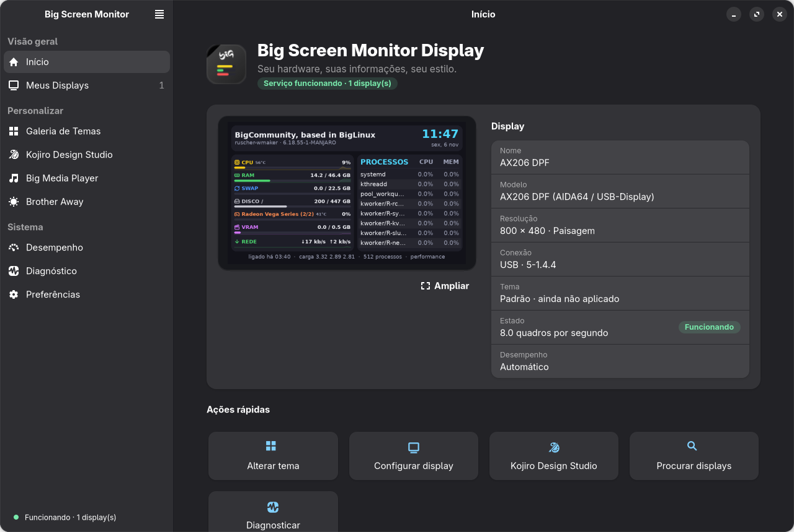
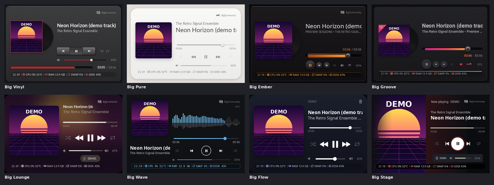

# Changelog

Todas as mudanças visíveis do Big Screen Monitor Display, da mais nova para a
mais antiga. As versões seguem [SemVer](https://semver.org/lang/pt-BR/); cada
`## [x.y.z]` tem uma tag `vx.y.z` e uma release com o APK do app Android a partir
da 5.5.0. Para publicar: `tools/release.sh` (veja o [CONTRIBUTING](CONTRIBUTING.md)).

## [Não lançado]

- Entrega: o pacote do BigLinux só é pedido depois dos testes verdes na `main`;
  `tools/release.sh` confere versões e publica a tag.
- Comunidade: issues com formulários (hardware, bug, recurso), `CONTRIBUTING.md`,
  `SECURITY.md`, este `CHANGELOG.md` e o README em inglês.
- Janela: **Diagnóstico › Relatar um problema** copia o relatório e abre o
  formulário de issue; "Sobre" aponta para o repositório onde as issues ficam.
- **GPU NVIDIA de verdade:** uso, temperatura, VRAM, frequência e consumo pela
  NVML (a biblioteca do driver, lida em processo, sem `nvidia-smi`). Antes a
  NVIDIA aparecia sempre com 0 % e sem temperatura.
- **Intel:** frequência atual da GPU (i915 e xe).
- **Sem número falso:** GPU cujo driver não informa o uso mostra "—" em todos os
  temas, em vez de 0 %.
- Qualidade: CI com Python 3.10, 3.12 e 3.14, `ruff` sem avisos, cobertura com
  piso e instalação testada em Debian, Ubuntu, Fedora, openSUSE e Arch.
- Distribuição: pacote `big-screen-monitor-display-git` para o AUR, gerado do
  PKGBUILD do BigLinux; `docs/compatibilidade.md` gerado do registro de drivers.
- **BSMD-lite:** protocolo de texto versionado e bridge (serial, TCP, terminal)
  para displays caseiros (ESP32, Arduino, Raspberry Pi), com cliente de
  referência; a bridge do Palm passou a usar a mesma leitura da telemetria.
- **Primeiro uso:** sem display detectado, a janela oferece procurar de novo,
  usar um celular/tablet (QR) ou relatar o modelo; índice em `docs/README.md`.

## [5.5.2] — Display no celular de qualquer lugar, pelo Tailscale

- **Acesso remoto pela VPN:** com o [Tailscale](https://tailscale.com) (ou Headscale/NetBird, faixa `100.64.0.0/10`) ligado no computador e no celular, o app conecta ao display longe de casa. Antes, o serviço descartava todo pacote da faixa do Tailscale e o celular só funcionava no mesmo Wi-Fi.
- **Sem digitar endereço:** o computador informa ao app, a cada conexão, os endereços da rede de casa e da VPN; o QR Code também já leva o endereço do Tailscale. Pareou em casa, funciona na rua.
- **Conexão rápida em qualquer lugar:** o app tenta todos os endereços conhecidos ao mesmo tempo (a rede local com uma pequena vantagem); antes tentava um por um, 4 s cada, e levava ~16 s para chegar ao Tailscale.
- O app reconecta assim que a VPN sobe, e a janela e o diagnóstico mostram o transporte **VPN**.
- **APK com assinatura oficial:** até a 5.5.1 cada versão saía com uma chave diferente e o Android recusava atualizar. Desta vez instale a 5.5.2 (aparece ao lado da antiga), pareie uma vez e desinstale a anterior; daqui em diante as atualizações instalam por cima.
- Passo a passo em [docs/android/04-conexao-rede.md](docs/android/04-conexao-rede.md#acesso-remoto-tailscale).
- **Pacote:** versões mínimas declaradas (`glib2>=2.80`, `libadwaita>=1.6`, `python>=3.10`) e `tailscale` como opcional. Corrigido: o Kojiro Studio usava `Adw.InlineViewSwitcher` (libadwaita 1.7) e não abria na 1.6, o mínimo declarado.

## [5.5.1] — App Android com download direto

- **Baixe o app do celular num link só, sempre a versão mais nova:** [`big-screen-monitor-display.apk`](https://github.com/ruscher/big-screen-monitor-display/releases/latest/download/big-screen-monitor-display.apk) — direto pelo navegador do Android, sem zip e sem conta no GitHub. Passo a passo em [App Android](#android).
- Cada versão publicada (tag `v*`) anexa o APK à release do GitHub automaticamente, com uma cópia com a versão no nome e o `SHA256SUMS`.
- A janela *Adicionar Android…* e a instalação do pacote mostram o mesmo link.

## [5.5.0] — 28 idiomas

O Big Screen Monitor Display agora fala **28 idiomas**, com as 1731 mensagens traduzidas e revisadas em todos: português do Brasil, inglês, alemão, búlgaro, chinês (simplificado), coreano, croata, dinamarquês, eslovaco, espanhol, estoniano, finlandês, francês, grego, hebraico, holandês, húngaro, islandês, italiano, japonês, norueguês (bokmål), polonês, romeno, russo, sueco, tcheco, turco e ucraniano.

- **Preferências › Idioma** lista todos eles pelo nome nativo, além de "Como o sistema".
- **Plurais de verdade**: contagens como "3 displays encontrados" usam `ngettext`, com as formas certas para línguas de 3 ou 4 plurais (russo, polonês, tcheco, ucraniano, hebraico…).
- **Sem quadradinhos nos displays**: os temas desenham com fontes próprias, sem chinês, japonês e coreano. Agora o texto que a fonte não tem é desenhado com uma fonte do sistema (por exemplo `noto-fonts-cjk`) ou, sem nenhuma, em inglês.
- **Rótulos do painel SmartMonitor/FOSTON** medidos em pixels em todas as línguas por um teste.
- **Tradução sem travar o GitHub Actions**: o workflow não chama mais o tradutor automático, que exigia uma chave da OpenAI e ficava parado até o limite de 6 h. As traduções ficam no repositório e `tools/update-pot.sh` atualiza o modelo; veja [docs/i18n.md](docs/i18n.md).
- Corrigido: o catálogo norueguês se chamava `no` e nunca era encontrado (agora `nb`); o `.pot` estava desatualizado (1083 de 1731 mensagens); textos em inglês ambíguos ou desatualizados ("Video engine", a descrição do Big Media Player, "Other theme").

## [5.4.0] — Android como display, Big WindowMaker e bandeja

[Instale o aplicativo **Big Screen Monitor Display**](#android) (Android 5.0+) e adicione o celular em **Meus Displays › Adicionar Android…** lendo o QR Code com a câmera, ou escolhendo o computador na lista e conferindo o mesmo código nas duas telas. O celular vira mais um display, com os mesmos temas (Padrão, GKrellM, Planet, Computador Antigo, Brother Away, Kojiro, Big Media Player), tema e ajustes próprios, e a tela sensível ao toque troca o tema, abre o menu com miniaturas reais e controla o Big Media Player (só o que o player oferece). Os temas continuam sendo desenhados no computador — uma implementação só —, e o celular recebe apenas as áreas que mudaram.

- **Wi-Fi/Ethernet** (desligado por padrão; TLS, aparelhos pareados, endereços públicos bloqueados) ou **cabo USB sem depuração** (acessório Android); ancoragem USB e `adb reverse` também funcionam.
- Mesma identidade em qualquer transporte: trocar do Wi-Fi para o cabo não cria outro display.
- Sem serviço em segundo plano nem permissões além de rede no celular; o computador nunca recebe mouse ou teclado do celular.
- Situação honesta: backend, janela e protocolo testados no computador (cliente de referência sobre TLS); o APK compila e passa no lint e nos testes no GitHub Actions; **falta validar em aparelhos** — veja [docs/android](docs/android/README.md) e o [relatório](docs/android/15-relatorio-final.md).

Também nesta versão: ícone oficial no **Big WindowMaker** (o `.desktop` agora tem o nome do `app_id`) e bandeja com **monitor symbolic** e ponto de estado verde/amarelo/vermelho/cinza, com escolha do display e "Todos os displays" ([docs/windowmaker](docs/windowmaker/)).

### 🧭 FOSTON FS-707DC vira display touch

Um navegador GPS de 2010 (Windows CE 5, MediaTek MT3351, 800×480 resistivo) passa a mostrar os temas do Big Screen Monitor **e a responder ao toque**, sem gravar firmware: o cliente `bsmd-ce` (32 KB, C) roda pelo menu "caminho da navegação", troca o USB para serial e fala o protocolo FSP com o serviço. Toque, deslize e segure na própria tela para trocar tema, abrir a galeria ou testar o toque — sem tocar no foco do teclado nem no mouse do computador. Medido no aparelho: 7 quadros completos/s, ~130 atualizações pequenas/s, PING de 2 ms. Detalhes em [docs/foston-fs707dc](docs/foston-fs707dc/13-relatorio-final.md).

## [5.3.1] — Bandeja nas Preferências

- **Preferências › Bandeja do sistema**: um interruptor para a bandeja das telas USB e outro para a dos coolers DeepCool. Ligado, a bandeja abre na hora e passa a iniciar com a sessão; desligado, ela fecha e sai do início automático. A página mostra se cada uma está rodando e avisa quando o desktop não tem bandeja (GNOME sem a extensão AppIndicator, Window Maker sem `big-wm-tray`) ou quando falta o PyQt, com o pacote certo.
- **Ao abrir o Big Screen Monitor Display** a bandeja ligada é iniciada se não estiver rodando; na primeira vez, num desktop com bandeja, a do tipo de aparelho conectado é ligada (também quando o aparelho é conectado com a janela já aberta) e um aviso diz onde desligar. Depois que você mexe num interruptor, essa escolha nunca é desfeita.
- Corrigido: a captura de temas do SmartMonitor deixava dois descritores abertos a cada troca de tema e podia travar se o processo escrevesse muito na saída; o agente de mídia usava APIs do GLib depreciadas; avisos de recurso agora fazem os testes falharem; desligar a bandeja enquanto ela ainda abria a deixava rodando; um comando dividido em duas leituras do socket se perdia.

## [5.3.0] — Bandejas do sistema e openSUSE/Regata OS

Contribuição de Marcos Queiroz Gomes ([PR #11](https://github.com/ruscher/big-screen-monitor-display/pull/11)), integrada e validada em máquinas virtuais e em hardware real.

- **Bandeja das telas USB** (`big-screen-monitor-tray`): galeria com miniaturas reais dos sete temas e suas variantes de cor, brilho com atalhos, desligar/religar a tela, quatro orientações e, com várias telas, a escolha de qual recebe a mudança. Acompanha a conexão e a desconexão pelo próprio serviço.
- **Bandeja DeepCool Digital** (`big-screen-monitor-deepcool`): temperatura da CPU no ícone (°C/°F, cor pelo limite de alarme), o que o cooler está mostrando, campo exibido, unidade e alarme conforme cada família (AK, AG, LS, AK PRO, LD, MYSTIQUE), aviso na área de trabalho quando o alarme acende e cor dos LEDs pelo OpenRGB — só no dispositivo escolhido. Sem sensor, mostra "—", nunca um número inventado.
- **Funciona onde há bandeja e onde não há**: KDE Plasma, Cinnamon, GNOME com a extensão AppIndicator e o Big WindowMaker mostram o ícone; no GNOME de fábrica e no Window Maker sem bandeja os mesmos controles abrem numa janela que explica como ter o ícone. Temas claro e escuro, Wayland e X11.
- **openSUSE, Regata OS, Debian/Ubuntu e Fedora**: `install-system.sh` reconhece a distribuição pelo `os-release`, instala os pacotes certos (com a versão do Python no openSUSE), nunca toca no `settings.json`, guarda uma cópia verificada antes de atualizar e registra o que instalou para o `uninstall-system.sh` remover exatamente isso.
- Validação: openSUSE Tumbleweed (Plasma Wayland), BigLinux (Plasma Wayland e X11), BigCommunity (GNOME), Arch Linux, Linux Mint (Cinnamon) e Big WindowMaker; matriz completa em [docs/20-compatibilidade](docs/20-compatibilidade.md), arquitetura em [docs/19-bandejas](docs/19-bandejas.md) e o relatório da integração em [docs/22-integracao-pr11](docs/22-integracao-pr11.md).

## [5.2.0] — SmartMonitor 3,5" e Big Media Player mais confiável

- **Novo display: SmartMonitor 3,5" HID** (`0483:0065`, vendido como "3.5 inch PC CPU Data Monitor" por llhmi.com / llTechCo e várias marcas). Ele não tem framebuffer: desenha uma imagem gravada na própria memória e só recebe números. O serviço grava ali uma versão do tema escolhido e envia os valores a cada segundo. **Validado em hardware (classe A)**, inclusive funcionando ao lado de uma Turing 3,5".
- **Todos os temas no SmartMonitor**: em vez de redesenhar cada tema à mão, o próprio tema é desenhado e o serviço descobre quais textos, barras, medidores, anéis e relógios mudam com cada dado. Esses viram elementos ao vivo do painel, com a mesma fonte, cor e alinhamento; o resto vira o fundo. Dados que o painel não consegue mostrar ao vivo são removidos, nunca congelados.
- **Brother Away no SmartMonitor** conta as histórias em cenas (começo, meio e fim, com o balão de fala), com personagem animado; a cena muda a cada 15, 30 ou 60 min, ou uma por período do dia.
- **Big Media Player no SmartMonitor**: tempo, progresso, volume, play/pausa, mudo e espectro ao vivo; opção de regravar a capa e o título a cada música. O painel continua ao vivo enquanto a imagem nova é preparada (antes congelava de 10 a 40 s).
- **Rodapé de telemetria** com posição fixa para cada valor (o "%" e o "°C" não pulam), GPU logo depois da CPU e linha do álbum nas skins modernas que não a tinham.
- **Agente de mídia dormente**: quando nenhum display usa o Big Media Player, o agente adormece em vez de sair e acorda sozinho quando o tema volta (antes, YouTube, mpv e outros só voltavam a aparecer no próximo login). Corrigidos também o `pactl subscribe` que vazava processos e o hub de mídia criado duas vezes, que deixava o player sem dados.
- **SmartMonitor mais robusto** (validado num PC real com ASRock A520M-HVS, em colaboração com Leandro Silva):
  - painel travado depois de reiniciar o PC é detectado na hora; a janela pede para reconectar o cabo e o serviço volta sozinho, sem reinícios em loop;
  - na **suspensão** o painel é protegido e volta sem reconectar;
  - **troca de tema em ~17 s**: os outros temas são preparados em segundo plano e a captura ficou 3,4× mais rápida; o Big Media Player atualiza ~5 vezes por segundo;
  - todos os valores são enviados a cada atualização (antes o painel podia congelar depois de uma gravação);
  - **data gravada na imagem** e renovada à meia-noite, liberando espaço para mais valores ao vivo (FAN, DN e UP voltaram ao Kojiro);
  - **Padrão**: números do painel de gráficos ao vivo e lista de processos opcional, como foto renovada a cada 30 min;
  - **Planet**: GPU Clock, CPU Freq, disco e rede ao vivo, e o planeta gira na hora real (a cada 30 min, 1 h ou 3 h);
  - tempo ligado e contagem de processos ao vivo em GKrellM, Computador Antigo e outros; números como "64.09%" e "3.6 GHz" exibidos corretamente;
  - ventoinha da CPU/placa-mãe com prioridade sobre a da GPU, e só orientações deitadas oferecidas para este painel.
- **Nome e logo da sessão ativa**: no Big WindowMaker (e em qualquer desktop com arquivo em `/usr/share/desktop-identity`), os temas mostram o nome e o logo do desktop em vez dos da distribuição. Detalhes em [docs/session-identity](docs/session-identity.md).

## [5.1.0] — Coolers DeepCool Digital

- **Coolers DeepCool com visor** controlados pelo próprio serviço: AK400/AK500/AK500S/AK620 DIGITAL (e SE), AG300/400/500/620 DIGITAL, LS520/LS720 SE DIGITAL, AK400/AK500/AK620 DIGITAL PRO, LD240/LD360 e MYSTIQUE 240/360 (modo de informações e rotação).
- **CPU em primeiro lugar**: temperatura (Tdie/Tctl/Package), uso, **potência** (RAPL, zenergy ou amd_energy) e frequência (núcleo mais rápido ou média). Um valor que o computador não mede nunca vira "0 W": fica indisponível, com o motivo no diagnóstico.
- **Presets** CPU Essencial, Avançado, Guardião, Desempenho, Mínimo e Personalizado, ou *Seguir o tema*: cada tema é representado no cooler, com matriz de compatibilidade na janela.
- **Meus Displays** mostra o cooler com a face desenhada (DEMO sem o serviço), modelo, tipo de visor, modo, alertas, desempenho e diagnóstico (USB, permissões, sensores, valores indisponíveis, outros programas DeepCool).
- **Seguro**: detecção só por VID/PID, identidade conferida antes do primeiro byte, trava exclusiva do dispositivo, regras udev restritas aos modelos suportados (sem `0666`), alarmes do firmware preservados e nenhum envio de imagens ao MYSTIQUE.
- Validação **B** (sem teste em hardware físico ainda). Detalhes em [docs/deepcool](docs/deepcool/08-relatorio-final.md).

## [5.0.0] — Nova janela de configuração

- **Janela redesenhada** na linguagem visual do AshyWall: barra lateral com Início, Meus Displays, Galeria de Temas, Kojiro Design Studio, Big Media Player, Brother Away, Desempenho, Diagnóstico e Preferências; recolhe em janelas estreitas.
- **Início** com a prévia real do display, modelo, resolução, conexão, tema, estado e ações rápidas; telas próprias para primeiro uso, serviço parado, nenhum display, modelo a escolher e display sem resposta.
- **Galerias de cartões** desenhados pelo motor real: temas (com página de detalhe, prévia grande e opções), displays (cada um com sua página), as 15 skins do Big Media Player e as **14 histórias** do Brother Away.
- **Big Media Player** com cartão *Tocando agora* (capa real, progresso, controles e volume do sistema) e as opções numa página própria.
- **Barra de alterações pendentes** com Descartar e Aplicar (Ctrl+S); atalhos Ctrl+1…9 e Ctrl+F; estilo claro/escuro/sistema.
- **Mais leve**: abre em 0,5 s (antes 1,2 s) e usa 163 MB ao abrir (antes 278 MB); seções construídas sob demanda, varredura USB fora da thread da interface, prévias param fora da tela e com a janela em segundo plano. Detalhes em [docs/redesign](docs/redesign/05-relatorio-final.md).
- Tradução pt-BR completa (1303 mensagens).

## [4.4.0] — Big Media Player Modern Collection

- **Oito skins modernas** no mesmo Big Media Player — agora são **15**: Big Vinyl (capa sobre um disco que gira), Big Pure (branco minimalista, também bege, cinza e grafite), Big Ember (preto premium com luz âmbar), Big Groove (couro e degradê magenta-laranja), Big Lounge (vidro quente sobre a capa desfocada), Big Wave (waveform que se pinta conforme a música), Big Flow (cartão de streaming) e Big Stage (capa cinematográfica de ponta a ponta).
- **Mesmos dados reais em todas**: MPRIS, volume e saída de áudio do sistema, telemetria, logo da distribuição — nada de favoritos, filas ou saídas inventadas.
- **Cores da capa** com contraste garantido, destaque próprio, monocromático e alto contraste; cantos, sombras, textura, disco, fonte e modo **Cinema**.
- **Animações em 5 níveis** (desligadas a fluidas), sempre limitadas pelo que o display aguenta; **volume ampliado** ao mudar o volume e faixa de **nova música**.
- **Galeria** com filtro Clássicas/Modernas e miniaturas ao vivo; skin por aplicativo e por horário aceitam as novas.
- Mesmo custo das clássicas (~1–3 ms por quadro, ~1 % dos pixels alterados por quadro), e as 7 clássicas renderizam pixel a pixel iguais à 4.3. Detalhes em [Modern Collection](docs/big-media-player-modern.md).

## [4.3.0] — Big Media Player

- **Big Media Player**: o display vira um reprodutor retrô que acompanha a mídia que toca no computador — Spotify, VLC, Rhythmbox, YouTube no navegador e qualquer aplicativo **MPRIS** — com capa, título, artista, álbum, progresso, tempos, estado e o **volume real do sistema** (PipeWire/PulseAudio).
- **Sete skins originais**: Bigamp, Bigmatch, Bigative, Bigalplayer, Big Media Player, BigXMMS2 e BIGX Multimedia System, inspiradas nos players dos anos 1990/2000 e desenhadas do zero.
- **Controles de verdade** na nova aba da janela (play/pause, anterior, próximo, busca, aleatório, repetir, volume, mudo, escolha do player) e por atalhos de teclado com `--media`.
- **Telemetria opcional** (hora, CPU, temperaturas, RAM, swap, disco, GPU) em 8 modos, telas de espera, modo vinil, cores da capa, modo noturno e visualizador decorativo ou espectro real.
- **Seguro**: o serviço continua isolado; um agente na sessão do usuário envia dados validados por um socket local autenticado.

## [4.2.1] — GKrellM completo e perfis de desempenho de verdade

- **GKrellM mostra todos os módulos ligados.** Em 480×320 só cabiam Relógio, CPU, Processos e Sensores — Discos, Memória, Swap, Rede e GPU sumiam sem aviso, e "Partições listadas" não tinha efeito. Agora o layout procura a maior fonte em que tudo cabe, acrescenta colunas (no modo automático) e achata os gráficos antes de abrir mão de qualquer módulo.
- **Partições de verdade.** `/` e `/home` em subvolumes btrfs aparecem separados, `/boot/efi` entra no fim da lista, e montagens internas (`@swapfile`, `/var/tmp`, as do próprio isolamento do serviço) não poluem mais a lista. O serviço passou a enxergar o `/home` (somente leitura).
- **Rede e E/S de disco não ficam mais congeladas.** Dentro do isolamento do serviço a leitura das interfaces falhava em todo ciclo, e as taxas viravam médias desde o início do serviço; a lista de interfaces do GKrellM ficava vazia. Agora o estado e a velocidade das interfaces vêm do `/sys`.
- **Perfis de desempenho valem para todos os temas.** Econômico, Equilibrado e Fluido mudam a frequência de coleta (2 s · 1 s · 0,5 s) e de desenho dos temas de painel (Padrão, GKrellM, Planet, Computador Antigo e o Kojiro estático), não só dos animados. A página Desempenho mostra o alvo real de cada tema.
- **Até 65% menos dados nos displays seriais lentos.** No Turing rev. A (~190 KB/s) só os pixels que mudaram vão para a tela, e não blocos inteiros de 48×20: no GKrellM 480×320, de 66 KB para 23 KB por atualização (~360 ms → ~125 ms).

## [4.2] — Kojiro

- **Kojiro — papel de parede e painel de hardware**: escolha qualquer imagem (ou uma das 8 artes incluídas) e posicione livremente 23 tipos de elemento — anéis, medidores com ponteiro, barras, gráficos, relógio digital, logotipo da distribuição…
- **Kojiro Design Studio**: editor visual na janela, com arrastar, redimensionar, encaixe, guias, grupos, camadas, desfazer/refazer e atalhos de teclado.
- **7 predefinições** (Cyberpunk, Minimalista, Gamer, Matrix, Retrô, Vidro, Industrial), predefinições suas e compartilhamento em `.json` ou `.kojiro.zip`.
- **Alterações visuais sem senha de administrador** para quem está no computador (Polkit por ação), aplicadas em até 1 s — ou *ao vivo* enquanto você edita.
- Sensores novos sob demanda: ventoinhas (RPM e PWM), discos por ponto de montagem com temperatura do disco físico, frequência e modelo da CPU, limites de temperatura informados pelo hardware.
- Configurações mais resistentes: cópia do último arquivo válido e nenhuma perda se o arquivo for corrompido.

## [4.1] — Universal Display Engine

- **8 famílias de displays USB**: AX206, Turing rev. A / UsbPCMonitor, XuanFang rev. B (com LEDs no flagship), Turing rev. C (2,1"/2,8"/5"/8,8"), Kipye rev. D, WeAct 3,5" e 0,96", e a nova linha Turing USB (2,8" redondo a 12,3").
- **Vários displays ao mesmo tempo**, cada um com seu tema, orientação (inclusive invertida), brilho e desempenho — e uma falha num deles não afeta os outros.
- **Detecção segura**: só lê os identificadores USB, mostra o nível de confiança e nunca manda comandos para "descobrir" um dispositivo desconhecido.
- **Meus Displays** na janela: detectar, nomear, escolher modelo, padrões de teste, identificar, reconectar e diagnóstico por display.
- **Telas minúsculas e redondas**: layout compacto para 80×160 e área segura para o 2,8" redondo.
- **Permissões mais restritas**: o serviço só alcança os nós dos displays conhecidos (saiu do grupo `uucp`).
- `--list-displays`, `--benchmark` e simulador com vários painéis, latência e vazão.

## [4.0]

<table>
<tr>
<td width="50%" valign="top">

### 🛡️ Fim dos congelamentos

A AX206 às vezes reinicia sozinha no USB. A versão antiga continuava escrevendo numa conexão morta e escondia os erros — a tela parava e o serviço parecia saudável. Agora o display **volta sozinho em 1–2 segundos** (comprovado no hardware, inclusive num reset espontâneo).

### 🐕 Watchdog de verdade

O serviço só diz ao systemd que está vivo quando **coleta, desenho e envio ao display estão progredindo**. Travou? É reiniciado em segundos, com intervalos crescentes — nunca em laço.

### ⚡ ~14× menos CPU

De **49,6% para ~3,5%** de um núcleo no tema de painel (AX206 800×480, medido). Só as áreas que mudam vão para o display.

</td>
<td width="50%" valign="top">

### 🏝️ Brother Away

Tema animado em pixel art com **14 histórias**, ciclo de dia e noite, clima, uma jangada que é construída ao longo dos dias e painel de telemetria estilo MangoHud.

### 🔐 Mais seguro

O serviço **não roda mais como root**, o display deixou de ser gravável por qualquer programa e o sudoers deu lugar a um **assistente Polkit** que só aceita operações validadas.

### 🧭 Nova janela de configuração

Prévia ao vivo, **aplicar sem reiniciar**, página de desempenho e o botão **"Diagnosticar meu display"**. Traduções funcionando.

### 🎨 Temas sem sobreposição
Escuro, Claro, Neon e Cyberpunk viraram o tema **Padrão** com 8 esquemas de cores; GKrellM foi reconstruído; Planet e Computador Antigo corrigidos. Cada tema tem **sua própria aba de opções**.

</td>
</tr>
</table>
