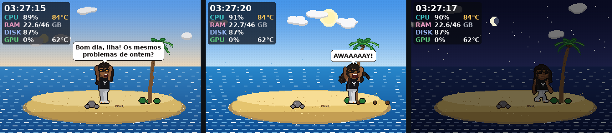

<div align="center">


# Big Screen Monitor Display

**Free hardware monitor for small USB displays, DeepCool coolers with a screen, and Android phones on Linux, with animated themes, self-recovery, the Big Media Player, Brother Away and Kojiro (any wallpaper becomes a hardware panel).**

[](https://github.com/ruscher/big-screen-monitor-display/actions/workflows/tests.yml)


🇧🇷 [Leia em português](README.md) (full documentation) · [Changelog](CHANGELOG.md) · [Contributing](CONTRIBUTING.md)



</div>

## Why

Most of these little USB screens ship with Windows-only software (AIDA64 and
friends). This project drives them natively on Linux, as an unprivileged,
sandboxed `systemd` service with a real watchdog: if the panel resets on the
USB bus, the picture is back in 1–2 seconds. The app is translated into
28 languages.

## Supported hardware

**A** = validated on real hardware · **B** = implemented and checked byte by
byte against the reference implementation; waiting for someone with the device
to confirm. **Own one of the B devices? Please
[report it](https://github.com/ruscher/big-screen-monitor-display/issues/new/choose).
That single report turns it into an A.**

| Family | Models | Status |
| --- | --- | --- |
| AX206 DPF | GEMBIRD/QTKeJi "USB-Display", AX206 photo frames | A |
| SmartMonitor HID (`0483:0065`) | "3.5 inch PC CPU Data Monitor" (llhmi / llTechCo) | A |
| FOSTON FS-707DC (`045e:00ce`) | Windows CE 7" GPS unit with the `bsmd-ce` client, with touch | A |
| Android phones and tablets | Android 5.0+, over Wi-Fi, USB cable (no debugging) or Tailscale | A |
| Turing rev. A / C, Turing USB | 2.1" to 12.3" | B |
| XuanFang rev. B, Kipye rev. D, WeAct Studio FS V1 | 3.5" and 0.96" | B |
| DeepCool Digital coolers | AK, AG, LS SE, AK PRO, LD, MYSTIQUE | B |

Experimental clients for vintage devices live in [`device-clients/`](device-clients/)
(Windows CE, Palm OS 5).

## Install

**Arch Linux · BigLinux · Manjaro**

```bash
git clone https://github.com/ruscher/big-screen-monitor-display.git
cd big-screen-monitor-display/pkgbuild
makepkg -si
```

**openSUSE · Debian/Ubuntu · Fedora**

```bash
git clone https://github.com/ruscher/big-screen-monitor-display.git
cd big-screen-monitor-display
./install-system.sh --print-deps   # packages for this system
sudo ./install-system.sh
```

**Android app:** [download the APK](https://github.com/ruscher/big-screen-monitor-display/releases/latest/download/big-screen-monitor-display.apk),
then in the desktop app open *My Displays › Android phones and tablets › Add
Android…* and scan the QR code.

## Use

| What | How |
| --- | --- |
| Settings window | app menu → *Big Screen Monitor Display* |
| Service state | `systemctl status big-screen-monitor-display` |
| Diagnose | `python3 /usr/share/big-screen-monitor-display/main.py --diagnose` |
| Detected displays | `main.py --list-displays` |
| Try without hardware | `main.py --simulate 480x320 --snapshot /tmp/frame.png` |
| Logs | `journalctl -u big-screen-monitor-display -f` |

## Help and bugs

Open an [issue](https://github.com/ruscher/big-screen-monitor-display/issues/new/choose).
The settings window (*Diagnostics › Report a problem*) copies a full report you
can paste into it. Security issues: see [SECURITY.md](SECURITY.md).

## License

GPL-3.0-or-later. Created by Rafael Ruscher and the BigLinux team.

The Turing, XuanFang, Kipye, WeAct and Turing USB protocols were studied in
[turing-smart-screen-python](https://github.com/mathoudebine/turing-smart-screen-python)
(© 2021 Matthieu Houdebine and contributors, GPL-3.0-or-later) and reimplemented
here; the AX206 protocol comes from [dpf-ax](https://github.com/dreamlayers/dpf-ax).
This project is not affiliated with any of the brands mentioned.
