<div align="center">


# Big Screen Monitor Display

**Monitor de hardware livre para pequenos displays USB no Linux — com temas, autorrecuperação, o Brother Away e o Kojiro, que transforma qualquer papel de parede em painel de hardware.**


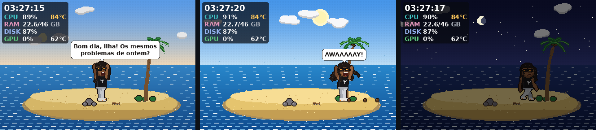

[Novidades](#novidades) ·
[Kojiro](#kojiro) ·
[Brother Away](#brother-away) ·
[Temas](#temas) ·
[Instalação](#instalacao) ·
[Uso](#uso) ·
[Detalhes técnicos](#detalhes-tecnicos) ·
[Problemas](#problemas) ·
[Documentação](docs/)

</div>

---

## 📜 A história por trás do projeto

O **Big Screen Monitor Display** nasceu de um desejo pessoal e de um desafio técnico. **Rafael Ruscher** queria um mini display para compor seu gabinete com informações de hardware em tempo real. Encontrou uma telinha simples, mas ao recebê-la percebeu o obstáculo: ela só funcionava no Windows, com softwares proprietários como o AIDA64.

Como usuário fiel de Linux, ele não pretendia mudar de sistema por causa de um acessório — e a tela ficou anos na gaveta. Ao reencontrá-la, uniu conhecimento técnico e o apoio de Inteligência Artificial para criar a própria solução, agora **Software Livre**: qualquer pessoa pode usar, estudar, modificar e distribuir.

> "Ele é excelente para quem, como eu, não sai do `htop` ou do `gkrellm` e quer um resumo visual sempre à mão." — *Rafael Ruscher*

---

<a id="novidades"></a>

## ✨ Novidades da 4.2.1 — GKrellM completo e perfis de desempenho de verdade

- **GKrellM mostra todos os módulos ligados.** Em 480×320 só cabiam Relógio, CPU, Processos e Sensores — Discos, Memória, Swap, Rede e GPU sumiam sem aviso, e "Partições listadas" não tinha efeito. Agora o layout procura a maior fonte em que tudo cabe, acrescenta colunas (no modo automático) e achata os gráficos antes de abrir mão de qualquer módulo.
- **Partições de verdade.** `/` e `/home` em subvolumes btrfs aparecem separados, `/boot/efi` entra no fim da lista, e montagens internas (`@swapfile`, `/var/tmp`, as do próprio isolamento do serviço) não poluem mais a lista. O serviço passou a enxergar o `/home` (somente leitura).
- **Rede e E/S de disco não ficam mais congeladas.** Dentro do isolamento do serviço a leitura das interfaces falhava em todo ciclo, e as taxas viravam médias desde o início do serviço; a lista de interfaces do GKrellM ficava vazia. Agora o estado e a velocidade das interfaces vêm do `/sys`.
- **Perfis de desempenho valem para todos os temas.** Econômico, Equilibrado e Fluido mudam a frequência de coleta (2 s · 1 s · 0,5 s) e de desenho dos temas de painel (Padrão, GKrellM, Planet, Computador Antigo e o Kojiro estático), não só dos animados. A página Desempenho mostra o alvo real de cada tema.
- **Até 65% menos dados nos displays seriais lentos.** No Turing rev. A (~190 KB/s) só os pixels que mudaram vão para a tela, e não blocos inteiros de 48×20: no GKrellM 480×320, de 66 KB para 23 KB por atualização (~360 ms → ~125 ms).

## ✨ Novidades da 4.2 — Kojiro

- **Kojiro — papel de parede e painel de hardware**: escolha qualquer imagem (ou uma das 8 artes incluídas) e posicione livremente 23 tipos de elemento — anéis, medidores com ponteiro, barras, gráficos, relógio digital, logotipo da distribuição…
- **Kojiro Design Studio**: editor visual na janela, com arrastar, redimensionar, encaixe, guias, grupos, camadas, desfazer/refazer e atalhos de teclado.
- **7 predefinições** (Cyberpunk, Minimalista, Gamer, Matrix, Retrô, Vidro, Industrial), predefinições suas e compartilhamento em `.json` ou `.kojiro.zip`.
- **Alterações visuais sem senha de administrador** para quem está no computador (Polkit por ação), aplicadas em até 1 s — ou *ao vivo* enquanto você edita.
- Sensores novos sob demanda: ventoinhas (RPM e PWM), discos por ponto de montagem com temperatura do disco físico, frequência e modelo da CPU, limites de temperatura informados pelo hardware.
- Configurações mais resistentes: cópia do último arquivo válido e nenhuma perda se o arquivo for corrompido.

## ✨ Novidades da 4.1 — Universal Display Engine

- **8 famílias de displays USB**: AX206, Turing rev. A / UsbPCMonitor, XuanFang rev. B (com LEDs no flagship), Turing rev. C (2,1"/2,8"/5"/8,8"), Kipye rev. D, WeAct 3,5" e 0,96", e a nova linha Turing USB (2,8" redondo a 12,3").
- **Vários displays ao mesmo tempo**, cada um com seu tema, orientação (inclusive invertida), brilho e desempenho — e uma falha num deles não afeta os outros.
- **Detecção segura**: só lê os identificadores USB, mostra o nível de confiança e nunca manda comandos para "descobrir" um dispositivo desconhecido.
- **Meus Displays** na janela: detectar, nomear, escolher modelo, padrões de teste, identificar, reconectar e diagnóstico por display.
- **Telas minúsculas e redondas**: layout compacto para 80×160 e área segura para o 2,8" redondo.
- **Permissões mais restritas**: o serviço só alcança os nós dos displays conhecidos (saiu do grupo `uucp`).
- `--list-displays`, `--benchmark` e simulador com vários painéis, latência e vazão.

## ✨ Novidades da 4.0

<table>
<tr>
<td width="50%" valign="top">

### 🛡️ Fim dos congelamentos

A AX206 às vezes reinicia sozinha no USB. A versão antiga continuava escrevendo numa conexão morta e escondia os erros — a tela parava e o serviço parecia saudável. Agora o display **volta sozinho em 1–2 segundos** (comprovado no hardware, inclusive num reset espontâneo).

### 🐕 Watchdog de verdade

O serviço só diz ao systemd que está vivo quando **coleta, desenho e envio ao display estão progredindo**. Travou? É reiniciado em segundos, com intervalos crescentes — nunca em laço.

### ⚡ ~14× menos CPU

De **49,6% para ~3,5%** de um núcleo no tema de painel (AX206 800×480, medido). Só as áreas que mudam vão para o display.

</td>
<td width="50%" valign="top">

### 🏝️ Brother Away

Tema animado em pixel art com **14 histórias**, ciclo de dia e noite, clima, uma jangada que é construída ao longo dos dias e painel de telemetria estilo MangoHud.

### 🔐 Mais seguro

O serviço **não roda mais como root**, o display deixou de ser gravável por qualquer programa e o sudoers deu lugar a um **assistente Polkit** que só aceita operações validadas.

### 🧭 Nova janela de configuração

Prévia ao vivo, **aplicar sem reiniciar**, página de desempenho e o botão **"Diagnosticar meu display"**. Traduções funcionando.

### 🎨 Temas sem sobreposição
Escuro, Claro, Neon e Cyberpunk viraram o tema **Padrão** com 8 esquemas de cores; GKrellM foi reconstruído; Planet e Computador Antigo corrigidos. Cada tema tem **sua própria aba de opções**.

</td>
</tr>
</table>

---

## 🖥️ Displays suportados

| Família | Modelos | Resolução | Transporte | Status |
| --- | --- | --- | --- | --- |
| **AX206 DPF** (dpf-ax) | GEMBIRD/QTKeJi "USB-Display", porta-retratos AX206 | informada pelo dispositivo (320×240 … 800×480) | USB · libusb | ✅ **A** — testado em hardware real |
| **Turing rev. A** | Turing 3,5", UsbPCMonitor 3,5"/5"/7" | 320×480 · 480×800 · 600×1024 | serial CDC-ACM | 🧪 **B** — conferido byte a byte com a referência |
| **XuanFang rev. B** | XuanFang 3,5", flagship com LEDs RGB | 320×480 | serial | 🧪 **B** |
| **Turing rev. C** | Turing 2,1", 2,8", 5", 8,8" | 480×480 · 480×800 · 480×1920 | serial (acorda o painel) | 🧪 **B** |
| **Kipye rev. D** | Kipye Qiye Smart Display 3,5" | 320×480 | serial | 🧪 **B** |
| **WeAct Studio FS V1** | 3,5" (com sensor de temperatura/umidade) e 0,96" | 320×480 · 80×160 | serial | 🧪 **B** |
| **Turing USB** | 2,8" redondo, 4,6", 5,2", 8", 8,8", 9,2", 12,3" | até 720×1920 | USB · libusb, PNG/JPEG | 🧪 **B** |

**A** = validado em hardware real · **B** = driver implementado e verificado contra o projeto de referência e mocks; aguardando teste físico (um mock nunca conta como aprovação). Pesquisados e ainda não suportados: NXElec BeadaPanel (**C**, protocolo publicado), ACEMAGIC S1 e Fuldho (**D**), GUITION e Waveshare USB-Monitor (**E**). Detalhes, IDs USB e níveis de confiança em [docs/11](docs/11-compatibilidade-hardware.md); como testar o seu painel em [docs/17](docs/17-testes-hardware.md).

A detecção só lê o `sysfs` (VID, PID, número de série): displays reconhecidos iniciam sozinhos; um caso ambíguo ou um dispositivo serial desconhecido espera você escolher o modelo em **Meus Displays**.

---

<a id="kojiro"></a>

## 🖼️ Kojiro — papel de parede e painel de hardware

Qualquer imagem vira um painel de hardware: o papel de parede fica embaixo e cada indicador é uma camada independente que você coloca onde quiser.

<p align="center">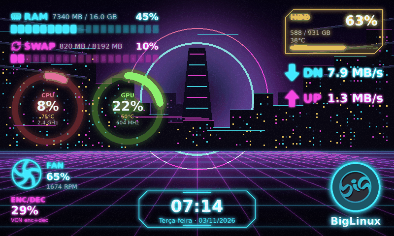</p>

<p align="center">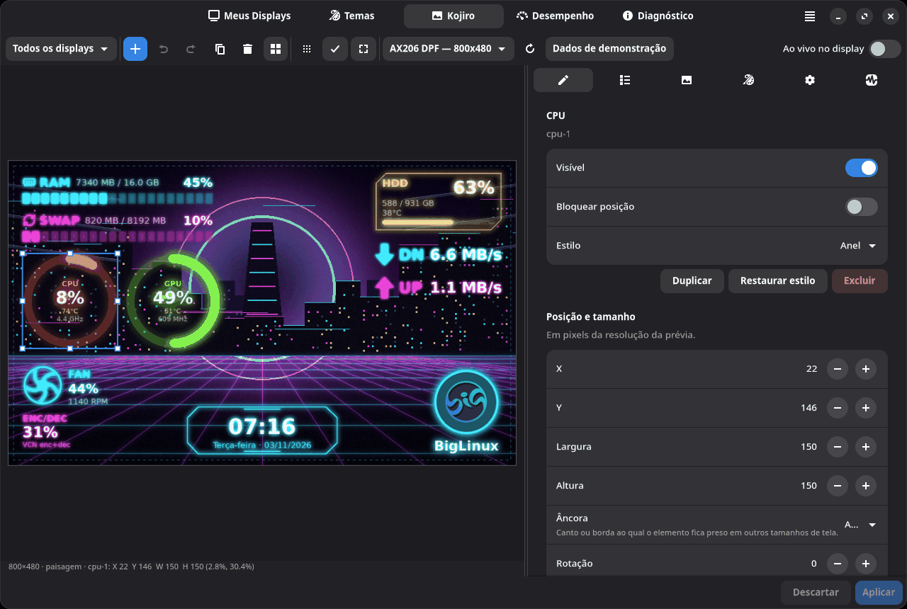<br/><sub>Kojiro Design Studio: a prévia é a saída real do display; arraste, redimensione e ajuste cada elemento</sub></p>

| | | |
| --- | --- | --- |
| 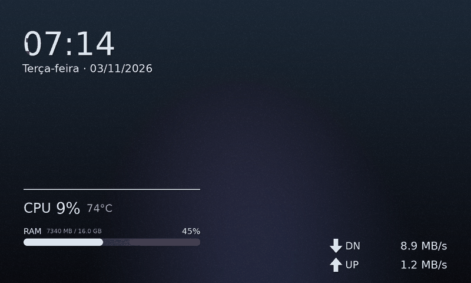 | 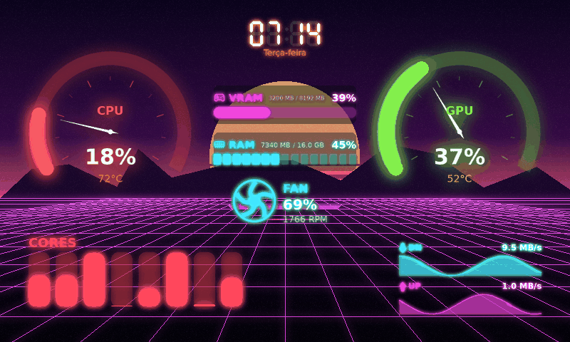 | 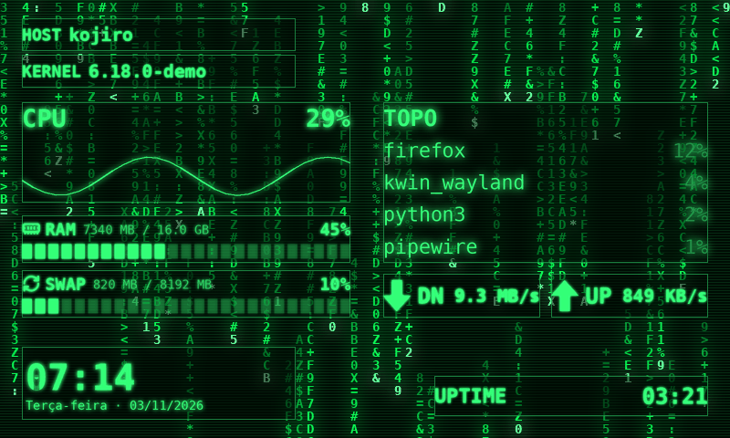 |
| 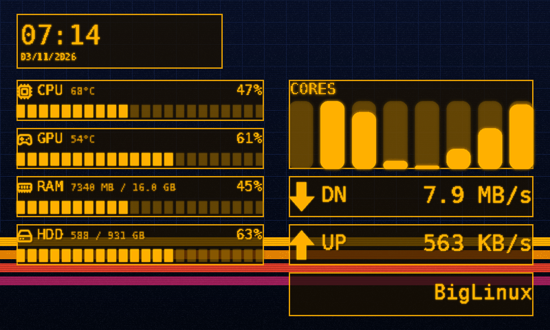 | 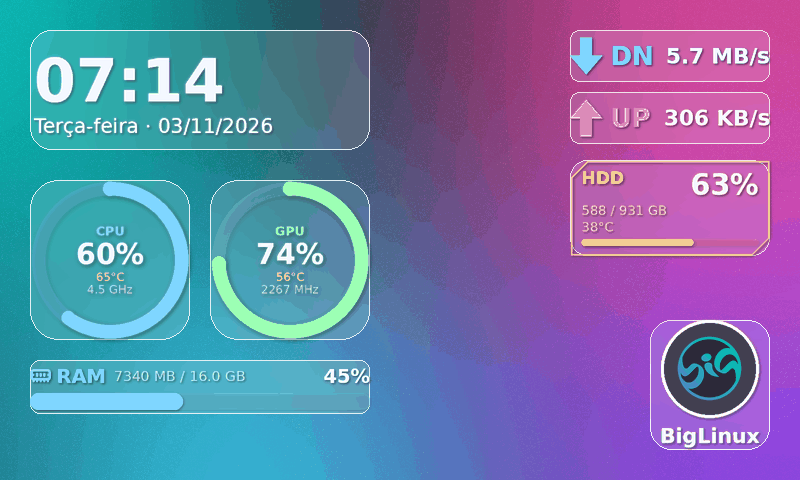 | 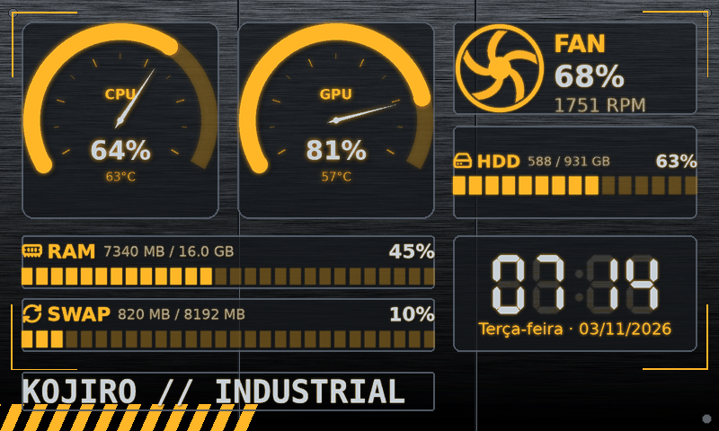 |

- **Papéis de parede**: 8 artes originais geradas pelo próprio aplicativo, suas imagens (PNG, JPEG, WebP, BMP, GIF, TIFF, SVG), cor ou degradê; preencher, ajustar, esticar, centralizar, repetir, zoom, deslocamento, rotação, espelho, brilho, contraste, saturação, gama, desfoque, escurecimento, sobreposição de cor, vinheta e degradê de proteção para textos. A imagem é importada com segurança — o arquivo original nunca é alterado.
- **Elementos**: CPU, GPU, RAM, SWAP, VRAM, ventoinha (girando conforme o RPM), codificação de vídeo, disco, download, upload, relógio, logotipo e nome da distribuição, núcleos, processos, tempo ligado, nome do computador, kernel, IP local, bateria, perfil de energia, texto, separadores e molduras — cada um com estilos próprios, cores, brilho neon, fonte, painel, vidro fosco, alertas e intervalo de atualização.
- **Dados reais e honestos**: o que o hardware não informa aparece como "—" (ou some); a % da ventoinha só vem do PWM; limites de temperatura vêm do chip quando ele informa.
- **Responsivo**: âncoras mantêm cada elemento no seu canto em qualquer resolução; layout retrato automático; telas minúsculas mostram linhas legíveis; círculos nunca ficam ovais.
- **Leve**: 1,5% de CPU com conteúdo estático e 7,5% com animações no AX206 800×480; memória estável.

Detalhes: [visão geral](docs/kojiro-overview.md) · [editor](docs/kojiro-editor.md) · [elementos e como criar novos](docs/kojiro-widget-system.md) · [papéis de parede](docs/kojiro-wallpapers.md) · [formato das configurações](docs/kojiro-configuration.md).

---

<a id="brother-away"></a>

## 🏝️ Brother Away — O Náufrago Perplecto!

Um náufrago com opinião sobre tudo, morando na ilha que existe dentro do seu display. Ele dorme, pesca, constrói uma jangada, conversa com o coqueiro, foge de tubarões, discursa para extraterrestres e filosofa com o horizonte — enquanto, no canto, o relógio e os indicadores de **CPU, RAM, disco e GPU** continuam mostrando o estado real da máquina.

<table>
<tr>
<td align="center">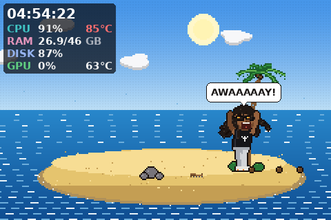<br/><b>O coqueiro revoltado</b><br/><sub>três cocos depois… "AWAAAAAY!"</sub></td>
<td align="center">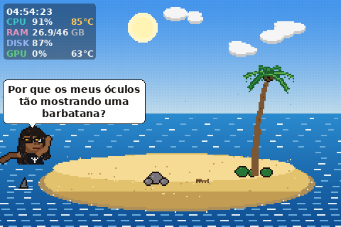<br/><b>O tubarão debochado</b><br/><sub>a barbatana aparece no reflexo dos óculos</sub></td>
<td align="center">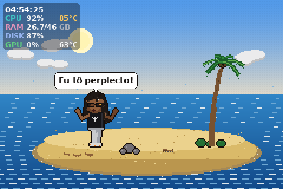<br/><b>A jangada impossível</b><br/><sub>dias de construção, uma ondinha… "Eu tô perplecto!"</sub></td>
</tr>
<tr>
<td align="center">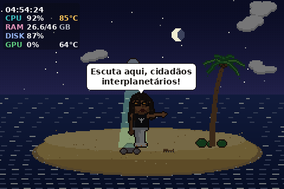<br/><b>O encontro extraterrestre</b><br/><sub>de madrugada, um discurso sobre a humanidade</sub></td>
<td align="center"><br/><b>O coqueiro filósofo</b><br/><sub>"Tu tá entendendo o que eu tô falando, morô?"</sub></td>
<td align="center">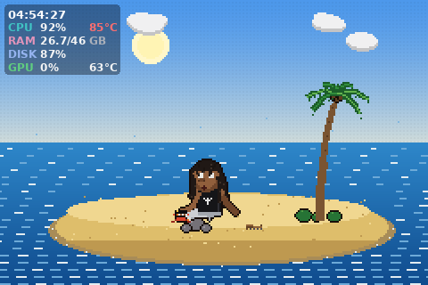<br/><b>O caranguejo e os óculos</b><br/><sub>sem óculos ele vê "realidade demais"</sub></td>
</tr>
</table>

**Mais histórias:** a gaivota que rouba o almoço · a mensagem na garrafa · a sereia que foge das reclamações · o navio que passa enquanto ele dorme · o tesouro · a noite de estrelas · a reclamação da chuva · o peixe que devolve a isca. Entre elas, ele passeia, cochila sob o coqueiro, pesca, nada, dança, sobe no coqueiro (e cai), senta na fogueira à noite e dá "Bom dia, ilha!".

<table>
<tr>
<td align="center">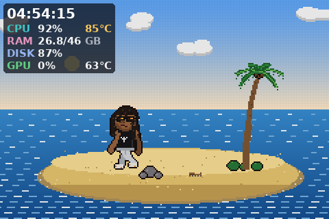<br/><sub>Manhã</sub></td>
<td align="center">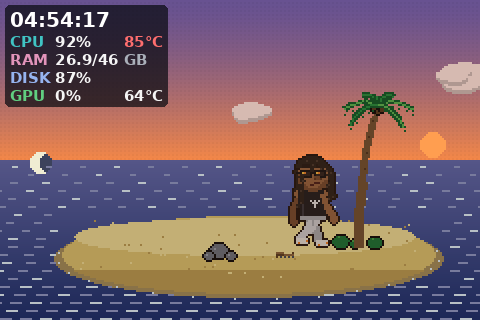<br/><sub>Pôr do sol</sub></td>
<td align="center">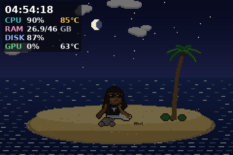<br/><sub>Noite (lua na fase real)</sub></td>
<td align="center">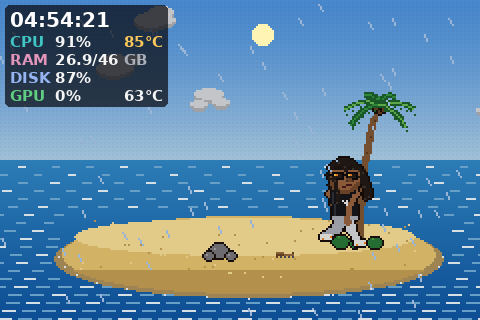<br/><sub>Chuva</sub></td>
</tr>
</table>

| Recurso | Detalhes |
| --- | --- |
| 🌅 **Dia e noite** | segue o relógio do computador: madrugada, amanhecer, manhã, meio-dia, tarde, pôr do sol, anoitecer, noite; sol em arco, lua com a fase real |
| 🌦️ **Clima simulado** | céu limpo, ventania, chuva, tempestade com relâmpagos, mar agitado, neblina e arco-íris — sem nenhum serviço externo |
| 🧩 **Continuidade** | a jangada cresce entre sessões e as recordações (garrafa, baú) ficam na ilha |
| 📊 **Painel de telemetria** | relógio, CPU % e °C, RAM usada/total, DISK %, GPU % e °C; canto, tamanho, opacidade e sensores configuráveis; encolhe durante as histórias (nunca some) |
| 🔥 **Reage ao computador** | CPU alta → sol ardendo e ele se abana · temperatura alta → vai para a sombra · RAM cheia → caixas acumulam · disco lotado → baú transbordando · GPU ocupada → vulcão no horizonte |
| 💬 **Humor** | Familiar, Clássico ou Debochado; bordões ("AWAAAAAY!", "perplecto", "morô?") podem ser desligados |
| 🔊 **Som opcional** | efeitos retrô sintetizados, tocados pelo computador (o display não tem alto-falante); desligado por padrão |
| 🪫 **Modo estático** | desligue a animação: a ilha fica parada e só os dados são atualizados |

<details>
<summary><b>Retrato e telas maiores</b></summary>
<br/>
<p align="center">
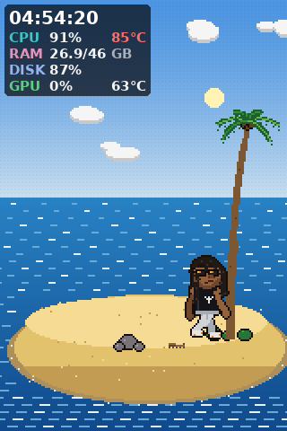
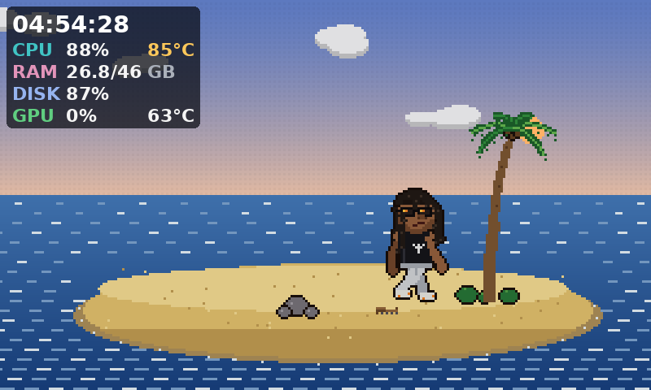
</p>
A arte é desenhada numa resolução lógica e ampliada por um fator inteiro (sem borrão): 320×240 e 480×320 usam ×2, 800×480 usa ×3.
</details>

**Como ativar:** abra *Big Screen Monitor Display* → **Temas** → *Brother Away — O Náufrago Perplecto!* → **Aplicar** (ou, na página **Brother Away**, "Usar este tema"). O display muda em até um segundo, sem reiniciar nada. Na prévia você pode assistir a qualquer história, mesmo sem o display conectado.

> Personagem, arte, histórias e falas são **originais** deste projeto, uma homenagem ao humor brasileiro e aos protetores de tela narrativos dos anos 90. Nenhum recurso de terceiros é usado. Veja [docs/07](docs/07-brother-away-design.md).

---

<a id="temas"></a>

## 🎨 Temas

Seis temas, todos na horizontal e na vertical, em qualquer resolução (o [Kojiro](#kojiro) tem seção própria acima). Depois de aplicado, cada tema ganha **uma aba própria** na janela de configuração, com todas as suas opções e uma prévia ao vivo — e só a aba do tema em uso aparece.

### Padrão

O antigo quarteto Escuro/Claro/Neon/Cyberpunk era o mesmo desenho com cores diferentes e tinha textos sobrepostos em várias resoluções. Agora é **um único tema** com um motor de layout que mede cada texto antes de desenhar: nomes longos ganham reticências, itens opcionais saem por prioridade e os tamanhos de fonte vêm do espaço real — nada se sobrepõe.

<table>
<tr>
<td align="center">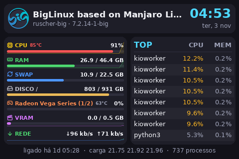<br/><sub>Escuro</sub></td>
<td align="center">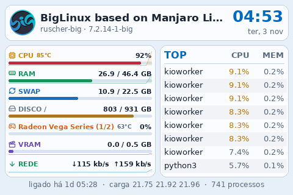<br/><sub>Claro</sub></td>
<td align="center">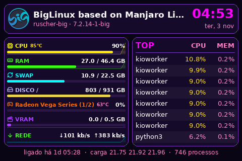<br/><sub>Neon</sub></td>
<td align="center">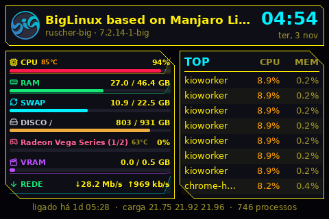<br/><sub>Cyberpunk</sub></td>
</tr>
<tr>
<td align="center">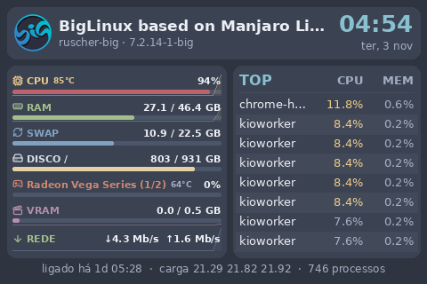<br/><sub>Nord</sub></td>
<td align="center">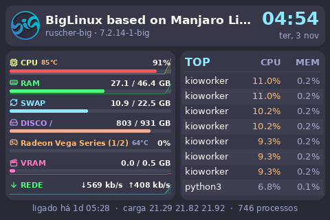<br/><sub>Dracula</sub></td>
<td align="center">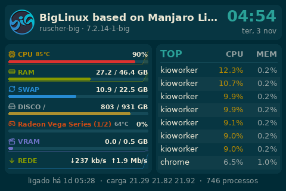<br/><sub>Solarized</sub></td>
<td align="center">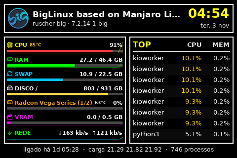<br/><sub>Alto contraste</sub></td>
</tr>
</table>

<details>
<summary><b>Opções do tema Padrão</b> (gráficos no painel lateral, barras segmentadas, retrato)</summary>
<br/>
<p align="center">
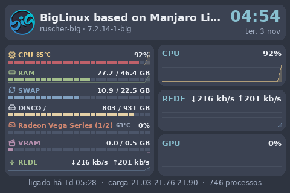
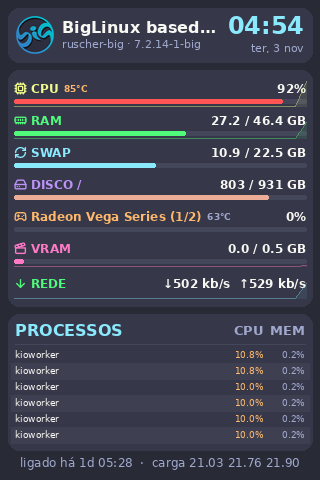
</p>

| Grupo | Opções |
| --- | --- |
| Aparência | 8 esquemas de cores · tamanho do texto · barras arredondadas, retas ou segmentadas · rótulos coloridos · cores de alerta (75%/90%) · histórico dos últimos 30 s ao fundo |
| Cabeçalho | mostrar/ocultar · logotipo da distribuição · host e kernel · data · relógio 24 h/12 h · segundos |
| Informações | CPU (uso e temperatura) · memória · swap · disco · GPU (uso e temperatura) · VRAM · rede · valores em usado/total ou % · °C/°F |
| Painel lateral | processos que mais consomem, gráficos (CPU, rede, GPU) ou nada · 5 a 12 processos · ordenar por CPU ou memória · rodapé com tempo ligado, carga, processos e perfil de energia |

Configurações antigas com Escuro, Claro, Neon ou Cyberpunk são migradas automaticamente para o Padrão com o mesmo esquema.
</details>

### GKrellM · Planet · Computador Antigo

<table>
<tr>
<td align="center" width="50%">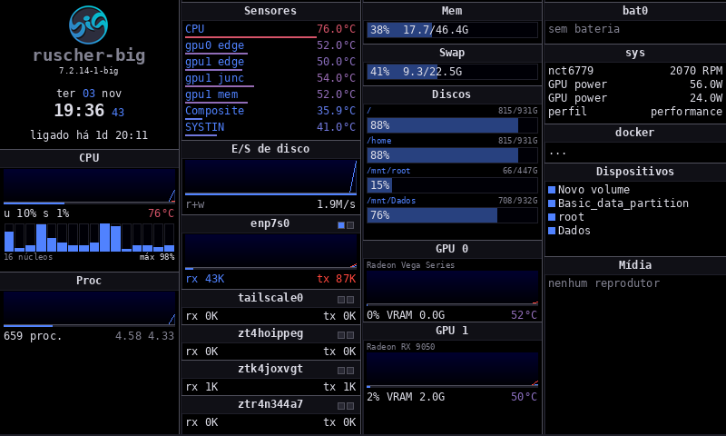<br/><b>GKrellM</b></td>
<td align="center" width="50%">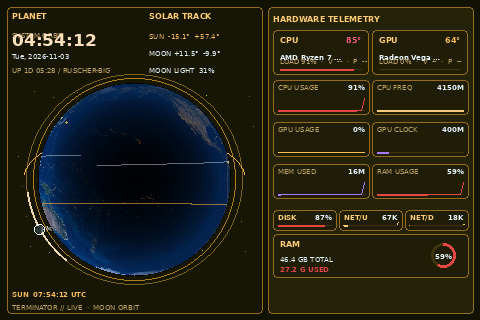<br/><b>Planet</b> · destaque âmbar</td>
</tr>
<tr>
<td align="center">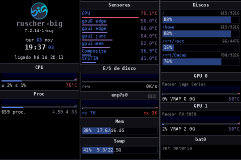<br/><b>GKrellM</b> · 480×320 com 4 partições</td>
<td align="center">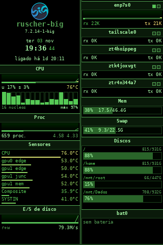<br/><b>GKrellM</b> · Clássico, retrato</td>
</tr>
<tr>
<td align="center">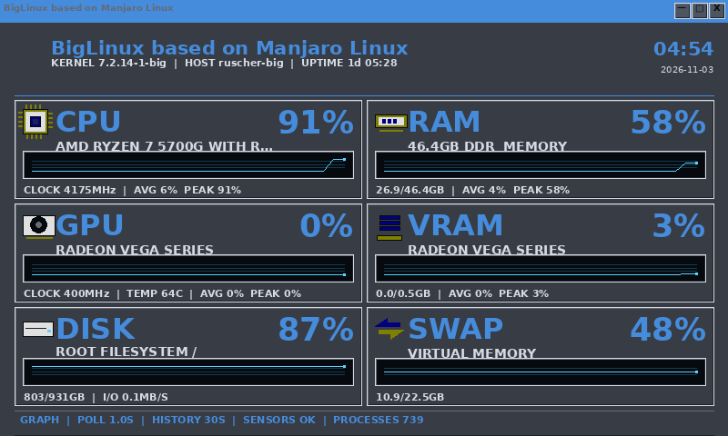<br/><b>Computador Antigo</b> · Ardósia, 6 cartões</td>
<td align="center">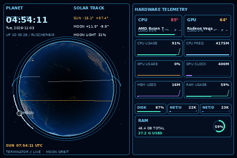<br/><b>Planet</b> · Sol e Lua nas posições reais</td>
</tr>
</table>

| Tema | O que mudou | Opções |
| --- | --- | --- |
| **GKrellM** | Reconstruído em módulos que medem a própria altura. O layout escolhe a maior fonte (até 9 px) em que **todos os módulos ligados** cabem, acrescentando colunas no modo automático e achatando os gráficos; só se nem assim couber, as listas de Discos e Sensores ficam mais curtas e os últimos módulos saem — nunca há sobreposição. Partições: `/`, `/home` e mídias montadas, com subvolumes btrfs distintos separados e `/boot` por último. Os módulos que antes **inventavam dados** (PPP/VLAN/inet0 desenhavam o gráfico da CPU, "sys" mostrava voltagens fixas) agora mostram interfaces, sensores e ventoinhas **reais** ou "indisponível". | estilo Urlicht/Clássico/Cyber-Red · colunas (auto, 1–4) · tamanho do texto · altura dos gráficos · partições listadas · 20 módulos (host, data, hora, tempo ligado, CPU, núcleos, processos e carga, temperaturas, E/S de disco, interface principal, outras interfaces, memória, swap, partições, GPU, bateria, ventoinhas e energia, Docker, mídias removíveis, reprodutor) |
| **Planet** | Sem sobreposição em telas pequenas e no retrato; RAM na ordem certa (usado/total); o texto fixo "SUNNY / WIND 3 / 22°C" e o "VOLUME 28%" **fictícios** viraram tempo ligado e uso do disco; "GPU CLOCK" mostra o clock real da GPU. | cor de destaque (azul, verde, âmbar, violeta, vermelho — a Terra mantém as cores reais) · lado noturno · luzes das cidades · trajetórias do Sol e da Lua · Lua · segundos |
| **Computador Antigo** | Não quebra mais em 240×320; sem textos sobrepostos em 320×240; cartões se adaptam à altura. | 4 paletas (Cinza clássico, Ardósia, Âmbar, Lilás) · barra de título · barra de status · segundos · cartões de GPU/VRAM · cartões de disco/swap |

---

## 🧭 Janela de configuração

<p align="center">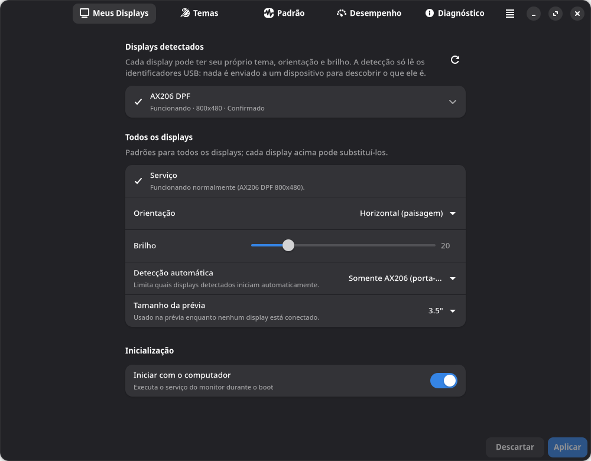<br/><sub>Meus Displays: cada display detectado com seu estado, confiança e opções próprias</sub></p>

<table>
<tr>
<td align="center">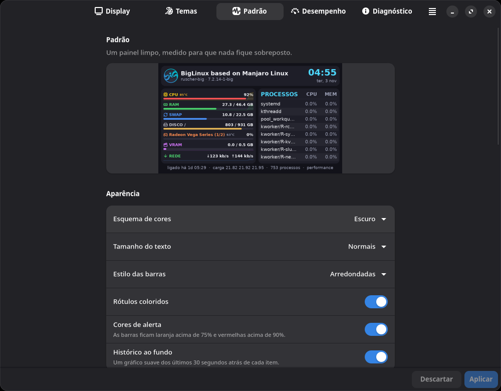<br/><sub>Aba do tema Padrão, com prévia ao vivo</sub></td>
<td align="center">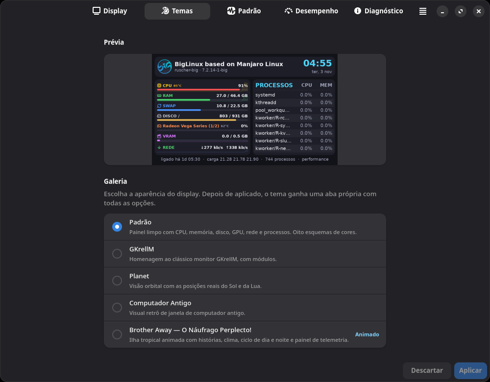<br/><sub>Galeria de temas</sub></td>
</tr>
<tr>
<td align="center">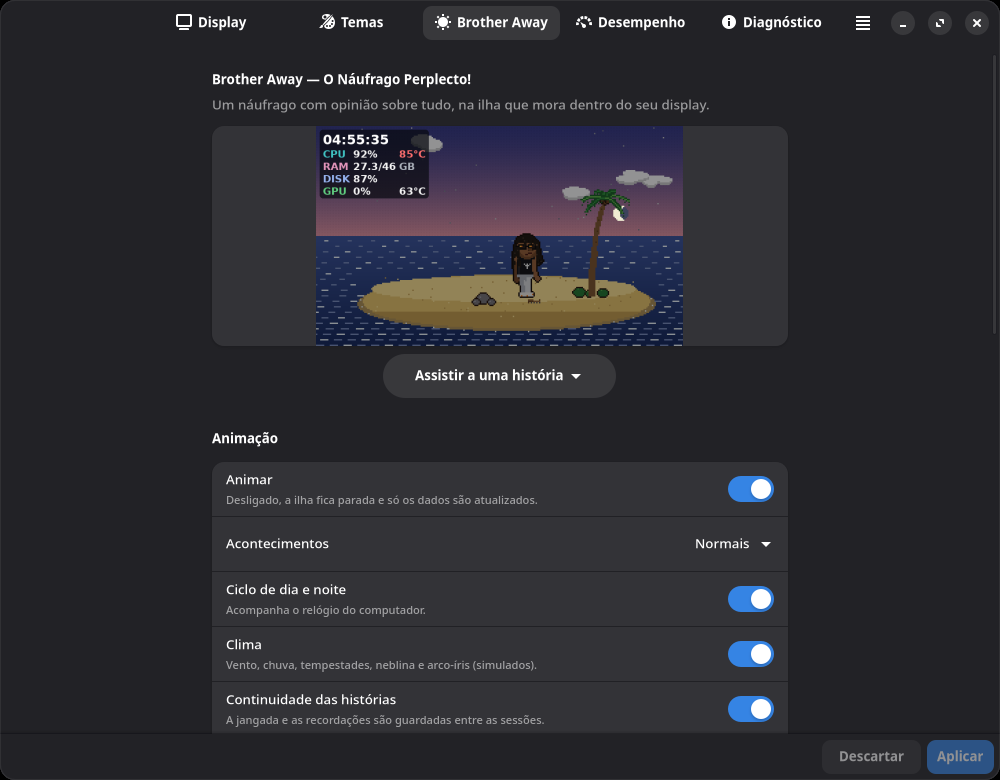<br/><sub>Aba Brother Away com prévia animada</sub></td>
<td align="center">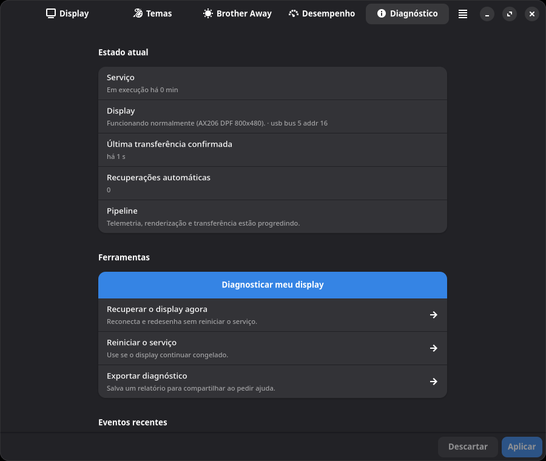<br/><sub>Diagnóstico com o estado real do serviço</sub></td>
</tr>
</table>

- **Meus Displays:** todos os displays detectados, com nome, modelo/protocolo (automático ou manual), nível de confiança, tema, orientação, brilho e desempenho próprios, firmware e capacidades, sensores do WeAct, padrões de teste, *Identificar* e *Reconectar* — mais os padrões para todos os displays e o início com o computador.
- **Temas:** galeria com prévia ao vivo usando o mesmo renderizador do display.
- **Aba do tema aplicado** (Padrão, GKrellM, Planet, Computador Antigo, Brother Away ou Kojiro): todas as opções do tema, com prévia própria — no Kojiro, o editor visual completo. Ao aplicar outro tema, a aba troca sozinha e um aviso oferece "Personalizar".
- **Desempenho:** perfil (Automático, Econômico, Equilibrado, Fluido) e números reais do serviço: CPU, memória, quadros por segundo (com o alvo real do tema aplicado), tempo de transferência, dados enviados.
- **Diagnóstico:** estado atual, *Diagnosticar meu display* com correções seguras, *Recuperar o display agora*, reiniciar o serviço, eventos recentes e exportar relatório.

Alterações são aplicadas com **Aplicar** e valem em até 1 s; *Descartar* volta ao que está salvo. Depois de atualizar o pacote, feche e abra a janela para a prévia usar a versão nova. Funciona com teclado e leitor de tela, nos modos claro e escuro do sistema.

<details>
<summary><b>Abas dos outros temas</b></summary>
<br/>
<p align="center">
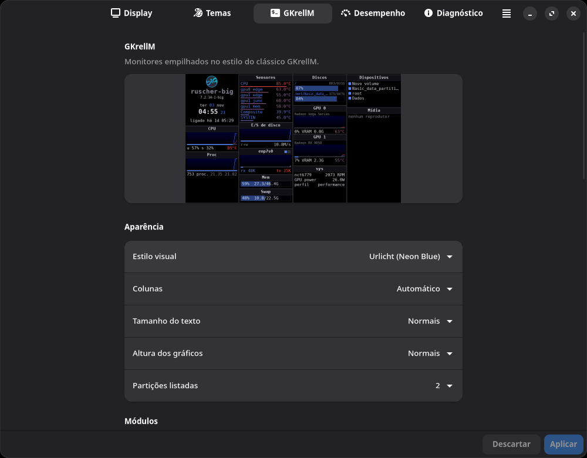
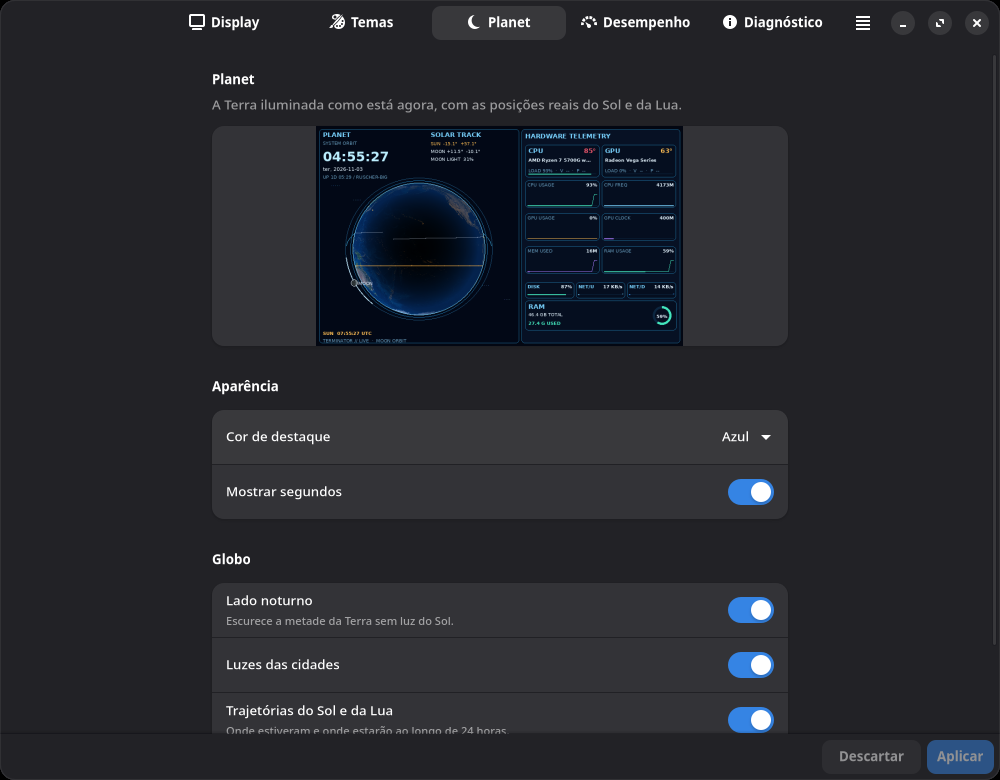
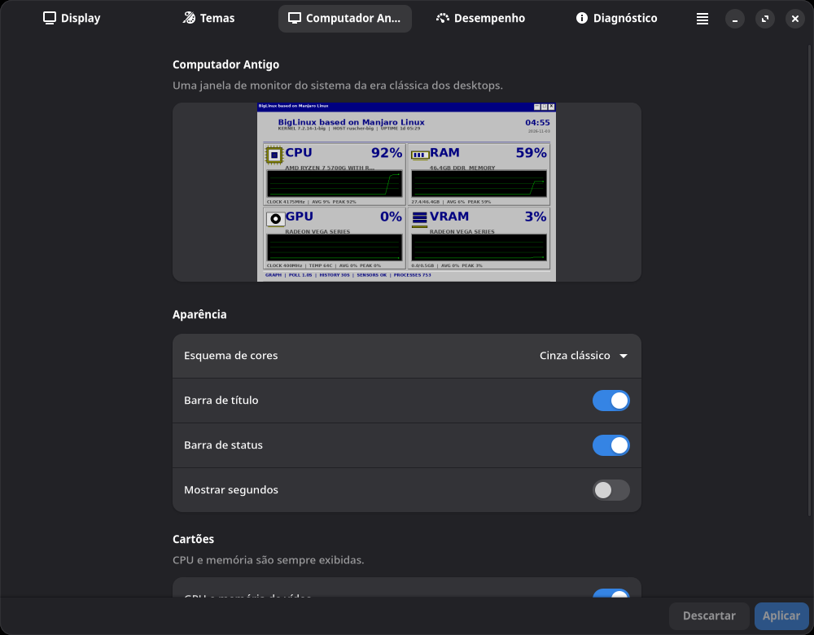
</p>
</details>

---

<a id="instalacao"></a>

## 🔧 Instalação

### Arch Linux · BigLinux · Manjaro

```bash
git clone https://github.com/biglinux/big-screen-monitor-display.git
cd big-screen-monitor-display/pkgbuild
makepkg -si
```

A instalação:

1. cria o grupo `big-screen-monitor` (sysusers) e aplica as regras udev aos displays já conectados;
2. importa automaticamente suas configurações antigas (`~/.config/big-screen-monitor/settings.json`);
3. habilita e inicia o serviço.

Atualizações preservam as configurações e **respeitam o serviço desativado**.

### Dependências

| Tipo | Pacotes |
| --- | --- |
| Execução | `bash`, `python` ≥ 3.10, `python-pillow`, `python-numpy`, `python-psutil`, `python-pyusb`, `libusb`, `python-pyserial`, `pciutils`, `librsvg`, `fontconfig`, `systemd`, `polkit` |
| Janela | `python-gobject`, `python-cairo`, `glib2`, `gtk4`, `libadwaita` ≥ 1.6, `hicolor-icon-theme` |
| Opcionais | `lm_sensors` (sensores extras), `python-pystray` (ícone de bandeja em execução manual), `libcanberra` (som ao aplicar), `pipewire-audio` / `libpulse` / `alsa-utils` (efeitos sonoros e módulo de volume do GKrellM), `adwaita-fonts` (fonte do GKrellM), `playerctl` (módulo de mídia do GKrellM), `docker` (contagem de contêineres no GKrellM), `python-cryptography` (cabeçalho mais rápido nos Turing USB) |
| Build | `gettext`, `git` |

---

<a id="uso"></a>

## ⚙️ Uso

| Ação | Comando / caminho |
| --- | --- |
| Abrir a configuração | menu do sistema → *Big Screen Monitor Display* · `big-screen-monitor-config.sh` |
| Estado do serviço | `systemctl status big-screen-monitor-display` (a linha **Status** diz o que está acontecendo) |
| Diagnóstico no terminal | `python3 /usr/share/big-screen-monitor-display/main.py --diagnose` |
| Relatório JSON | `python3 /usr/share/big-screen-monitor-display/main.py --status` |
| Logs | `journalctl -u big-screen-monitor-display -f` |
| Forçar reconexão | `sudo systemctl kill -s SIGUSR1 big-screen-monitor-display` |
| Displays detectados | `main.py --list-displays` (somente leitura; `--json` para detalhes) |
| Testar sem display | `main.py --simulate 480x320,160x80,480x480:round --snapshot /tmp/frame.png` |
| Medir desempenho | `main.py --benchmark --bench-sizes 160x80 480x320 800x480` |
| Gerar uma imagem de tema | `main.py --render planet --size 800x480 --out planet.png` |
| Ver uma história em imagem | `main.py --render brother_away --scene shark --hour 11 --at 15 --out tubarao.png` |

Exemplo de `systemctl status`:

```text
● big-screen-monitor-display.service - Big Screen Monitor Display - USB LCD hardware monitor
     Active: active (running)
     Status: "healthy: AX206 DPF 800x480, theme brother_away, 8.0 fps"
     Memory: 72.6M (high: 192M, max: 320M)
```

### Arquivos

| Caminho | Conteúdo |
| --- | --- |
| `/etc/big-screen-monitor-display/settings.json` | configurações (fonte única, escrita pelo assistente Polkit; `settings.json.bak` = último arquivo válido) |
| `/etc/big-screen-monitor-display/wallpapers/` | papéis de parede importados para o Kojiro (PNG verificados) |
| `~/.local/share/big-screen-monitor-display/kojiro/presets/` | suas predefinições do Kojiro |
| `/run/big-screen-monitor-display/status.json` | relatório de saúde, atualizado a cada 2 s (campo `displays` com cada display) |
| `/run/big-screen-monitor-display/commands/` | fila de comandos por display (padrões de teste, reconectar), escrita só via assistente Polkit |
| `/var/lib/private/big-screen-monitor-display/` | histórico de incidentes e progresso do Brother Away |

---

<a id="detalhes-tecnicos"></a>

## 🔬 Detalhes técnicos

### Arquitetura

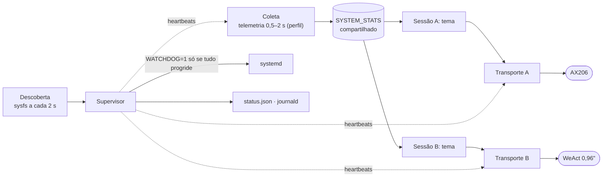

- **Uma sessão por display + supervisor.** Cada display tem threads de render e transporte, estado, backoff e incidentes próprios; só o seu transporte fala com o dispositivo; a coleta é única e nunca atrasa a animação. Drivers por família em `bsmd/displays/` ([docs/13](docs/13-arquitetura-drivers.md)).
- **Backpressure e coalescência.** O render nunca fica mais de um quadro à frente do transporte; um quadro não enviado é trocado pelo mais novo.
- **Progresso, não pixels.** Tela estática não é travamento: cada subsistema informa iterações concluídas e operações em andamento. Operação presa > 30 s, ausência de progresso ou thread morta suspendem o watchdog.
- **Recuperação progressiva:**

```text
HEALTHY ⇄ DEGRADED → RECOVERING → HEALTHY
                       ↓     ↑
               DISCONNECTED → RETRYING → FAILED → systemd reinicia
```

Erro transitório degrada; dois seguidos ou desconexão reabrem o driver, redetectam o dispositivo, reaplicam o brilho e mandam um quadro completo. Ausente: espera sondando a cada 2 s. Presente mas mudo: backoff 1→30 s, reset USB **somente** do próprio display na 4ª tentativa, e após 8 falhas o processo sai para o systemd reiniciar (atraso de 5 s a 5 min).

### systemd

```ini
Type=notify · WatchdogSec=30 · Restart=on-failure · RestartSteps=6 · RestartMaxDelaySec=300
DynamicUser=yes · SupplementaryGroups=big-screen-monitor · DevicePolicy=closed
ProtectSystem=strict · ProtectHome=read-only · CapabilityBoundingSet= · SystemCallFilter=@system-service
RestrictAddressFamilies=AF_UNIX AF_NETLINK · NoNewPrivileges=yes
Nice=10 · CPUWeight=20 · IOSchedulingClass=idle · MemoryMax=320M
```

`ProtectHome=read-only` (o padrão do systemd para `DynamicUser`) deixa as montagens do `/home` visíveis para a lista de partições e os elementos de disco, sem permitir escrita. Sem sockets de rede, as interfaces são lidas do `/sys/class/net`.

Sinais: `SIGTERM` encerra mostrando "Monitoramento parado" (em vez de uma imagem congelada), `SIGUSR1` reconecta, `SIGHUP` recarrega as configurações.

### Segurança

| | 3.x | 4.0 – 4.2 |
| --- | --- | --- |
| Usuário do serviço | root | usuário dinâmico sem privilégios |
| Acesso ao display | udev `0666` (qualquer processo) | `0660` + grupo do serviço + `uaccess`, só nos IDs/seriais dos displays suportados |
| Operações administrativas | sudoers `NOPASSWD` | Polkit + `bsm-helper` com verbos fixos e JSON validado; alterações visuais sem senha para o usuário local ativo, controle do serviço só com administrador |
| Imagens do usuário | — | decodificadas só sem privilégios; o root confere apenas a estrutura PNG |
| Configurações | primeiro `/home/*` encontrado | `/etc/…/settings.json`, validado e gravado atomicamente |

### Desempenho (medido na AX206 800×480)

| | 3.x | 4.0 |
| --- | --- | --- |
| CPU, tema de painel (Escuro) | 49,6% | 3,2–3,5% |
| CPU, Brother Away 8 fps | — | 5,1% |
| Conversão RGB565 + diff | 110 ms | ~2 ms |
| Coleta de telemetria | 131 ms a cada 0,4 s | 2,9 ms a cada 1 s |
| Envio | quadro inteiro (768 KB, 115 ms) | só o que mudou (canto: ~4 ms) |
| Volta após desconexão | nunca | 1,1–2,1 s |

**Perfis de desempenho:**

| Perfil | Temas animados (Brother Away, Kojiro animado) | Temas de painel (Padrão, GKrellM, Planet, Computador Antigo) | Kojiro estático | Coleta de telemetria |
| --- | --- | --- | --- | --- |
| Econômico | até 4 fps | 1 desenho/s | 1/s | a cada 2 s |
| Automático | até 8 fps, adaptativo | 2/s | 1/s | a cada 1 s |
| Equilibrado | até 8 fps | 2/s | 1/s | a cada 1 s |
| Fluido | até 15 fps | 4/s | 2/s | a cada 0,5 s |

O Automático limita os temas animados a 8 fps (as poses são desenhadas "em dois"), reduz para manter o pipeline abaixo de 60% de ocupação, respeita o limite de cada transporte lento e cai para 4 fps na bateria. Os desenhos dos temas de painel são alinhados ao relógio, então os segundos nunca atrasam. Com vários displays, vale o perfil mais rápido entre eles para a coleta.

**Displays seriais lentos (Turing rev. A, ~190 KB/s):** uma tela cheia de 480×320 leva ~1,6 s, por isso só os pixels que mudaram são enviados (retângulos recortados ao pixel). Medido no GKrellM 480×320: 23 KB e ~125 ms por atualização (antes 66 KB e ~360 ms).

### Traduções

Textos marcados com gettext (`locale/big-screen-monitor-display.pot`, 929 mensagens). Português completo em `locale/pt.po`; as demais línguas são geradas pelo tradutor automático do BigLinux e compiladas no PKGBUILD.

---

<a id="problemas"></a>

## 🩺 Solução de problemas

| Sintoma | O que fazer |
| --- | --- |
| Display apagado ou parado | Janela → **Diagnóstico** → *Diagnosticar meu display*. *Recuperar o display agora* reconecta sem reiniciar o serviço. |
| "Display não encontrado" | Confira o cabo, troque de porta, evite hubs sem fonte. `error -71` em `journalctl -k` indica problema elétrico (cabo, porta ou alimentação). |
| Display "aguardando a escolha do modelo" | O identificador USB é compartilhado (ex.: `1a86:5722` sem número de série conhecido) ou o dispositivo serial não é reconhecido. Em **Meus Displays**, escolha o modelo e pressione *Aplicar*. |
| Display atribuído manualmente dá "permissão" | Só os IDs da tabela recebem acesso pelo udev. Crie uma regra local para aquele dispositivo (veja [docs/14](docs/14-deteccao.md)). |
| "Dispositivo ocupado" | Outro programa usa o display (por exemplo, `main.py` aberto manualmente). Feche-o. |
| Aviso de permissões | Uma regra udev local em `/etc/udev/rules.d/` pode estar sobrepondo a do pacote (por exemplo, `MODE="0666"`). Remova-a e reconecte o display. |
| Serviço sem watchdog/isolamento | Há uma cópia antiga em `/etc/systemd/system/big-screen-monitor-display.service`; remova-a e rode `sudo systemctl daemon-reload`. O diagnóstico avisa. |
| Quero gastar menos | **Desempenho → Econômico**, ou desligue a animação do Brother Away. |
| GKrellM com letras pequenas ou listas encurtadas | Há mais módulos ligados do que cabem na tela. Desligue módulos que não usa na aba **GKrellM**, reduza "Partições listadas" ou use colunas automáticas. |
| Partição do `/home` não aparece | Confira se o serviço usa o arquivo do pacote: `systemctl show -p ProtectHome big-screen-monitor-display` deve dizer `read-only`. Uma cópia antiga em `/etc/systemd/system/` sobrepõe o pacote (veja acima). |
| Rede ou E/S de disco parados | `main.py --status`: o campo `sensor_errors` deve estar vazio. Desde a 4.2.1 as interfaces são lidas do `/sys`; atualize o pacote. |
| Prévia da janela diferente do display | A janela foi aberta antes de uma atualização: feche e abra de novo. |
| Pedir ajuda | **Diagnóstico → Exportar diagnóstico** gera um relatório com o estado e os logs. |

---

## 🧪 Desenvolvimento

```bash
python3 -m pytest -q tests                                  # 633 testes, sem hardware
./tools/make_screenshots.sh                                 # regenera docs/images
python3 usr/share/big-screen-monitor-display/main.py --simulate 480x320 --snapshot /tmp/f.png
BSM_CONFIG=/tmp/s.json python3 usr/share/big-screen-monitor-display/config_gui.py
```

Os testes cobrem configurações, conversão e retângulos, todos os temas em 10 resoluções nas duas orientações e em tela redonda, os bytes de cada protocolo comparados com a referência, o layout do GKrellM (todos os módulos e partições em 480×320, listas encurtadas sem sobreposição), partições btrfs dentro do isolamento do serviço, perfis de desempenho, retângulos recortados ao pixel, detecção e níveis de confiança, vários displays com hot-plug e falha isolada, drivers com USB/serial falsos, máquina de estados, pipeline com falhas injetadas (desconexão, timeout, travamento, falha persistente), assistente Polkit, as 14 histórias do Brother Away e um dia simulado. A CI roda em `.github/workflows/tests.yml`.

### Estrutura

```text
usr/share/big-screen-monitor-display/
├── main.py              ponto de entrada (serviço, --render, --diagnose, --status, --simulate, --list-displays, --benchmark)
├── config_gui.py        janela GTK4/libadwaita
├── displays_page.py     página "Meus Displays"
├── kojiro_page.py       aba Kojiro (barra de ferramentas e inspetor)
├── kojiro_editor.py     Kojiro Design Studio (estado, desfazer/refazer, canvas Cairo)
└── bsmd/
    ├── runtime.py       descoberta, sessões por display, supervisor, recuperação
    ├── health.py        heartbeats, máquina de estados, backoff, incidentes
    ├── displays/        drivers por família, registro, descoberta, transporte serial, simulador
    ├── kojiro/          tema Kojiro: modelo, layout, dados, desenho, elementos, papéis de parede, armazenamento, motor
    ├── drivers.py       compatibilidade com a API antiga
    ├── compact.py       layout para telas minúsculas
    ├── patterns.py      padrões de teste
    ├── benchmark.py     --benchmark
    ├── frames.py        RGB565, retângulos alterados, caixa de correio
    ├── telemetry.py     coletores
    ├── settings.py      esquema, validação, gravação atômica, migração
    ├── themes.py        registro de temas
    ├── dashboard.py     tema Padrão (8 esquemas de cores)
    ├── gkrellm.py       tema GKrellM em módulos
    ├── legacy_themes.py Planet, Computador Antigo e utilitários compartilhados
    ├── diagnostics.py   "Diagnosticar meu display"
    ├── sound.py         efeitos sonoros opcionais
    └── brother_away/    personagem, mundo, poses, narrativa, histórias, falas, overlay
usr/lib/big-screen-monitor-display/bsm-helper    assistente Polkit
usr/lib/{systemd,udev,sysusers.d} · usr/share/polkit-1    integração com o sistema
locale/ · pkgbuild/ · tests/ · tools/ · docs/
```

### Documentação técnica

| | |
| --- | --- |
| [01 · Auditoria técnica](docs/01-auditoria-tecnica.md) | [06 · Arquitetura de temas](docs/06-arquitetura-temas.md) |
| [02 · Análise dos travamentos](docs/02-analise-travamentos.md) | [07 · Brother Away: arte e personagem](docs/07-brother-away-design.md) |
| [03 · Watchdog e recuperação](docs/03-watchdog-recuperacao.md) | [08 · Brother Away: narrativa](docs/08-brother-away-narrativa.md) |
| [04 · Segurança e permissões](docs/04-seguranca-permissoes.md) | [09 · Testes e validação](docs/09-testes-validacao.md) |
| [05 · Desempenho](docs/05-performance-benchmarks.md) | [10 · Relatório final](docs/10-relatorio-final.md) |
| [11 · Compatibilidade de hardware](docs/11-compatibilidade-hardware.md) | [15 · Múltiplos displays](docs/15-multi-display.md) |
| [12 · Protocolos](docs/12-protocolos.md) | [16 · Benchmarks do Display Engine](docs/16-benchmarks.md) |
| [13 · Arquitetura dos drivers](docs/13-arquitetura-drivers.md) | [17 · Testes em hardware real](docs/17-testes-hardware.md) |
| [14 · Detecção universal](docs/14-deteccao.md) | [18 · Relatório do Universal Display Engine](docs/18-relatorio-universal-display-engine.md) |
| [Kojiro · visão geral](docs/kojiro-overview.md) | [Kojiro · configuração](docs/kojiro-configuration.md) |
| [Kojiro · arquitetura](docs/kojiro-architecture.md) | [Kojiro · predefinições](docs/kojiro-presets.md) |
| [Kojiro · papéis de parede](docs/kojiro-wallpapers.md) | [Kojiro · desempenho](docs/kojiro-performance.md) |
| [Kojiro · elementos](docs/kojiro-widget-system.md) | [Kojiro · testes](docs/kojiro-testing.md) |
| [Kojiro · editor](docs/kojiro-editor.md) | [Kojiro · relatório final](docs/kojiro-final-report.md) |

---

## 📄 Licença

**GPL-3.0-or-later.** Código aberto para estudo, modificação e distribuição, fortalecendo a comunidade de software livre brasileira.

Os protocolos Turing, XuanFang, Kipye, WeAct e Turing USB foram estudados no projeto [turing-smart-screen-python](https://github.com/mathoudebine/turing-smart-screen-python) (Copyright © 2021 Matthieu Houdebine e colaboradores, GPL-3.0-or-later) e reimplementados aqui; o protocolo AX206 vem do [dpf-ax](https://github.com/dreamlayers/dpf-ax). Este projeto não é afiliado às marcas citadas.

## 👤 Desenvolvedor

**Rafael Ruscher** · Equipe BigLinux — [github.com/biglinux/big-screen-monitor-display](https://github.com/biglinux/big-screen-monitor-display)
