<div align="center">


# Big Screen Monitor Display

**Monitor de hardware livre para pequenos displays USB e coolers DeepCool com visor no Linux — com temas, autorrecuperação, o Big Media Player, o Brother Away e o Kojiro, que transforma qualquer papel de parede em painel de hardware.**


[](https://github.com/ruscher/big-screen-monitor-display/actions/workflows/tests.yml)

[](https://github.com/ruscher/big-screen-monitor-display/releases/latest/download/big-screen-monitor-display.apk)

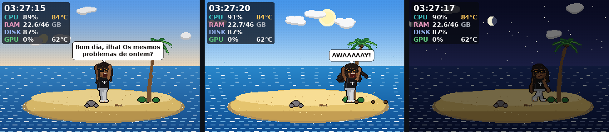

[Novidades](#novidades) ·
[Big Media Player](#big-media-player) ·
[Kojiro](#kojiro) ·
[Brother Away](#brother-away) ·
[Temas](#temas) ·
[Instalação](#instalacao) ·
[App Android](#android) ·
[Uso](#uso) ·
[Detalhes técnicos](#detalhes-tecnicos) ·
[Problemas](#problemas) ·
[Documentação](docs/) ·
[Contribuir](CONTRIBUTING.md)

🇬🇧 [Read in English](README.en.md)

</div>

---

## 📜 A história por trás do projeto

O **Big Screen Monitor Display** nasceu de um desejo pessoal e de um desafio técnico. **Rafael Ruscher** queria um mini display para compor seu gabinete com informações de hardware em tempo real. Encontrou uma telinha simples, mas ao recebê-la percebeu o obstáculo: ela só funcionava no Windows, com softwares proprietários como o AIDA64.

Como usuário fiel de Linux, ele não pretendia mudar de sistema por causa de um acessório — e a tela ficou anos na gaveta. Ao reencontrá-la, uniu conhecimento técnico e o apoio de Inteligência Artificial para criar a própria solução, agora **Software Livre**: qualquer pessoa pode usar, estudar, modificar e distribuir.

> "Ele é excelente para quem, como eu, não sai do `htop` ou do `gkrellm` e quer um resumo visual sempre à mão." — *Rafael Ruscher*

---

<a id="novidades"></a>

## ✨ Novidades da 5.5.2 — Display no celular de qualquer lugar, pelo Tailscale

- **Acesso remoto pela VPN:** com o [Tailscale](https://tailscale.com) (ou Headscale/NetBird, faixa `100.64.0.0/10`) ligado no computador e no celular, o app conecta ao display longe de casa. Antes, o serviço descartava todo pacote da faixa do Tailscale e o celular só funcionava no mesmo Wi-Fi.
- **Sem digitar endereço:** o computador informa ao app, a cada conexão, os endereços da rede de casa e da VPN; o QR Code também já leva o endereço do Tailscale. Pareou em casa, funciona na rua.
- **Conexão rápida em qualquer lugar:** o app tenta todos os endereços conhecidos ao mesmo tempo (a rede local com uma pequena vantagem); antes tentava um por um, 4 s cada, e levava ~16 s para chegar ao Tailscale.
- O app reconecta assim que a VPN sobe, e a janela e o diagnóstico mostram o transporte **VPN**.
- **APK com assinatura oficial:** até a 5.5.1 cada versão saía com uma chave diferente e o Android recusava atualizar. Desta vez instale a 5.5.2 (aparece ao lado da antiga), pareie uma vez e desinstale a anterior; daqui em diante as atualizações instalam por cima.
- Passo a passo em [docs/android/04-conexao-rede.md](docs/android/04-conexao-rede.md#acesso-remoto-tailscale).
- **Pacote:** versões mínimas declaradas (`glib2>=2.80`, `libadwaita>=1.6`, `python>=3.10`) e `tailscale` como opcional. Corrigido: o Kojiro Studio usava `Adw.InlineViewSwitcher` (libadwaita 1.7) e não abria na 1.6, o mínimo declarado.

Histórico completo de versões: [CHANGELOG.md](CHANGELOG.md).

---

## 🖥️ Displays suportados

| Família | Modelos | Resolução | Transporte | Status |
| --- | --- | --- | --- | --- |
| **AX206 DPF** (dpf-ax) | GEMBIRD/QTKeJi "USB-Display", porta-retratos AX206 | informada pelo dispositivo (320×240 … 800×480) | USB · libusb | ✅ **A** — testado em hardware real |
| **Turing rev. A** | Turing 3,5", UsbPCMonitor 3,5"/5"/7" | 320×480 · 480×800 · 600×1024 | serial CDC-ACM | 🧪 **B** — conferido byte a byte com a referência |
| **XuanFang rev. B** | XuanFang 3,5", flagship com LEDs RGB | 320×480 | serial | 🧪 **B** |
| **Turing rev. C** | Turing 2,1", 2,8", 5", 8,8" | 480×480 · 480×800 · 480×1920 | serial (acorda o painel) | 🧪 **B** |
| **Kipye rev. D** | Kipye Qiye Smart Display 3,5" | 320×480 | serial | 🧪 **B** |
| **WeAct Studio FS V1** | 3,5" (com sensor de temperatura/umidade) e 0,96" | 320×480 · 80×160 | serial | 🧪 **B** |
| **Turing USB** | 2,8" redondo, 4,6", 5,2", 8", 8,8", 9,2", 12,3" | até 720×1920 | USB · libusb, PNG/JPEG | 🧪 **B** |
| **SmartMonitor HID** (`0483:0065`) | "3.5 inch PC CPU Data Monitor" (llhmi / llTechCo) | 480×320 | USB HID · imagem gravada + valores | ✅ **A** — testado em hardware real |
| **FOSTON FS-707DC Touch Display** (`045e:00ce`) | navegador GPS Windows CE 7" com o cliente `bsmd-ce` | 800×480 (informada pelo aparelho) | USB serial · FSP + **toque** | ✅ **A** — vídeo, toque e reconexão validados no aparelho ([docs](docs/foston-fs707dc/13-relatorio-final.md)) |

### SmartMonitor 3,5" HID

O painel vendido como "3.5 inch PC CPU Data Monitor" (llhmi.com / llTechCo, várias
marcas) não tem framebuffer: ele desenha uma imagem gravada na própria memória e
recebe só números para os elementos ao vivo. Por isso ele funciona diferente dos
outros displays:

- **O tema é "fotografado".** O serviço desenha o tema escolhido variando cada
  dado (CPU, RAM, GPU, rede, relógio…) para descobrir o que depende de quê.
  Textos, barras, medidores, anéis e relógios de 7 segmentos viram elementos ao
  vivo do painel; o resto vira a imagem de fundo. Isso roda em um processo
  separado e o resultado fica em cache.
- **A gravação leva de 10 a 15 s** (a troca toda, com o reinício do painel, ~17 s) e só se repete quando a aparência muda (tema,
  opções, esquema, unidade, nome, orientação). Durante a preparação de uma
  imagem nova o painel continua mostrando os valores ao vivo.
- **O firmware tem limite de elementos.** Quando um tema tem mais dados do que
  cabem, saem primeiro as casas decimais, depois dados secundários; o que não é
  mostrado ao vivo é removido da imagem, nunca congelado com um valor antigo.
- **Brother Away** vira uma sequência de cenas das histórias, com o personagem
  animado; **Big Media Player** mostra o player com tempo, progresso, volume e
  espectro quando há música e a telemetria do tema quando não há.
- O brilho funciona normalmente; se o painel ficar preso numa transferência,
  o serviço o recupera sozinho.

### Coolers DeepCool Digital (5.1)

| Família | Modelos | Visor | Transporte | Status |
| --- | --- | --- | --- | --- |
| **AK DIGITAL** | AK400, AK500, AK500S, AK620 (e SE) | 3 dígitos + barra de uso + alarme | USB HID | 🧪 **B** |
| **AG DIGITAL** | AG300, AG400, AG500, AG620 | 2 dígitos + alarme | USB HID | 🧪 **B** |
| **LS SE DIGITAL** | LS520 SE, LS720 SE | 3 dígitos (temp./potência) + barra | USB HID | 🧪 **B** |
| **AK DIGITAL PRO** | AK400 PRO; AK500 PRO e AK620 PRO (com frequência) | potência, temperatura, uso (e MHz) | USB HID | 🧪 **B** |
| **LD** | LD240, LD360 | potência, temperatura, uso | USB HID | 🧪 **B** |
| **MYSTIQUE** | 240, 360 | LCD 2,8" no modo de informações | USB (libusb) | 🧪 **B** |

Outros produtos DeepCool (gabinetes CH, LP, LQ, MORPHEUS, linha G2 NYX) são identificados e listados, mas nada é enviado a eles. Protocolos, permissões e testes pendentes em [docs/deepcool](docs/deepcool/03-protocolos.md).

**A** = validado em hardware real · **B** = driver implementado e verificado contra o projeto de referência e mocks; aguardando teste físico (um mock nunca conta como aprovação). Pesquisados e ainda não suportados: NXElec BeadaPanel (**C**, protocolo publicado), ACEMAGIC S1 e Fuldho (**D**), GUITION e Waveshare USB-Monitor (**E**). Detalhes, IDs USB e níveis de confiança em [docs/11](docs/11-compatibilidade-hardware.md); como testar o seu painel em [docs/17](docs/17-testes-hardware.md).

Todos os modelos, IDs USB e níveis numa só tabela: [docs/compatibilidade.md](docs/compatibilidade.md). Tem um aparelho nível **B**? [Conte se funciona](https://github.com/ruscher/big-screen-monitor-display/issues/new?template=1-hardware.yml).

A detecção só lê o `sysfs` (VID, PID, número de série): displays reconhecidos iniciam sozinhos; um caso ambíguo ou um dispositivo serial desconhecido espera você escolher o modelo em **Meus Displays**.

---

<a id="big-media-player"></a>

## 🎵 Big Media Player — 7 skins clássicas e 8 modernas

O display acompanha o player em uso no computador. Os botões desenhados no LCD
refletem o estado e as capacidades reais do player; os controles que funcionam
ficam na aba **Big Media Player** da janela (os displays suportados não têm
toque).

| | | |
| --- | --- | --- |
| 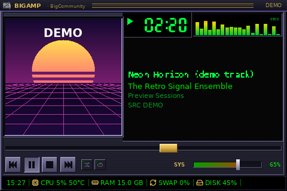 | 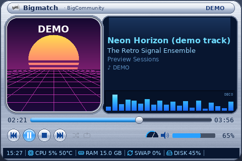 | 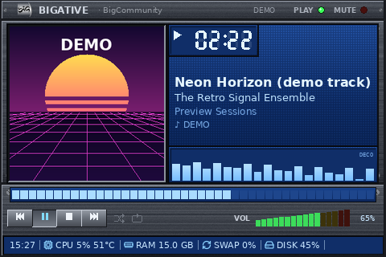 |
| **Bigamp** | **Bigmatch** | **Bigative** |
| 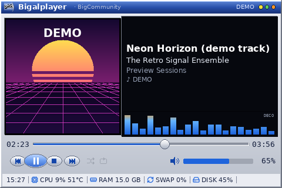 | 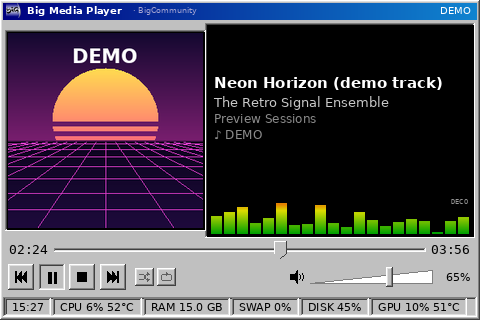 | 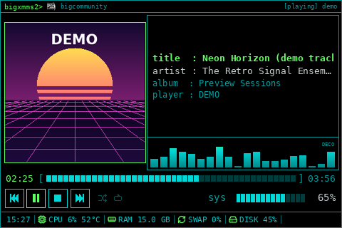 |
| **Bigalplayer** | **Big Media Player** | **BigXMMS2** |
| 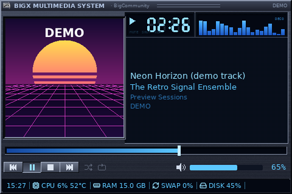 | 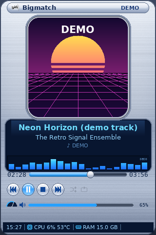 | 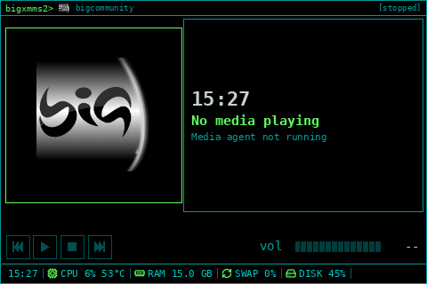 |
| **BIGX Multimedia System** | retrato 320×480 | sem reprodução |

As imagens usam os dados de demonstração da prévia (marcados **DEMO**).

### Modern Collection (4.4)

| | | | |
| --- | --- | --- | --- |
| 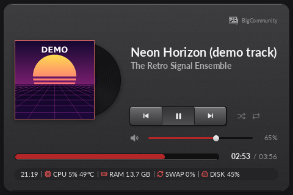 | 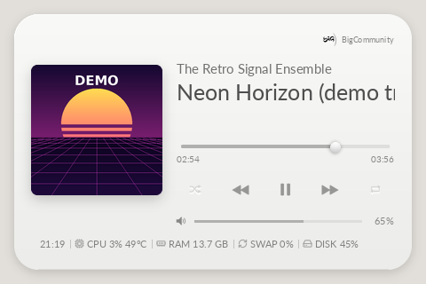 | 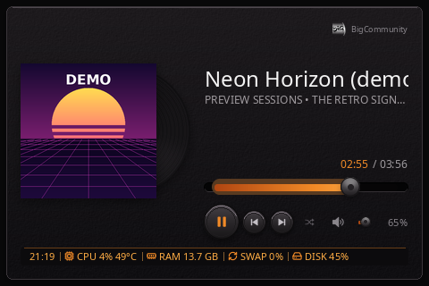 | 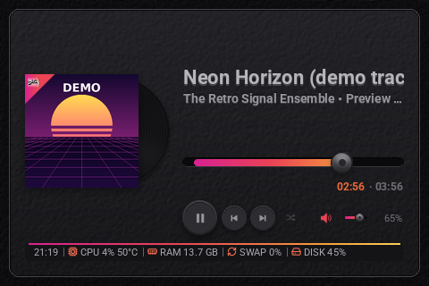 |
| **Big Vinyl** | **Big Pure** | **Big Ember** | **Big Groove** |
| 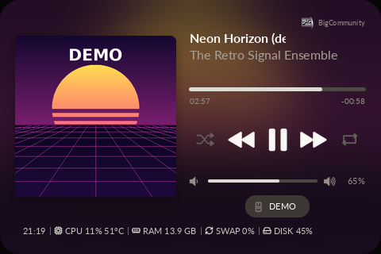 | 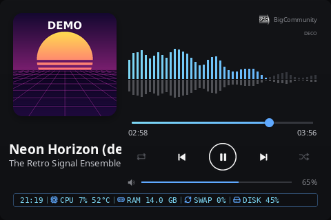 | 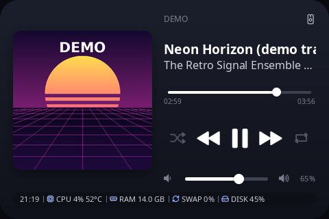 | 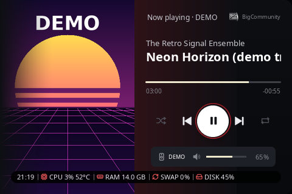 |
| **Big Lounge** | **Big Wave** | **Big Flow** | **Big Stage** |

Galeria com filtro **Todas · Clássicas · Modernas** e grupo **Coleção Moderna**
(cores da capa, destaque, tons do Pure, cantos, sombras, textura, disco, fonte):

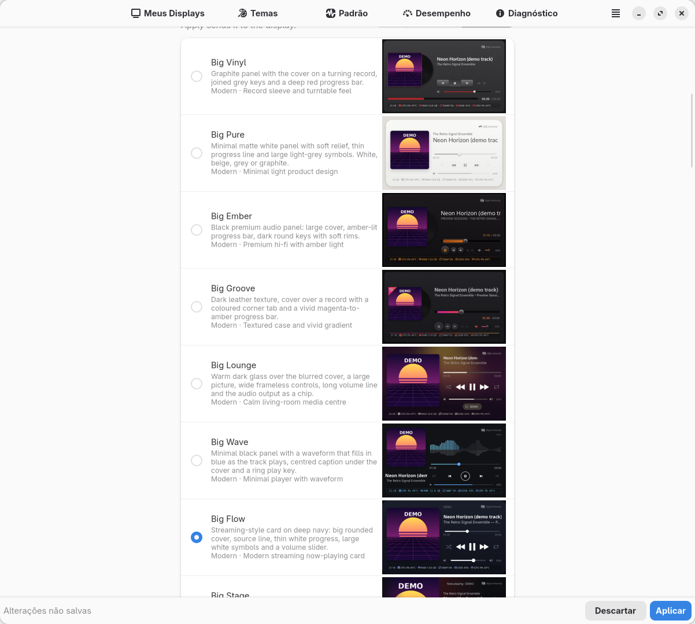

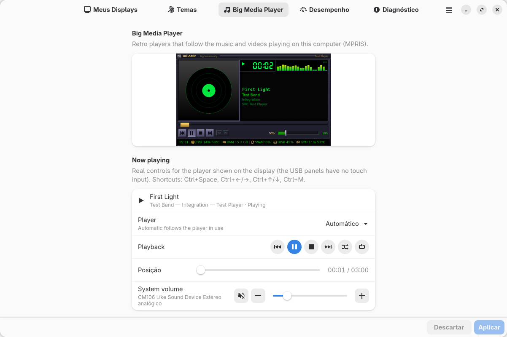

**Aplicativos**: qualquer um que publique `org.mpris.MediaPlayer2.*` — Spotify,
VLC, Rhythmbox, Elisa, Clementine, Strawberry, Audacious, Amarok, Lollypop, mpv
(com `mpv-mpris`), Firefox e Chrome/Chromium (sessões de mídia, como YouTube).
A miniatura de vídeo depende de o site fornecê-la.

**Requisitos**: sessão gráfica com D-Bus; para o volume, `pactl` (PipeWire com
`pipewire-pulse` ou PulseAudio), ou `wpctl`, ou `amixer`. O agente de mídia
inicia com a sessão (`/etc/xdg/autostart/big-screen-monitor-media.desktop`) e
fica dormente (sem consumir MPRIS nem áudio) quando nenhum display usa o tema,
acordando sozinho quando o tema volta a ser usado. O mpv precisa do plugin
`mpv-mpris` para aparecer.

**Escolher o player**: *Automático* (recomendado) mantém o que está tocando e
não deixa uma aba com um som curto roubar o display; *Último utilizado*; ou um
player fixo. Também dá para ignorar aplicativos e escolher um player
manualmente em *Tocando agora*.

**Volume**: por padrão, a saída padrão do sistema (acompanha teclado, Plasma,
GNOME e troca de saída para fone). Passo, máximo seguro (até 150 %) e uma
saída específica são configuráveis; o volume próprio do aplicativo é opcional e
rotulado `APP`.

**Telemetria**: aba → *Telemetria*: modo (oculto, sempre, intermitente,
alternado, só pausado, ocioso, alertas, automático), posição (rodapé, topo,
sobre a capa) e itens.

**Atalhos de teclado** (configure no KDE/GNOME):
`big-screen-monitor-display.sh --media play_pause` · `next` · `previous` ·
`volume_up` · `volume_down` · `mute` · `volume_set --value 35`.

Documentação: [visão geral](docs/big-media-player-overview.md) ·
[arquitetura](docs/big-media-player-architecture.md) ·
[MPRIS](docs/big-media-player-mpris.md) · [volume](docs/big-media-player-volume.md) ·
[skins e como criar uma](docs/big-media-player-skins.md) ·
[configurações](docs/big-media-player-settings.md) ·
[telemetria](docs/big-media-player-telemetry.md) ·
[desempenho](docs/big-media-player-performance.md) ·
[testes](docs/big-media-player-testing.md) ·
[relatório final](docs/big-media-player-final-report.md).

**Limitações**: sem toque nos displays (controle pela janela/atalhos); MPRIS
não transporta áudio, então o visualizador padrão é decorativo (rotulado
`DECO`) e o espectro real (`FFT`) exige escolha explícita e `parec`; com
`wpctl`/ALSA o volume é lido a cada 2 s; não há descrição universal no MPRIS.

<a id="kojiro"></a>

## 🖼️ Kojiro — papel de parede e painel de hardware

Qualquer imagem vira um painel de hardware: o papel de parede fica embaixo e cada indicador é uma camada independente que você coloca onde quiser.

<p align="center">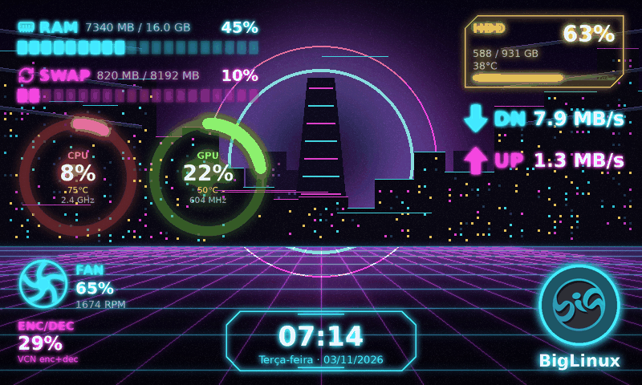</p>

<p align="center">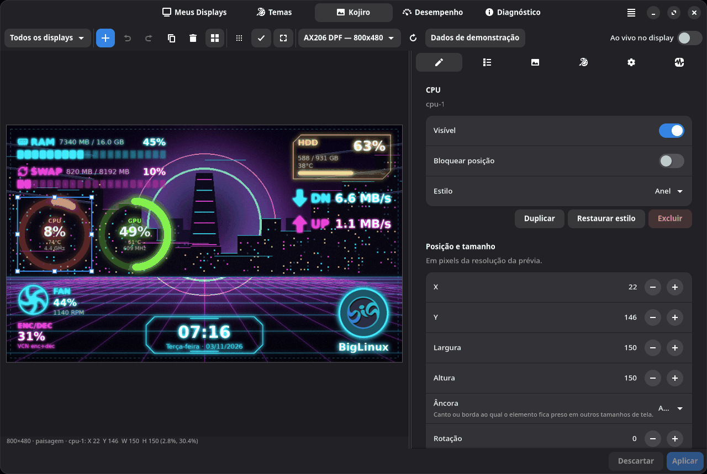<br/><sub>Kojiro Design Studio: a prévia é a saída real do display; arraste, redimensione e ajuste cada elemento</sub></p>

| | | |
| --- | --- | --- |
| 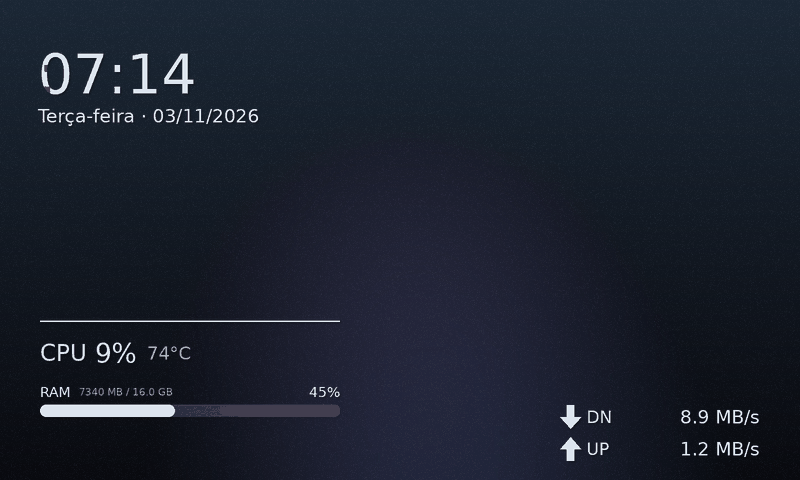 | 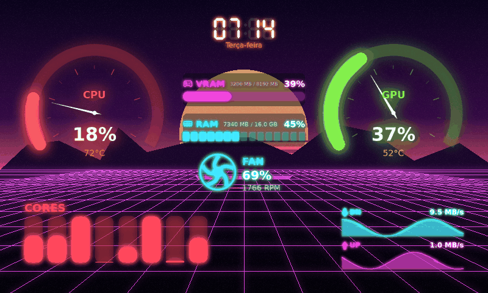 | 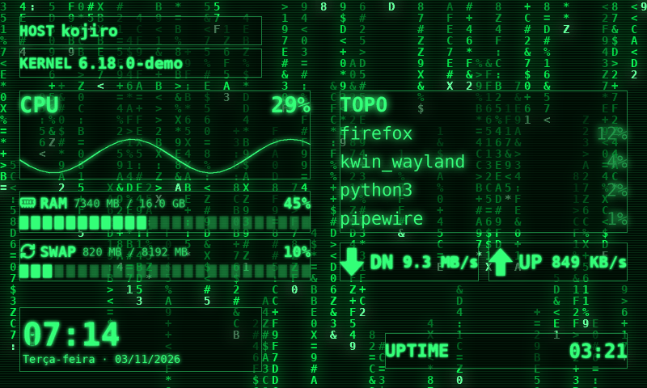 |
| 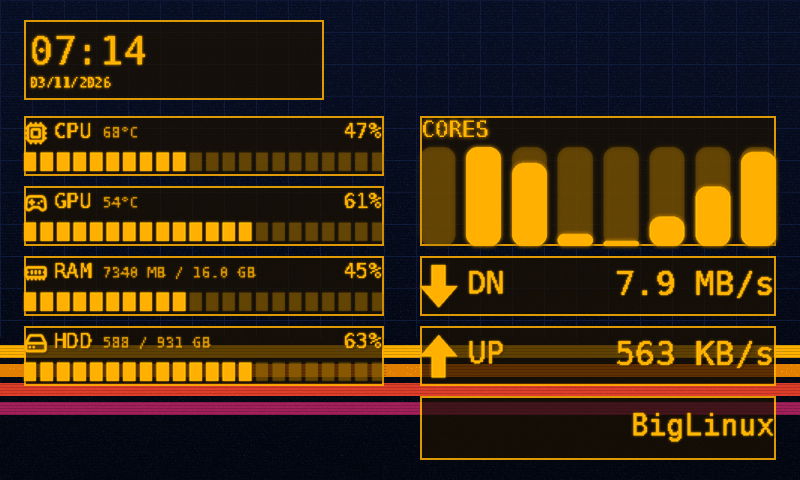 | 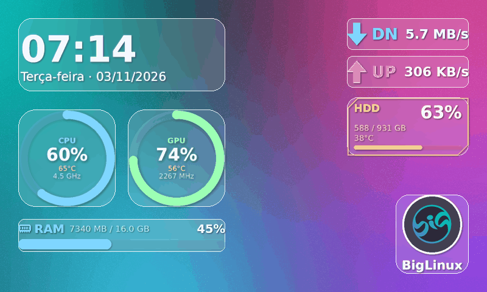 | 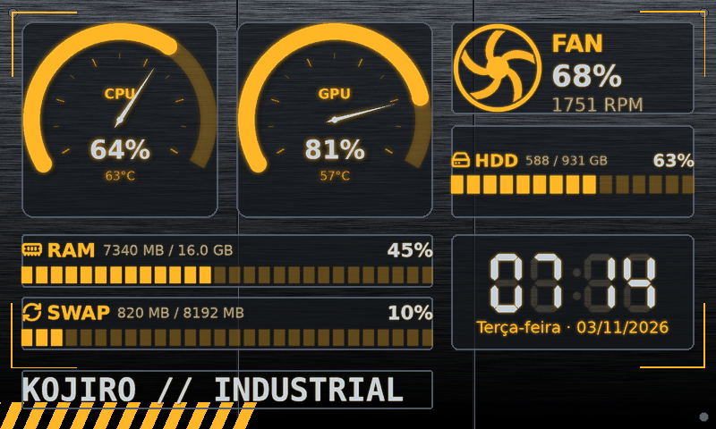 |

- **Papéis de parede**: 8 artes originais geradas pelo próprio aplicativo, suas imagens (PNG, JPEG, WebP, BMP, GIF, TIFF, SVG), cor ou degradê; preencher, ajustar, esticar, centralizar, repetir, zoom, deslocamento, rotação, espelho, brilho, contraste, saturação, gama, desfoque, escurecimento, sobreposição de cor, vinheta e degradê de proteção para textos. A imagem é importada com segurança — o arquivo original nunca é alterado.
- **Elementos**: CPU, GPU, RAM, SWAP, VRAM, ventoinha (girando conforme o RPM), codificação de vídeo, disco, download, upload, relógio, logotipo e nome da distribuição, núcleos, processos, tempo ligado, nome do computador, kernel, IP local, bateria, perfil de energia, texto, separadores e molduras — cada um com estilos próprios, cores, brilho neon, fonte, painel, vidro fosco, alertas e intervalo de atualização.
- **Dados reais e honestos**: o que o hardware não informa aparece como "—" (ou some); a % da ventoinha só vem do PWM; limites de temperatura vêm do chip quando ele informa.
- **Responsivo**: âncoras mantêm cada elemento no seu canto em qualquer resolução; layout retrato automático; telas minúsculas mostram linhas legíveis; círculos nunca ficam ovais.
- **Leve**: 1,5% de CPU com conteúdo estático e 7,5% com animações no AX206 800×480; memória estável.

Detalhes: [visão geral](docs/kojiro-overview.md) · [editor](docs/kojiro-editor.md) · [elementos e como criar novos](docs/kojiro-widget-system.md) · [papéis de parede](docs/kojiro-wallpapers.md) · [formato das configurações](docs/kojiro-configuration.md).

---

<a id="brother-away"></a>

## 🏝️ Brother Away — O Náufrago Perplecto!

Um náufrago com opinião sobre tudo, morando na ilha que existe dentro do seu display. Ele dorme, pesca, constrói uma jangada, conversa com o coqueiro, foge de tubarões, discursa para extraterrestres e filosofa com o horizonte — enquanto, no canto, o relógio e os indicadores de **CPU, RAM, disco e GPU** continuam mostrando o estado real da máquina.

<table>
<tr>
<td align="center">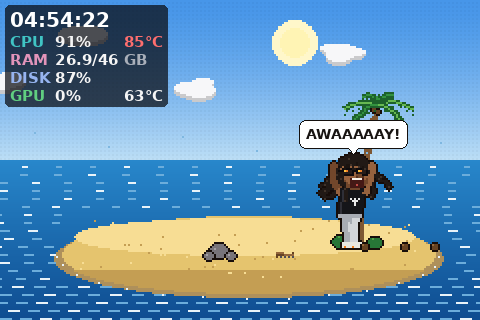<br/><b>O coqueiro revoltado</b><br/><sub>três cocos depois… "AWAAAAAY!"</sub></td>
<td align="center">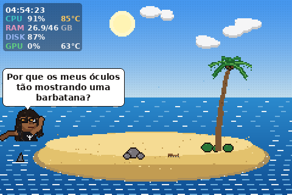<br/><b>O tubarão debochado</b><br/><sub>a barbatana aparece no reflexo dos óculos</sub></td>
<td align="center">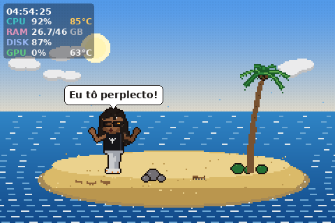<br/><b>A jangada impossível</b><br/><sub>dias de construção, uma ondinha… "Eu tô perplecto!"</sub></td>
</tr>
<tr>
<td align="center">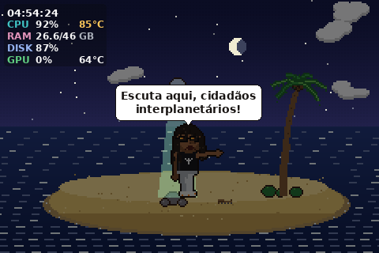<br/><b>O encontro extraterrestre</b><br/><sub>de madrugada, um discurso sobre a humanidade</sub></td>
<td align="center">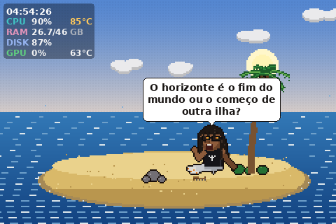<br/><b>O coqueiro filósofo</b><br/><sub>"Tu tá entendendo o que eu tô falando, morô?"</sub></td>
<td align="center">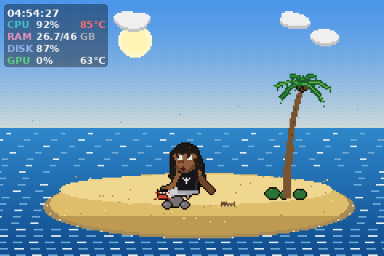<br/><b>O caranguejo e os óculos</b><br/><sub>sem óculos ele vê "realidade demais"</sub></td>
</tr>
</table>

**Mais histórias:** a gaivota que rouba o almoço · a mensagem na garrafa · a sereia que foge das reclamações · o navio que passa enquanto ele dorme · o tesouro · a noite de estrelas · a reclamação da chuva · o peixe que devolve a isca. Entre elas, ele passeia, cochila sob o coqueiro, pesca, nada, dança, sobe no coqueiro (e cai), senta na fogueira à noite e dá "Bom dia, ilha!".

<table>
<tr>
<td align="center">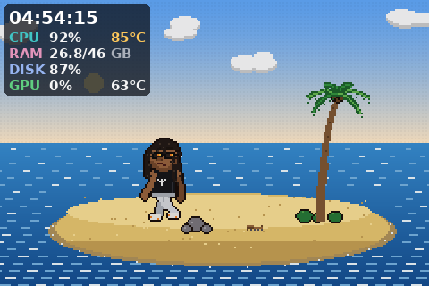<br/><sub>Manhã</sub></td>
<td align="center">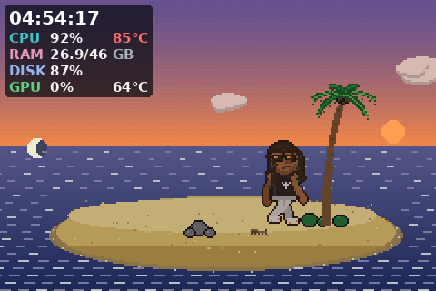<br/><sub>Pôr do sol</sub></td>
<td align="center">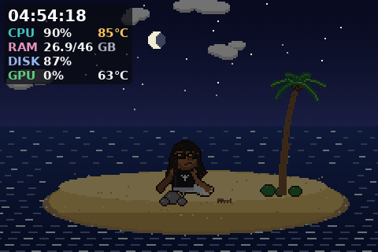<br/><sub>Noite (lua na fase real)</sub></td>
<td align="center">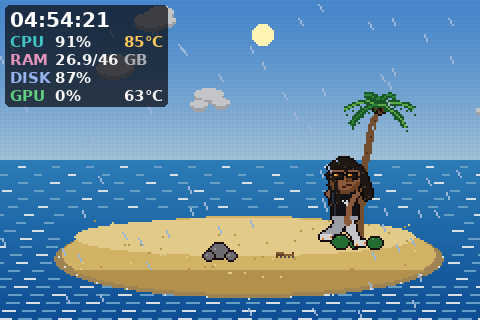<br/><sub>Chuva</sub></td>
</tr>
</table>

| Recurso | Detalhes |
| --- | --- |
| 🌅 **Dia e noite** | segue o relógio do computador: madrugada, amanhecer, manhã, meio-dia, tarde, pôr do sol, anoitecer, noite; sol em arco, lua com a fase real |
| 🌦️ **Clima simulado** | céu limpo, ventania, chuva, tempestade com relâmpagos, mar agitado, neblina e arco-íris — sem nenhum serviço externo |
| 🧩 **Continuidade** | a jangada cresce entre sessões e as recordações (garrafa, baú) ficam na ilha |
| 📊 **Painel de telemetria** | relógio, CPU % e °C, RAM usada/total, DISK %, GPU % e °C; canto, tamanho, opacidade e sensores configuráveis; encolhe durante as histórias (nunca some) |
| 🔥 **Reage ao computador** | CPU alta → sol ardendo e ele se abana · temperatura alta → vai para a sombra · RAM cheia → caixas acumulam · disco lotado → baú transbordando · GPU ocupada → vulcão no horizonte |
| 💬 **Humor** | Familiar, Clássico ou Debochado; bordões ("AWAAAAAY!", "perplecto", "morô?") podem ser desligados |
| 🔊 **Som opcional** | efeitos retrô sintetizados, tocados pelo computador (o display não tem alto-falante); desligado por padrão |
| 🪫 **Modo estático** | desligue a animação: a ilha fica parada e só os dados são atualizados |

<details>
<summary><b>Retrato e telas maiores</b></summary>
<br/>
<p align="center">
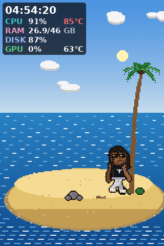
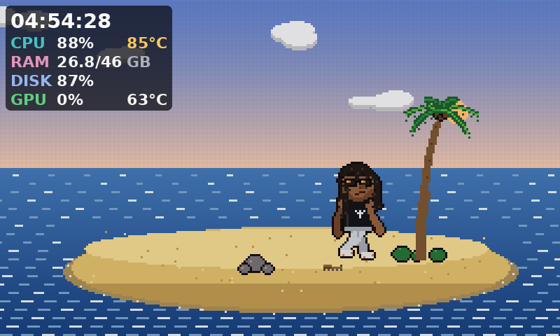
</p>
A arte é desenhada numa resolução lógica e ampliada por um fator inteiro (sem borrão): 320×240 e 480×320 usam ×2, 800×480 usa ×3.
</details>

**Como ativar:** abra *Big Screen Monitor Display* → **Temas** → *Brother Away — O Náufrago Perplecto!* → **Aplicar** (ou, na página **Brother Away**, "Usar este tema"). O display muda em até um segundo, sem reiniciar nada. Na prévia você pode assistir a qualquer história, mesmo sem o display conectado.

> Personagem, arte, histórias e falas são **originais** deste projeto, uma homenagem ao humor brasileiro e aos protetores de tela narrativos dos anos 90. Nenhum recurso de terceiros é usado. Veja [docs/07](docs/07-brother-away-design.md).

---

<a id="temas"></a>

## 🎨 Temas

Seis temas, todos na horizontal e na vertical, em qualquer resolução (o [Kojiro](#kojiro) tem seção própria acima). Depois de aplicado, cada tema ganha **uma aba própria** na janela de configuração, com todas as suas opções e uma prévia ao vivo — e só a aba do tema em uso aparece.

### Padrão

O antigo quarteto Escuro/Claro/Neon/Cyberpunk era o mesmo desenho com cores diferentes e tinha textos sobrepostos em várias resoluções. Agora é **um único tema** com um motor de layout que mede cada texto antes de desenhar: nomes longos ganham reticências, itens opcionais saem por prioridade e os tamanhos de fonte vêm do espaço real — nada se sobrepõe.

<table>
<tr>
<td align="center">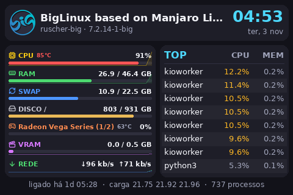<br/><sub>Escuro</sub></td>
<td align="center">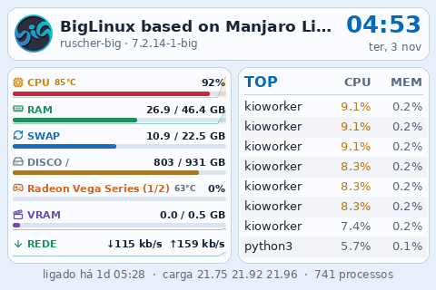<br/><sub>Claro</sub></td>
<td align="center">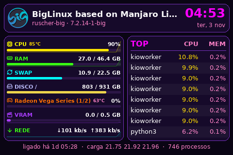<br/><sub>Neon</sub></td>
<td align="center">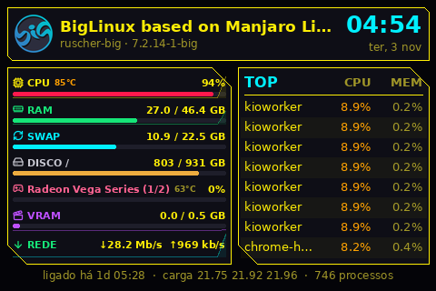<br/><sub>Cyberpunk</sub></td>
</tr>
<tr>
<td align="center">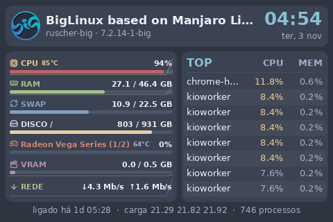<br/><sub>Nord</sub></td>
<td align="center">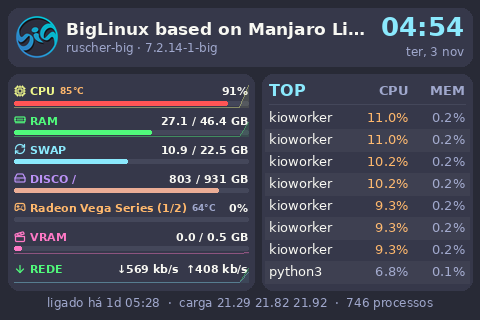<br/><sub>Dracula</sub></td>
<td align="center">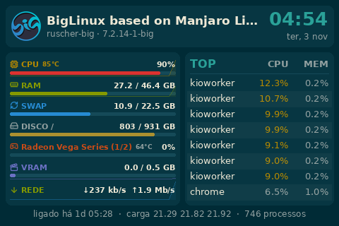<br/><sub>Solarized</sub></td>
<td align="center">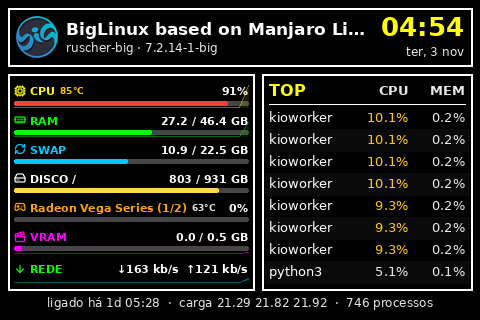<br/><sub>Alto contraste</sub></td>
</tr>
</table>

<details>
<summary><b>Opções do tema Padrão</b> (gráficos no painel lateral, barras segmentadas, retrato)</summary>
<br/>
<p align="center">
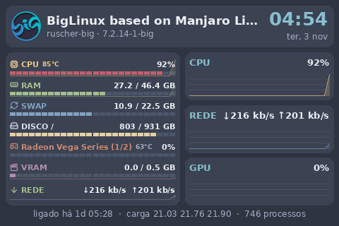
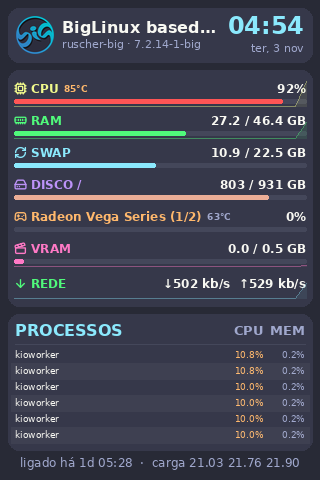
</p>

| Grupo | Opções |
| --- | --- |
| Aparência | 8 esquemas de cores · tamanho do texto · barras arredondadas, retas ou segmentadas · rótulos coloridos · cores de alerta (75%/90%) · histórico dos últimos 30 s ao fundo |
| Cabeçalho | mostrar/ocultar · logotipo da distribuição · host e kernel · data · relógio 24 h/12 h · segundos |
| Informações | CPU (uso e temperatura) · memória · swap · disco · GPU (uso e temperatura) · VRAM · rede · valores em usado/total ou % · °C/°F |
| Painel lateral | processos que mais consomem, gráficos (CPU, rede, GPU) ou nada · 5 a 12 processos · ordenar por CPU ou memória · rodapé com tempo ligado, carga, processos e perfil de energia |

Configurações antigas com Escuro, Claro, Neon ou Cyberpunk são migradas automaticamente para o Padrão com o mesmo esquema.
</details>

### GKrellM · Planet · Computador Antigo

<table>
<tr>
<td align="center" width="50%"><br/><b>GKrellM</b></td>
<td align="center" width="50%"><br/><b>Planet</b> · destaque âmbar</td>
</tr>
<tr>
<td align="center"><br/><b>GKrellM</b> · 480×320 com 4 partições</td>
<td align="center"><br/><b>GKrellM</b> · Clássico, retrato</td>
</tr>
<tr>
<td align="center"><br/><b>Computador Antigo</b> · Ardósia, 6 cartões</td>
<td align="center"><br/><b>Planet</b> · Sol e Lua nas posições reais</td>
</tr>
</table>

| Tema | O que mudou | Opções |
| --- | --- | --- |
| **GKrellM** | Reconstruído em módulos que medem a própria altura. O layout escolhe a maior fonte (até 9 px) em que **todos os módulos ligados** cabem, acrescentando colunas no modo automático e achatando os gráficos; só se nem assim couber, as listas de Discos e Sensores ficam mais curtas e os últimos módulos saem — nunca há sobreposição. Partições: `/`, `/home` e mídias montadas, com subvolumes btrfs distintos separados e `/boot` por último. Os módulos que antes **inventavam dados** (PPP/VLAN/inet0 desenhavam o gráfico da CPU, "sys" mostrava voltagens fixas) agora mostram interfaces, sensores e ventoinhas **reais** ou "indisponível". | estilo Urlicht/Clássico/Cyber-Red · colunas (auto, 1–4) · tamanho do texto · altura dos gráficos · partições listadas · 20 módulos (host, data, hora, tempo ligado, CPU, núcleos, processos e carga, temperaturas, E/S de disco, interface principal, outras interfaces, memória, swap, partições, GPU, bateria, ventoinhas e energia, Docker, mídias removíveis, reprodutor) |
| **Planet** | Sem sobreposição em telas pequenas e no retrato; RAM na ordem certa (usado/total); o texto fixo "SUNNY / WIND 3 / 22°C" e o "VOLUME 28%" **fictícios** viraram tempo ligado e uso do disco; "GPU CLOCK" mostra o clock real da GPU. | cor de destaque (azul, verde, âmbar, violeta, vermelho — a Terra mantém as cores reais) · lado noturno · luzes das cidades · trajetórias do Sol e da Lua · Lua · segundos |
| **Computador Antigo** | Não quebra mais em 240×320; sem textos sobrepostos em 320×240; cartões se adaptam à altura. | 4 paletas (Cinza clássico, Ardósia, Âmbar, Lilás) · barra de título · barra de status · segundos · cartões de GPU/VRAM · cartões de disco/swap |

---

## 🧭 Janela de configuração

<table>
<tr>
<td align="center"><br/><sub>Galeria de Temas: miniaturas do renderizador real</sub></td>
<td align="center"><br/><sub>Página de um tema: prévia grande e opções</sub></td>
</tr>
<tr>
<td align="center"><br/><sub>Página de um display: o que ele mostra, ajustes próprios e hardware</sub></td>
<td align="center"><br/><sub>Big Media Player: Tocando agora e as 15 skins</sub></td>
</tr>
<tr>
<td align="center"><br/><sub>Brother Away: a ilha e as 14 histórias</sub></td>
<td align="center"><br/><sub>Kojiro Design Studio</sub></td>
</tr>
</table>

| Seção | O que tem |
| --- | --- |
| **Início** | prévia do que o display mostra, nome, modelo, resolução, conexão, tema, estado e desempenho reais; ações rápidas; avisos com a próxima ação (primeiro uso, serviço parado, nenhum display, modelo a escolher, display sem resposta) |
| **Meus Displays** | um cartão por display; a página de cada um tem nome, uso, tema, orientação, brilho e desempenho próprios (ou "igual ao padrão"), modelo/protocolo, dados do hardware, sensores e testes (identificar, padrões, reconectar); abaixo, os padrões para todos os displays |
| **Galeria de Temas** | os 7 temas em cartões, busca (Ctrl+F); cada tema abre com prévia grande, ampliação e todas as opções |
| **Kojiro Design Studio** | o editor visual: canvas, camadas, inspetor, predefinições, ao vivo |
| **Big Media Player** | Tocando agora (MPRIS real e volume do sistema), galeria das 15 skins com filtro Clássicas/Modernas, página *Personalizar* com todas as opções |
| **Brother Away** | prévia da ilha, as 14 histórias para assistir na prévia, animação, humor, som e telemetria |
| **Desempenho** | perfis com o efeito de cada um e as medições do serviço |
| **Diagnóstico** | estado, *Diagnosticar*, recuperar, reiniciar, exportar relatório, eventos |
| **Preferências** | iniciar com o computador, estilo da janela, idioma, som ao aplicar, atalhos, restaurar padrões, sobre |

Cada alteração aparece na prévia na hora; a barra inferior mostra quantas
estão pendentes, com **Descartar** e **Aplicar** (Ctrl+S). Aplicar vale em até
1 s, sem reiniciar o serviço; operações administrativas continuam pedindo
autorização pelo Polkit. A janela segue o tema claro/escuro do sistema (ou o
escolhido em Preferências), funciona com teclado e leitor de tela e se adapta
a janelas estreitas.

---

<a id="instalacao"></a>

## 🔧 Instalação

### Arch Linux · BigLinux · Manjaro

```bash
git clone https://github.com/ruscher/big-screen-monitor-display.git
cd big-screen-monitor-display/pkgbuild
makepkg -si
```

A instalação:

1. cria o grupo `big-screen-monitor` (sysusers) e aplica as regras udev aos displays já conectados;
2. importa automaticamente suas configurações antigas (`~/.config/big-screen-monitor/settings.json`);
3. habilita e inicia o serviço.

Atualizações preservam as configurações e **respeitam o serviço desativado**.

Pelo AUR (qualquer Arch): `big-screen-monitor-display-git` — o PKGBUILD fica em [pkgbuild/aur](pkgbuild/aur/).

### openSUSE · Regata OS · Debian/Ubuntu · Fedora

```bash
git clone https://github.com/ruscher/big-screen-monitor-display.git
cd big-screen-monitor-display
./install-system.sh --print-deps   # mostra os pacotes deste sistema
sudo ./install-system.sh           # instala dependências, arquivos e o serviço
sudo ./uninstall-system.sh         # remove (as configurações ficam; --purge também as apaga)
```

Requer Python 3.10 ou mais novo. Detalhes, garantias e testes sem root em [docs/21-instalacao-manual](docs/21-instalacao-manual.md).

<a id="android"></a>

### 📱 App Android (celulares e tablets como display)

**Download direto do APK (sempre a versão mais nova):**

**[⬇️ big-screen-monitor-display.apk](https://github.com/ruscher/big-screen-monitor-display/releases/latest/download/big-screen-monitor-display.apk)**

1. Abra o link acima no navegador do celular (Android 5.0 ou mais novo) e toque no arquivo baixado. O Android pede para **permitir instalar apps de fontes desconhecidas** para o navegador — é normal fora de uma loja.
2. No computador, abra **Big Screen Monitor Display › Meus Displays › Celulares e tablets Android**, ligue **Conectar pela rede** e aplique.
3. Toque em **Adicionar Android…** e leia o QR Code com a câmera do celular (ou abra o app e toque em "Scan the code"). O celular vira mais um display. Também funciona pelo **cabo USB, sem depuração**.
4. **Longe de casa:** com o [Tailscale](https://tailscale.com) ligado no computador e no celular (mesma conta), o app conecta de qualquer lugar — dados móveis, outro Wi-Fi. Pareie uma vez em casa; o app aprende o endereço `100.x.y.z` sozinho (ou use *Add by address* com ele). Detalhes e firewall em [docs/android/04-conexao-rede.md](docs/android/04-conexao-rede.md#acesso-remoto-tailscale).

Outras versões, notas e o `SHA256SUMS` ficam nas [releases](https://github.com/ruscher/big-screen-monitor-display/releases). Desde a 5.5.2 o APK é assinado com a **chave oficial** do projeto (pacote `br.com.biglinux.bigscreen`) e as atualizações instalam por cima, mantendo o pareamento. Quem tem a versão de depuração da 5.5.1 ou anterior (`br.com.biglinux.bigscreen.debug`) instala a nova ao lado, pareia uma vez e desinstala a antiga. O app pede só permissões de rede. Compilar o APK, firewall e detalhes: [docs/android](docs/android/12-instalacao-e-apk.md).

### Dependências

| Tipo | Pacotes |
| --- | --- |
| Execução | `bash`, `python` ≥ 3.10, `python-pillow`, `python-numpy`, `python-psutil`, `python-pyusb`, `libusb`, `python-pyserial`, `pciutils`, `librsvg`, `fontconfig`, `systemd`, `polkit`, `openssl` (certificado para os displays Android) |
| Janela | `python-gobject`, `python-cairo`, `glib2` ≥ 2.80, `gtk4`, `libadwaita` ≥ 1.6 (1.7+ usa as abas compactas do Kojiro Studio), `hicolor-icon-theme` |
| Bandejas | `python-pyqt6` (PyQt5 também serve) |
| Opcionais | `openrgb` (cor dos LEDs dos coolers DeepCool), `lm_sensors` (sensores extras), `python-pystray` (ícone de bandeja em execução manual), `libcanberra` (som ao aplicar), `pipewire-audio` / `libpulse` / `alsa-utils` (efeitos sonoros e módulo de volume do GKrellM), `adwaita-fonts` (fonte do GKrellM), `playerctl` (módulo de mídia do GKrellM), `libpulse` (volume do Big Media Player via `pactl` e espectro real via `parec`), `wireplumber` (volume do Big Media Player sem `pactl`), `mpv-mpris` (mostrar o que o mpv toca no Big Media Player), `docker` (contagem de contêineres no GKrellM), `python-cryptography` (cabeçalho mais rápido nos Turing USB), `python-qrcode` (QR Code para adicionar celulares Android), `tailscale` (display Android longe de casa pela VPN), `noto-fonts-cjk` (chinês, japonês e coreano nos displays) |
| Build | `gettext`, `git` |

---

<a id="uso"></a>

## ⚙️ Uso

| Ação | Comando / caminho |
| --- | --- |
| Abrir a configuração | menu do sistema → *Big Screen Monitor Display* · `big-screen-monitor-config.sh` |
| Adicionar celular Android (QR Code) | `big-screen-monitor-config.sh --add-android` |
| Bandeja das telas | menu → *Big Screen Monitor Tray* · `big-screen-monitor-tray` |
| Bandeja dos coolers DeepCool | menu → *DeepCool Digital* · `big-screen-monitor-deepcool` |
| Estado do serviço | `systemctl status big-screen-monitor-display` (a linha **Status** diz o que está acontecendo) |
| Diagnóstico no terminal | `python3 /usr/share/big-screen-monitor-display/main.py --diagnose` |
| Relatório JSON | `python3 /usr/share/big-screen-monitor-display/main.py --status` |
| Logs | `journalctl -u big-screen-monitor-display -f` |
| Forçar reconexão | `sudo systemctl kill -s SIGUSR1 big-screen-monitor-display` |
| Displays detectados | `main.py --list-displays` (somente leitura; `--json` para detalhes) |
| Testar sem display | `main.py --simulate 480x320,160x80,480x480:round --snapshot /tmp/frame.png` |
| Medir desempenho | `main.py --benchmark --bench-sizes 160x80 480x320 800x480` |
| Gerar uma imagem de tema | `main.py --render planet --size 800x480 --out planet.png` |
| Controlar a mídia (atalhos) | `big-screen-monitor-display.sh --media play_pause` (também `next`, `previous`, `volume_up`, `mute`…) |
| Agente de mídia manual | `main.py --media-agent --verbose` (normalmente iniciado com a sessão) |
| Ver uma história em imagem | `main.py --render brother_away --scene shark --hour 11 --at 15 --out tubarao.png` |

Exemplo de `systemctl status`:

```text
● big-screen-monitor-display.service - Big Screen Monitor Display - USB LCD hardware monitor
     Active: active (running)
     Status: "healthy: AX206 DPF 800x480, theme brother_away, 8.0 fps"
     Memory: 72.6M (high: 256M, max: 384M)
```

### Arquivos

| Caminho | Conteúdo |
| --- | --- |
| `/etc/big-screen-monitor-display/settings.json` | configurações (fonte única, escrita pelo assistente Polkit; `settings.json.bak` = último arquivo válido) |
| `/etc/big-screen-monitor-display/wallpapers/` | papéis de parede importados para o Kojiro (PNG verificados) |
| `~/.local/share/big-screen-monitor-display/kojiro/presets/` | suas predefinições do Kojiro |
| `/run/big-screen-monitor-display/status.json` | relatório de saúde, atualizado a cada 2 s (campo `displays` com cada display) |
| `/run/big-screen-monitor-display/commands/` | fila de comandos por display (padrões de teste, reconectar), escrita só via assistente Polkit |
| `/var/lib/private/big-screen-monitor-display/` | histórico de incidentes e progresso do Brother Away |

---

<a id="detalhes-tecnicos"></a>

## 🔬 Detalhes técnicos

### Arquitetura

O diagrama mostra como o serviço se organiza por dentro: uma coleta de dados única alimenta uma sessão por display (cada uma com seu tema e seu transporte), e um supervisor só avisa o systemd que está tudo bem quando todas as partes estão realmente progredindo.


- **Uma sessão por display + supervisor.** Cada display tem threads de render e transporte, estado, backoff e incidentes próprios; só o seu transporte fala com o dispositivo; a coleta é única e nunca atrasa a animação. Drivers por família em `bsmd/displays/` ([docs/13](docs/13-arquitetura-drivers.md)).
- **Drivers de telemetria.** Coolers DeepCool e o SmartMonitor não recebem imagens prontas: o driver monta o próprio "quadro" (números, ou a imagem gravada mais os valores ao vivo). Operações longas, como gravar a imagem no SmartMonitor, também informam progresso ao supervisor e param junto com o serviço.
- **Mídia isolada do serviço.** O agente de mídia roda na sessão do usuário (onde estão o MPRIS e o áudio) e envia dados validados ao serviço por um socket local autenticado; o serviço continua sem acesso ao D-Bus da sessão.
- **Backpressure e coalescência.** O render nunca fica mais de um quadro à frente do transporte; um quadro não enviado é trocado pelo mais novo.
- **Progresso, não pixels.** Tela estática não é travamento: cada subsistema informa iterações concluídas e operações em andamento. Operação presa > 30 s, ausência de progresso ou thread morta suspendem o watchdog.
- **Recuperação progressiva:**

```text
HEALTHY ⇄ DEGRADED → RECOVERING → HEALTHY
                       ↓     ↑
               DISCONNECTED → RETRYING → FAILED → systemd reinicia
```

Erro transitório degrada; dois seguidos ou desconexão reabrem o driver, redetectam o dispositivo, reaplicam o brilho e mandam um quadro completo. Ausente: espera sondando a cada 2 s. Presente mas mudo: backoff 1→30 s, reset USB **somente** do próprio display na 4ª tentativa, e após 8 falhas o processo sai para o systemd reiniciar (atraso de 5 s a 5 min).

### systemd

```ini
Type=notify · WatchdogSec=30 · Restart=on-failure · RestartSteps=6 · RestartMaxDelaySec=300
DynamicUser=yes · SupplementaryGroups=big-screen-monitor · DevicePolicy=closed
ProtectSystem=strict · ProtectHome=read-only · CapabilityBoundingSet= · SystemCallFilter=@system-service
RestrictAddressFamilies=AF_UNIX AF_NETLINK · NoNewPrivileges=yes
Nice=10 · CPUWeight=20 · IOSchedulingClass=idle · MemoryMax=320M
```

`ProtectHome=read-only` (o padrão do systemd para `DynamicUser`) deixa as montagens do `/home` visíveis para a lista de partições e os elementos de disco, sem permitir escrita. Sem sockets de rede, as interfaces são lidas do `/sys/class/net`.

Sinais: `SIGTERM` encerra mostrando "Monitoramento parado" (em vez de uma imagem congelada), `SIGUSR1` reconecta, `SIGHUP` recarrega as configurações.

### Segurança

| | 3.x | 4.0 em diante |
| --- | --- | --- |
| Usuário do serviço | root | usuário dinâmico sem privilégios |
| Acesso ao display | udev `0666` (qualquer processo) | `0660` + grupo do serviço + `uaccess`, só nos IDs/seriais dos displays e coolers suportados (no SmartMonitor, só o `hidraw` de `0483:0065`) |
| Dispositivos desconhecidos | — | nunca recebem comandos; só os identificadores USB são lidos |
| Mídia (MPRIS, áudio) | — | agente na sessão do usuário, socket local autenticado, dados validados |
| Operações administrativas | sudoers `NOPASSWD` | Polkit + `bsm-helper` com verbos fixos e JSON validado; alterações visuais sem senha para o usuário local ativo, controle do serviço só com administrador |
| Imagens do usuário | — | decodificadas só sem privilégios; o root confere apenas a estrutura PNG |
| Configurações | primeiro `/home/*` encontrado | `/etc/…/settings.json`, validado e gravado atomicamente |

### Desempenho (medido na AX206 800×480)

| | 3.x | 4.0 |
| --- | --- | --- |
| CPU, tema de painel (Escuro) | 49,6% | 3,2–3,5% |
| CPU, Brother Away 8 fps | — | 5,1% |
| Conversão RGB565 + diff | 110 ms | ~2 ms |
| Coleta de telemetria | 131 ms a cada 0,4 s | 2,9 ms a cada 1 s |
| Envio | quadro inteiro (768 KB, 115 ms) | só o que mudou (canto: ~4 ms) |
| Volta após desconexão | nunca | 1,1–2,1 s |

**Perfis de desempenho:**

| Perfil | Temas animados (Brother Away, Kojiro animado) | Temas de painel (Padrão, GKrellM, Planet, Computador Antigo) | Kojiro estático | Coleta de telemetria |
| --- | --- | --- | --- | --- |
| Econômico | até 4 fps | 1 desenho/s | 1/s | a cada 2 s |
| Automático | até 8 fps, adaptativo | 2/s | 1/s | a cada 1 s |
| Equilibrado | até 8 fps | 2/s | 1/s | a cada 1 s |
| Fluido | até 15 fps | 4/s | 2/s | a cada 0,5 s |

O Automático limita os temas animados a 8 fps (as poses são desenhadas "em dois"), reduz para manter o pipeline abaixo de 60% de ocupação, respeita o limite de cada transporte lento e cai para 4 fps na bateria. Os desenhos dos temas de painel são alinhados ao relógio, então os segundos nunca atrasam. Com vários displays, vale o perfil mais rápido entre eles para a coleta.

**Displays seriais lentos (Turing rev. A, ~190 KB/s):** uma tela cheia de 480×320 leva ~1,6 s, por isso só os pixels que mudaram são enviados (retângulos recortados ao pixel). Medido no GKrellM 480×320: 23 KB e ~125 ms por atualização (antes 66 KB e ~360 ms).

### Traduções

Textos marcados com gettext (`locale/big-screen-monitor-display.pot`, 1731 mensagens) e traduzidos em 28 idiomas em `locale/*.po`, compilados no PKGBUILD. Depois de mudar um texto, rode `tools/update-pot.sh`; os testes falham se o `.pot` não acompanhar o código ou se algum catálogo tiver mensagem sem tradução. Como as traduções são feitas e revisadas: [docs/i18n.md](docs/i18n.md).

---

<a id="problemas"></a>

## 🩺 Solução de problemas

| Sintoma | O que fazer |
| --- | --- |
| Display apagado ou parado | Janela → **Diagnóstico** → *Diagnosticar meu display*. *Recuperar o display agora* reconecta sem reiniciar o serviço. |
| "Display não encontrado" | Confira o cabo, troque de porta, evite hubs sem fonte. `error -71` em `journalctl -k` indica problema elétrico (cabo, porta ou alimentação). |
| Display "aguardando a escolha do modelo" | O identificador USB é compartilhado (ex.: `1a86:5722` sem número de série conhecido) ou o dispositivo serial não é reconhecido. Em **Meus Displays**, escolha o modelo e pressione *Aplicar*. |
| Display atribuído manualmente dá "permissão" | Só os IDs da tabela recebem acesso pelo udev. Crie uma regra local para aquele dispositivo (veja [docs/14](docs/14-deteccao.md)). |
| "Dispositivo ocupado" | Outro programa usa o display (por exemplo, `main.py` aberto manualmente). Feche-o. |
| Cooler DeepCool "ocupado" ou piscando | Outro programa DeepCool (`deepcool-digital-linux`, `deepcool-digital-info`, …) controla o cooler. A página do cooler → *Diagnóstico* lista o que foi encontrado e o comando para desativar; o Big Screen Monitor nunca para serviços de terceiros sozinho. |
| Potência da CPU indisponível no cooler | O contador RAPL só é legível pelo grupo do serviço depois da regra udev do pacote: reinstale o pacote ou rode `sudo udevadm trigger --subsystem-match=powercap --action=change`. Sem RAPL/zenergy (algumas VMs), a potência fica indisponível — nunca 0 W. |
| Aviso de permissões | Uma regra udev local em `/etc/udev/rules.d/` pode estar sobrepondo a do pacote (por exemplo, `MODE="0666"`). Remova-a e reconecte o display. |
| Serviço sem watchdog/isolamento | Há uma cópia antiga em `/etc/systemd/system/big-screen-monitor-display.service`; remova-a e rode `sudo systemctl daemon-reload`. O diagnóstico avisa. |
| Quero gastar menos | **Desempenho → Econômico**, ou desligue a animação do Brother Away. |
| GKrellM com letras pequenas ou listas encurtadas | Há mais módulos ligados do que cabem na tela. Desligue módulos que não usa na aba **GKrellM**, reduza "Partições listadas" ou use colunas automáticas. |
| Partição do `/home` não aparece | Confira se o serviço usa o arquivo do pacote: `systemctl show -p ProtectHome big-screen-monitor-display` deve dizer `read-only`. Uma cópia antiga em `/etc/systemd/system/` sobrepõe o pacote (veja acima). |
| Rede ou E/S de disco parados | `main.py --status`: o campo `sensor_errors` deve estar vazio. Desde a 4.2.1 as interfaces são lidas do `/sys`; atualize o pacote. |
| Prévia da janela diferente do display | A janela foi aberta antes de uma atualização: feche e abra de novo. |
| Big Media Player: "Agente de mídia não está rodando" | Aba **Big Media Player → Diagnóstico → Iniciar**; confira se o tema está aplicado (o agente sai quando nenhum display o usa). |
| Big Media Player: player não aparece | O aplicativo precisa publicar MPRIS. Firefox: `media.hardwaremediakeys.enabled` ligado. Veja a lista em *Diagnóstico → Players MPRIS*. |
| Big Media Player: display mostra outro player | Use *Player* em *Tocando agora*, ou *Reprodução → Player mostrado → Sempre o mesmo* / *Aplicativos ignorados*. |
| Big Media Player: YouTube/mpv sumiram depois de trocar de tema | Atualize o pacote: desde a versão atual o agente de mídia fica dormente e acorda sozinho. No mpv, instale `mpv-mpris`. |
| SmartMonitor mostra o tema antigo por alguns segundos | Normal: a nova imagem leva de 10 a 15 s para ser gravada no painel; os valores continuam ao vivo enquanto isso. |
| SmartMonitor parado depois de reiniciar o PC | O firmware do painel deixa de aceitar dados depois de um reset de USB e só volta sem energia; no reinício a BIOS o configura e o kernel o reseta, e a placa-mãe mantém o USB energizado. A janela pede para **desconectar e conectar o cabo** e o serviço continua sozinho (sem reinícios em loop). Na **suspensão** o painel é protegido automaticamente (`big-screen-monitor-display-sleep`). Detalhes em [docs/smartmonitor-usb-reset](docs/smartmonitor-usb-reset.md). |
| SmartMonitor some do USB por ~4 s ao trocar de tema | Normal: o firmware só carrega um tema novo reiniciando. Para não reiniciar a cada ajuste, a imagem nova só é gravada quando as opções ficam 4 s sem mudar. |
| Ventoinha sem valor no Kojiro | O chip de sensores da placa-mãe precisa do driver certo. Rode `sudo sensors-detect` (pacote `lm_sensors`) ou carregue o módulo indicado (muitas placas ASRock/ASUS usam `nct6775`: `echo nct6775 \| sudo tee /etc/modules-load.d/nct6775.conf`). No modo automático a ventoinha da CPU/placa-mãe tem prioridade sobre a da placa de vídeo. |
| SmartMonitor: planeta do tema Planet parado | O planeta é desenhado na hora real e gira com uma nova imagem gravada no intervalo de **Meus Displays → SmartMonitor → Planet: posição do planeta** (30 min, 1 h ou 3 h; o painel reinicia ~17 s a cada vez). |
| SmartMonitor: gráficos do Padrão sem as linhas | O painel só recebe números: com *Painel lateral → Gráficos*, CPU, rede e GPU aparecem ao vivo, mas as linhas de histórico ficam de fora (nunca congeladas). O mesmo vale para os gráficos do GKrellM. |
| SmartMonitor sem a lista de processos no tema Padrão | O painel só recebe números ao vivo, então a lista não pode ser atualizada em tempo real. Em **Meus Displays → SmartMonitor → Padrão: lista de processos**, ligue a opção: a lista entra como uma foto gravada com o tema e renovada a cada 30 min (o painel reinicia ~17 s a cada vez e a memória dele se desgasta com o uso). |
| SmartMonitor sem algum dado do tema | O firmware tem um limite de elementos ao vivo; o que não cabe é removido (nunca congelado). Desligue itens que não usa nas opções do tema para liberar espaço. |
| Big Media Player: volume indisponível | Instale `libpulse` (`pactl`) ou `wireplumber` (`wpctl`); o diagnóstico mostra o sistema de áudio detectado. |
| Pedir ajuda | **Diagnóstico → Exportar diagnóstico** gera um relatório com o estado e os logs. |

---

## 🧪 Desenvolvimento

```bash
python3 -m pytest -q tests                                  # 1409 testes, sem hardware (os de D-Bus usam um barramento privado)
./tools/make_screenshots.sh                                 # regenera docs/images
python3 usr/share/big-screen-monitor-display/main.py --simulate 480x320 --snapshot /tmp/f.png
BSM_CONFIG=/tmp/s.json python3 usr/share/big-screen-monitor-display/config_gui.py
```

Os testes cobrem configurações, conversão e retângulos, todos os temas em 10 resoluções nas duas orientações e em tela redonda, os bytes de cada protocolo comparados com a referência, o layout do GKrellM (todos os módulos e partições em 480×320, listas encurtadas sem sobreposição), partições btrfs dentro do isolamento do serviço, perfis de desempenho, retângulos recortados ao pixel, detecção e níveis de confiança, vários displays com hot-plug e falha isolada, drivers com USB/serial falsos, máquina de estados, pipeline com falhas injetadas (desconexão, timeout, travamento, falha persistente), assistente Polkit, as 14 histórias do Brother Away e um dia simulado, os protocolos e presets dos coolers DeepCool, a captura dos temas para o SmartMonitor, o agente de mídia (MPRIS, volume, dormência) e a identidade da sessão. A CI roda em `.github/workflows/tests.yml`.

### Estrutura

```text
usr/share/big-screen-monitor-display/
├── main.py              ponto de entrada (serviço, --render, --diagnose, --status, --simulate, --list-displays, --benchmark)
├── config_gui.py        janela GTK4/libadwaita
├── displays_page.py     página "Meus Displays"
├── kojiro_page.py       aba Kojiro (barra de ferramentas e inspetor)
├── kojiro_editor.py     Kojiro Design Studio (estado, desfazer/refazer, canvas Cairo)
├── media_player_page.py página Big Media Player (Tocando agora, skins, personalizar)
├── gui/                 páginas e componentes da janela (Início, temas, Brother Away, DeepCool, SmartMonitor, preferências)
└── bsmd/
    ├── runtime.py       descoberta, sessões por display, supervisor, recuperação
    ├── health.py        heartbeats, máquina de estados, backoff, incidentes
    ├── displays/        drivers por família, registro, descoberta, transporte serial, simulador
    │   ├── deepcool/    coolers DeepCool Digital (HID, MYSTIQUE, presets)
    │   └── smartmonitor/ SmartMonitor HID: protocolo, imagem gravada, captura dos temas
    ├── media/           agente de mídia, MPRIS, volume, espectro, hub e socket local
    ├── bigmedia/        tema Big Media Player: skins clássicas e modernas
    ├── kojiro/          tema Kojiro: modelo, layout, dados, desenho, elementos, papéis de parede, armazenamento, motor
    ├── drivers.py       compatibilidade com a API antiga
    ├── compact.py       layout para telas minúsculas
    ├── patterns.py      padrões de teste
    ├── benchmark.py     --benchmark
    ├── frames.py        RGB565, retângulos alterados, caixa de correio
    ├── telemetry.py     coletores
    ├── settings.py      esquema, validação, gravação atômica, migração
    ├── themes.py        registro de temas
    ├── dashboard.py     tema Padrão (8 esquemas de cores)
    ├── gkrellm.py       tema GKrellM em módulos
    ├── legacy_themes.py Planet, Computador Antigo e utilitários compartilhados
    ├── diagnostics.py   "Diagnosticar meu display"
    ├── sound.py         efeitos sonoros opcionais
    └── brother_away/    personagem, mundo, poses, narrativa, histórias, falas, overlay
usr/lib/big-screen-monitor-display/bsm-helper    assistente Polkit
usr/lib/{systemd,udev,sysusers.d} · usr/share/polkit-1    integração com o sistema
locale/ · pkgbuild/ · tests/ · tools/ · docs/
```

### Documentação técnica

| | |
| --- | --- |
| [01 · Auditoria técnica](docs/01-auditoria-tecnica.md) | [06 · Arquitetura de temas](docs/06-arquitetura-temas.md) |
| [02 · Análise dos travamentos](docs/02-analise-travamentos.md) | [07 · Brother Away: arte e personagem](docs/07-brother-away-design.md) |
| [03 · Watchdog e recuperação](docs/03-watchdog-recuperacao.md) | [08 · Brother Away: narrativa](docs/08-brother-away-narrativa.md) |
| [04 · Segurança e permissões](docs/04-seguranca-permissoes.md) | [09 · Testes e validação](docs/09-testes-validacao.md) |
| [05 · Desempenho](docs/05-performance-benchmarks.md) | [10 · Relatório final](docs/10-relatorio-final.md) |
| [11 · Compatibilidade de hardware](docs/11-compatibilidade-hardware.md) | [15 · Múltiplos displays](docs/15-multi-display.md) |
| [12 · Protocolos](docs/12-protocolos.md) | [16 · Benchmarks do Display Engine](docs/16-benchmarks.md) |
| [13 · Arquitetura dos drivers](docs/13-arquitetura-drivers.md) | [17 · Testes em hardware real](docs/17-testes-hardware.md) |
| [14 · Detecção universal](docs/14-deteccao.md) | [18 · Relatório do Universal Display Engine](docs/18-relatorio-universal-display-engine.md) |
| [Kojiro · visão geral](docs/kojiro-overview.md) | [Kojiro · configuração](docs/kojiro-configuration.md) |
| [Kojiro · arquitetura](docs/kojiro-architecture.md) | [Kojiro · predefinições](docs/kojiro-presets.md) |
| [Kojiro · papéis de parede](docs/kojiro-wallpapers.md) | [Kojiro · desempenho](docs/kojiro-performance.md) |
| [Kojiro · elementos](docs/kojiro-widget-system.md) | [Kojiro · testes](docs/kojiro-testing.md) |
| [Kojiro · editor](docs/kojiro-editor.md) | [Kojiro · relatório final](docs/kojiro-final-report.md) |
| [Big Media Player · visão geral](docs/big-media-player-overview.md) | [Big Media Player · arquitetura](docs/big-media-player-architecture.md) |
| [Big Media Player · MPRIS](docs/big-media-player-mpris.md) | [Big Media Player · volume](docs/big-media-player-volume.md) |
| [Big Media Player · skins](docs/big-media-player-skins.md) | [Big Media Player · configurações](docs/big-media-player-settings.md) |
| [Big Media Player · telemetria](docs/big-media-player-telemetry.md) | [Big Media Player · desempenho](docs/big-media-player-performance.md) |
| [Big Media Player · testes](docs/big-media-player-testing.md) | [Big Media Player · relatório final](docs/big-media-player-final-report.md) |
| [Modern Collection · skins e layouts](docs/big-media-player-modern.md) | [Modern Collection · configurações](docs/big-media-player-modern-settings.md) |
| [Modern Collection · desempenho, testes e relatório](docs/big-media-player-modern-report.md) | [Nome e logo da sessão ativa](docs/session-identity.md) |
| [DeepCool · auditoria](docs/deepcool/01-auditoria.md) | [DeepCool · arquitetura](docs/deepcool/02-arquitetura.md) |
| [DeepCool · protocolos](docs/deepcool/03-protocolos.md) | [DeepCool · implementação](docs/deepcool/04-implementacao.md) |
| [DeepCool · interface](docs/deepcool/05-interface.md) | [DeepCool · compatibilidade com temas](docs/deepcool/06-compatibilidade-temas.md) |
| [DeepCool · testes](docs/deepcool/07-testes.md) | [DeepCool · relatório final](docs/deepcool/08-relatorio-final.md) |
| [Janela · auditoria](docs/redesign/01-auditoria.md) | [Janela · design system](docs/redesign/02-design-system.md) |
| [Janela · arquitetura de UX](docs/redesign/03-arquitetura-ux.md) | [Janela · testes e benchmarks](docs/redesign/04-testes-benchmarks.md) |
| [Janela · relatório final](docs/redesign/05-relatorio-final.md) | |

---

## 📄 Licença

**GPL-3.0-or-later.** Código aberto para estudo, modificação e distribuição, fortalecendo a comunidade de software livre brasileira.

Os protocolos Turing, XuanFang, Kipye, WeAct e Turing USB foram estudados no projeto [turing-smart-screen-python](https://github.com/mathoudebine/turing-smart-screen-python) (Copyright © 2021 Matthieu Houdebine e colaboradores, GPL-3.0-or-later) e reimplementados aqui; o protocolo AX206 vem do [dpf-ax](https://github.com/dreamlayers/dpf-ax). Este projeto não é afiliado às marcas citadas.

## 👤 Desenvolvedor

**Rafael Ruscher** · Equipe BigLinux — [github.com/biglinux/big-screen-monitor-display](https://github.com/biglinux/big-screen-monitor-display)

## 🙏 Créditos

Agradecimento especial a quem colaborou com os testes:

- **Cristian Philipe** — cristianphilipe1234@hotmail.com
- **Reinaldo Nunes Rodrigues Junior** — reinaldodeuseamor8@gmail.com
- **Leandro Silva** — leandroruizbrabo@ig.com (colaboração nos testes do SmartMonitor 3,5")
