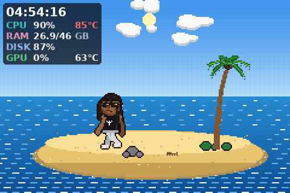
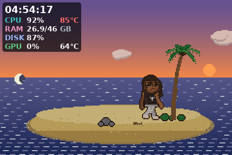
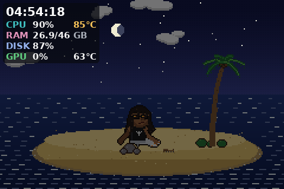

# 07 — Brother Away: direção de arte e personagem

## Conceito

Um náufrago brasileiro, teatral e questionador, numa ilhota tropical que vive
dentro do display: discute com o coqueiro, atribui intenções ao tubarão,
filosofa com o horizonte. Homenagem respeitosa ao humor brasileiro e à estética
dos protetores de tela narrativos dos anos 1990 — sem copiar nenhum deles.

## Pipeline de arte (100% original, gerado por código)

Não havia ferramenta de geração de imagens disponível, e nenhum recurso de
terceiros foi usado. Toda a arte é desenhada por código em
`bsmd/brother_away/`:

1. **Resolução lógica** escolhida por fator inteiro: `escala = round(min(L, A) / 160)`
   → 320×240 e 480×320 usam escala 2; 800×480 usa 3; 1024×600 usa 4.
2. Cena desenhada com primitivas **sem antialiasing** (Pillow), paleta limitada
   em `palette.py` (rampas de 3–4 tons, céu com *dithering* de faixas).
3. Personagem desenhado parte por parte numa camada RGBA e **contornado** por
   dilatação da máscara (1 px escuro), garantindo silhueta legível.
4. Ampliação **nearest-neighbor** para a resolução nativa.
5. HUD e balões desenhados **depois**, na resolução nativa, para texto nítido.

A arquitetura aceita substituir o boneco procedural por folhas de sprites
desenhadas por um artista: basta outra implementação de `Puppet.render(pose)`
devolvendo a camada RGBA com a mesma âncora.

## Character design

| Elemento | Implementação |
| --- | --- |
| Rosto | cabeça ampliada (leitura em pixels), pele marrom média e quente (`SKIN`, sombra e luz), nariz largo deslocado para o lado em que olha, sorriso assimétrico |
| Dreadlocks | 13 mechas simuladas como **cordas de Verlet** em coordenadas do mundo: atrasam no movimento, balançam na corrida, seguem o vento, **arrepiam no susto** (`fright`), espalham na areia quando deitado |
| Óculos | armação preta retangular, lentes escuras com reflexos dourado/laranja; o reflexo mostra a **barbatana do tubarão** na história 2 |
| Corpo | ombros largos, braços com cotovelo, gestos amplos |
| Roupa | regata preta com estampa branca original (sol sobre coqueiro), calça larga cinza-claro, tênis claros com detalhes laranja |
| Sem óculos | olhos aparecem (história do caranguejo); espiar por cima dos óculos indica "olhar para o espectador" |

Expressões (sobrancelhas acima dos óculos + boca): neutro, alegre, irônico,
furioso, indignado, perplecto, assustado, desconfiado, confuso, pensativo,
triste, gargalhando, além de grito e sono.

## Animação

Clipes em `poses.py` são funções do tempo, quantizadas "em dois" (8 desenhos
por segundo) para manter a sensação de quadro a quadro: respirar, sentar,
caminhar, correr, correr apavorado, apontar, cruzar os braços, coçar a cabeça,
ajustar os óculos, sacudir os dreads, conversar, gargalhar, reclamar, gritar,
dormir, acordar assustado, dançar, pescar, puxar a linha, nadar, construir,
carregar, subir no coqueiro, cair, levantar, abanar-se, olhar para trás, dar de
ombros, comemorar, empurrar, ler, discursar.

Princípios aplicados: **antecipação** (agachar antes do grito), **squash &
stretch** (corrida, pulo, susto), **follow-through** (dreads com física),
**timing cômico** (pausas de silêncio antes do "AWAAAAAY!") e silhuetas claras.

## A ilha

Céu com 9 quadros-chave de cor interpolados ao longo de 24 h (madrugada,
amanhecer, manhã, meio-dia, tarde, pôr do sol, anoitecer, noite), sol em arco,
lua com **fase real** calculada pela data, estrelas cintilando, nuvens em
camadas, mar com ondas e espuma na beira, ilha com areia molhada, pedras,
arbustos, coqueiro curvado com folhas que balançam, fogueira animada à noite,
jangada que cresce entre sessões e recordações persistentes.

Clima simulado (cadeia de Markov, sem serviço externo): céu limpo, ventania,
chuva, tempestade com relâmpagos, mar agitado, neblina e arco-íris.

 

## Direitos autorais, imagem e voz

- Personagem, sprites, cenário, histórias e falas são **originais** deste projeto.
- Nenhum sprite, cenário, áudio, código ou roteiro de *Johnny Castaway* foi usado.
- O nome é uma homenagem a Gil Brother Away (Jaime Gil da Costa). O design é
  uma caricatura genérica, **sem reprodução facial**; nenhuma foto foi usada.
- Os bordões ("AWAAAAAY!", "perplecto", "morô?") são referências culturais e
  podem ser desligados (`ba_catchphrases`). As frases novas **não** são
  apresentadas como citações do artista.
- Nenhuma voz é sintetizada ou clonada; os efeitos sonoros são sintetizados
  proceduralmente (onda quadrada/ruído).
- **Pendência antes de distribuição pública ampla:** confirmar com o
  responsável legal do projeto o uso do nome artístico em homenagem; se houver
  objeção, basta renomear `ThemeInfo.name` e as strings de tradução.
