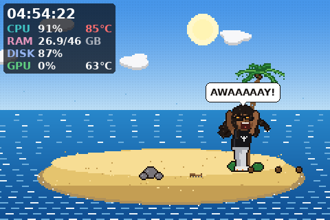
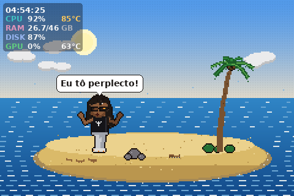

# 08 — Brother Away: motor narrativo e histórias

## Motor (`narrative.py`)

Histórias e atividades são **geradores Python** que produzem comandos pequenos:

| Comando | Efeito |
| --- | --- |
| `Walk(x, run=, clip=, y=)` | anda/corre/nada até `x` (e opcionalmente muda `y`) |
| `Do(clip, segundos, expr=, …)` | mantém um clipe com sobreposições de pose |
| `Say(contexto)` | escolhe uma fala do contexto e mostra o balão |
| `Wait`, `Until(predicado)` | espera tempo ou um evento do mundo (coco caiu, onda chegou) |
| `Call`, `Emote`, `Phase` | ação imediata, símbolo sobre a cabeça, mudança de estado |

O motor avança com o *delta time* de cada quadro: nada bloqueia o render nem a
comunicação com o display. Interromper uma história chama `generator.close()`,
que executa os blocos `finally` e restaura o mundo.

Estados: `IDLE → PREPARATION → EVENT → REACTION → RESOLUTION → COOLDOWN`.
Durante `EVENT`/`REACTION` o HUD fica compacto e mais transparente (nunca some).

## Seleção

- Pesos por história × raridade (comum 1,0; incomum 0,45; rara 0,14).
- Cooldown individual (15 min a 1,5 h) e intervalo mínimo entre histórias
  conforme "Acontecimentos": raros 7 min, normais 3 min, frequentes 75 s.
- Pré-requisitos: horário (OVNI só de madrugada), clima (sem tubarão na
  chuva), progresso (a jangada precisa estar pronta), itens (tesouro uma vez).
- Histórico: as 3 últimas têm peso × 0,15 (teste: < 10% de repetição imediata
  em 400 seleções, ≥ 8 histórias diferentes).
- Nada de IA generativa: seleção determinística com variação controlada.

## Persistência leve

`/var/lib/big-screen-monitor-display/brother_away.json`: progresso da
jangada, recordações, contadores de histórias, "AWAAAAAY!"s, primeiro dia na
ilha. Gravação atômica no máximo a cada 10 min e ao encerrar; a prévia da
janela não grava. Arquivo corrompido é ignorado com segurança (testado).

## As cinco histórias principais

| # | História | Preparação → Surpresa → Reação → Desfecho |
| --- | --- | --- |
| 1 | **O coqueiro revoltado** | dorme sob a copa → coco cai ao lado ("Coincidência") → coco na cabeça, acorda, cruza os braços e discute; a árvore balança "respondendo" → terceiro coco, imobilidade, olha para o espectador → **"AWAAAAAY!"** |
| 2 | **O tubarão debochado** | entra no mar → barbatana aparece atrás e **no reflexo dos óculos** → olha para trás, corre sobre a água de forma cartunesca → tubarão ri ("HA HA"), discussão com o oceano |
| 3 | **A jangada impossível** | jangada construída ao longo de várias sessões (atividade "construir") → comemora com dança e empurra para o mar → uma ondinha devolve e desmonta → silêncio, olha para o espectador: **"Eu tô perplecto!"** |
| 4 | **O encontro extraterrestre** | dorme de madrugada → OVNI com feixe de luz → acorda e, em vez de fugir, discursa sobre a civilização humana → os ETs desistem e vão embora → comemora a "vitória" |
| 5 | **O coqueiro filósofo** | senta e contempla → reflexões absurdas → **"Tu tá entendendo o que eu tô falando, morô?"** → o vento inclina a árvore → "Viu? Até o coqueiro concorda." |

 

## Histórias adicionais implementadas

Caranguejo rouba os óculos (e ele vê "realidade demais"), gaivota rouba o
almoço, mensagem na garrafa (vira recordação), navio passa enquanto ele dorme,
sereia que foge das reclamações, tesouro, noite de estrelas, reclamação da
chuva/tempestade, peixe que devolve a isca. Total: **14 histórias**, todas
executadas até o fim no teste automatizado.

Atividades ociosas: passear, sentar e olhar o horizonte, cochilar sob o
coqueiro, pescar, construir a jangada, dançar, conversar com o coqueiro,
nadar, subir no coqueiro (e cair), sentar na fogueira, cochilo de madrugada,
"Bom dia, ilha!" pela manhã.

**Planejadas, ainda não implementadas:** concurso de dança com macaco, castelo
de areia destruído pela chuva (desenho do item já existe), rádio antigo,
aniversário solitário, invasão de cocos, espelho improvisado, tempestade que
apaga a fogueira, histórias de datas comemorativas.

## Falas e humor

`dialogue.py` organiza ~85 falas originais por contexto, com níveis
**Familiar**, **Clássico** e **Debochado** (sarcástico, nunca discriminatório)
e bordões separados que podem ser desligados. A voz canônica é o português
brasileiro em `locale/pt.po`; os msgids estão em inglês para o tradutor
automático do BigLinux.

## Telemetria e reações

HUD estilo MangoHud no canto escolhido: relógio, CPU % e temperatura, RAM
usada/total, DISK %, GPU % e temperatura; temperaturas mudam de cor a partir de
70 °C/85 °C; dado indisponível aparece como `--`. Opções: mostrar/ocultar,
compacto/expandido, opacidade, posição, sensores visíveis, encolher durante
histórias. Usa o mesmo coletor do serviço (nenhuma consulta duplicada).

Reações (configuráveis, com histerese, 8 s acima do limite e cooldown de 15 min):

| Condição | Entrada / saída | Na ilha |
| --- | --- | --- |
| CPU alta | 85% / 65% | sol com halo, ondulação de calor, ele se abana |
| Temperatura alta | 82 °C / 72 °C | vai para a sombra do coqueiro |
| RAM alta | 88% / 78% | caixas e barris se acumulam |
| Disco quase cheio | 92% / 88% | baú transbordando, ele tenta fechar |
| GPU alta | 80% / 55% | vulcão fictício fumegando no horizonte |

## Som (opcional, desligado por padrão)

O display não tem alto-falante e o serviço de sistema não acessa o áudio da
sessão. Ao ativar o som, a janela cria um autostart para um agente leve
(`main.py --sound-agent`) que lê os eventos sonoros publicados no
`status.json` e toca efeitos retrô sintetizados (grito, alarme, "bonk",
espuma, OVNI, fanfarra, risada, gaivota, "fala" em sílabas) com `pw-play`,
`paplay` ou `aplay`, no máximo um a cada 1,5 s, com volume e frequência das
falas ajustáveis. O agente sai sozinho quando o som é desligado. Uma futura
integração com o TTS BigLinux poderia sintetizar falas com uma voz autorizada;
não foi implementada.
