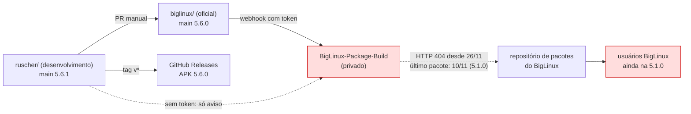
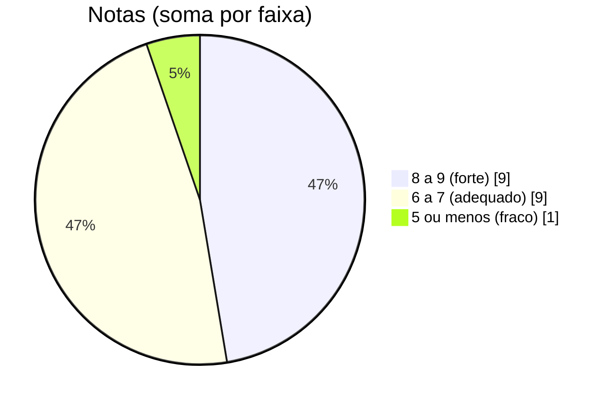
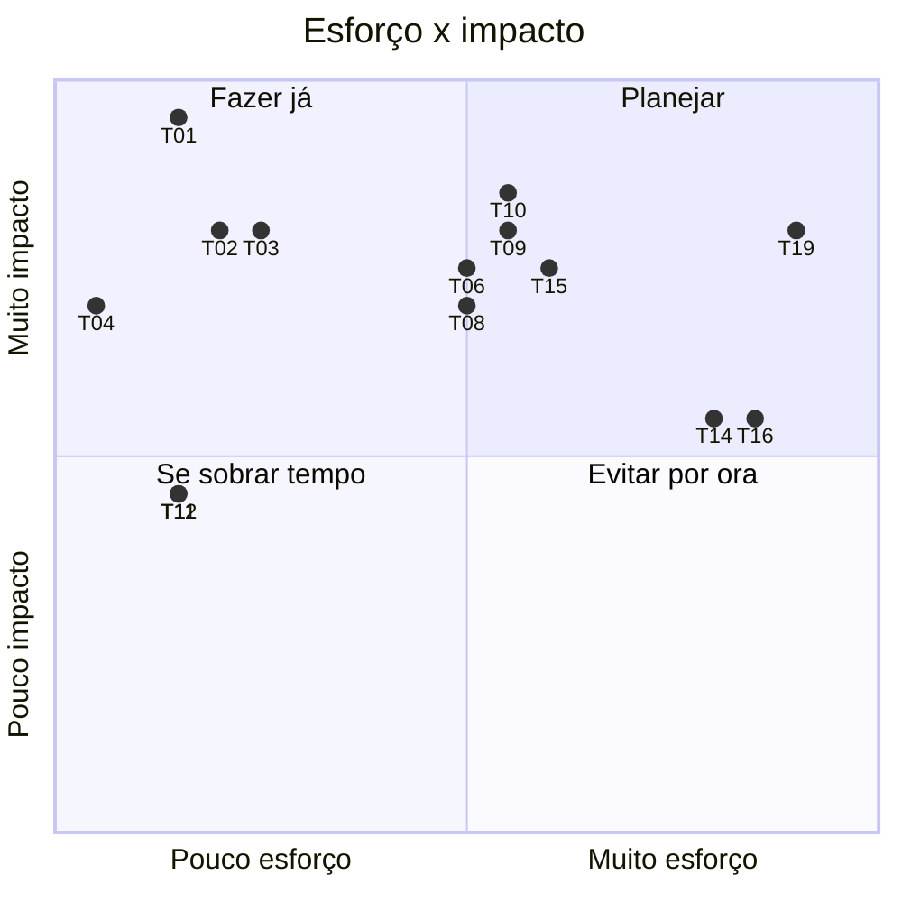
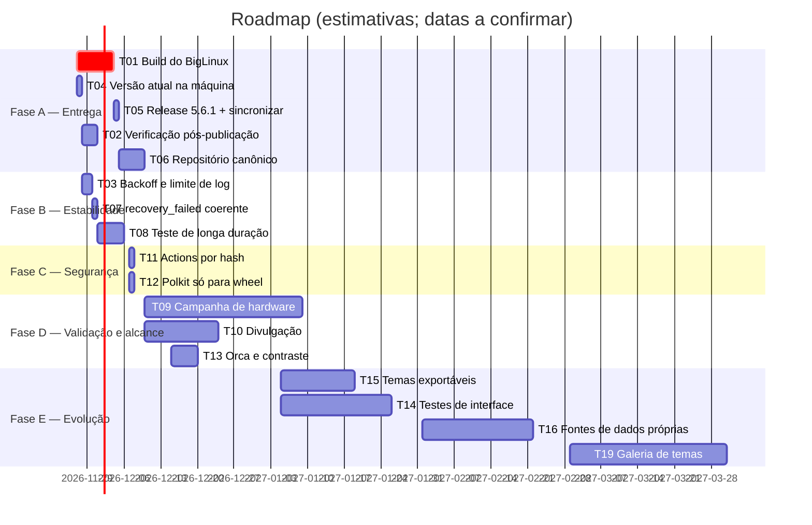

# Planejamento estratégico — Big Screen Monitor Display

> Documento central de auditoria, diagnóstico e evolução. Não é usado pelo
> programa. O roteiro anterior (fases 0 a 7, executado entre 25 e 26/11/2026)
> continua em [`PLANNING.md`](../PLANNING.md) como registro; este documento o
> substitui como referência de planejamento.

| | |
| --- | --- |
| **Data da auditoria** | 26/11/2026 |
| **Versão auditada** | `main` em `25d7f67` (v5.6.1, não publicada como release); última release: v5.6.0 |
| **Repositórios** | desenvolvimento `ruscher/big-screen-monitor-display`; oficial/pacote `biglinux/big-screen-monitor-display` (em 5.6.0 desde 26/11 23:36 UTC) |
| **Projeto relacionado** | `ruscher/big-misterdeck` (independente, sem código compartilhado) |
| **Legenda de evidência** | **[F]** fato medido ou lido no código · **[H]** hipótese a validar · **[O]** opinião do auditor · **[R]** recomendação |

---

## Sumário

1. [Resumo executivo](#1-resumo-executivo)
2. [Objetivos do projeto](#2-objetivos-do-projeto)
3. [Metodologia](#3-metodologia)
4. [Estado atual](#4-estado-atual)
5. [Pontos fortes](#5-pontos-fortes)
6. [Problemas identificados](#6-problemas-identificados)
7. [Pontos cegos](#7-pontos-cegos)
8. [Perspectivas de cada perfil](#8-perspectivas-de-cada-perfil)
9. [Comparação com outras soluções](#9-comparação-com-outras-soluções)
10. [Avaliação de maturidade](#10-avaliação-de-maturidade)
11. [Opinião profissional](#11-opinião-profissional)
12. [Etapas: concluídas e pendentes](#12-etapas-concluídas-e-pendentes)
13. [Matriz de prioridades](#13-matriz-de-prioridades)
14. [Roadmap](#14-roadmap)
15. [Tarefas detalhadas](#15-tarefas-detalhadas)
16. [Métricas de sucesso e validação](#16-métricas-de-sucesso-e-validação)
17. [Riscos](#17-riscos)
18. [Limitações desta auditoria](#18-limitações-desta-auditoria)

---

## 1. Resumo executivo

**O software está muito acima da média; a entrega e o alcance estão muito abaixo
dele.** Essa é a conclusão central.

- A engenharia do serviço é de nível profissional: `systemd` com watchdog real,
  usuário dinâmico sem privilégios, filtro de syscalls, rede restrita a faixas
  privadas, assistente polkit com verbos fixos, 1651 casos de teste, CI em três
  versões de Python e instalação testada em cinco distribuições. **[F]**
- Mas **o repositório estável do BigLinux entrega um pacote de 28/03/2026, da
  série 3.x** (anterior à reconstrução da 4.0: rodava como root e travava). O
  `biglinux-testing` nem tem o pacote. As builds de novembro (até a 5.1.0) não
  chegaram a nenhum repositório público. O repositório de desenvolvimento nunca
  conseguiu pedir pacotes (sem token), e o oficial, sincronizado hoje para a
  5.6.0, recebe **HTTP 404** ao pedir o build. **[F]** (verificado nos bancos
  públicos `biglinux-stable.db` e `biglinux-testing.db` e nas tags de build)
- A própria máquina de desenvolvimento roda a **5.5.2** (pacote de 23/11), não a
  versão publicada. **[F]**
- O serviço instalado aqui grava **um aviso a cada 2 segundos** (23.438 em 24 h)
  enquanto o FOSTON com BigFoston está ligado e o app dele fechado: falta backoff
  para "conexão recusada" e falta limitar o log. **[F]**
- Alcance: 3 estrelas, 13 visitantes únicos em 14 dias, 0 issues, uma pessoa com
  193 dos 216 commits. **[F]** O projeto tem diferenciais que nenhum concorrente
  tem (Brother Away, Kojiro, celular Android como display, SmartMonitor
  "fotografado"), mas quase ninguém sabe que ele existe. **[O]**

**Recomendação mais importante:** pare de acrescentar funcionalidades por algumas
semanas e feche o ciclo **construir → empacotar → instalar → usar → ouvir**.
Cada recurso novo hoje não chega a ninguém.

---

## 2. Objetivos do projeto

Inferidos do README, do histórico e dos documentos **[F]**:

1. Monitor de hardware livre para pequenos displays USB que só tinham software de
   Windows (AIDA64), coolers DeepCool com visor e celulares/tablets Android.
2. Nunca travar: recuperação automática, watchdog, sem laço de reinício.
3. Seguro por padrão: sem root, sandbox, permissões mínimas.
4. Bonito e divertido: temas animados (Brother Away), papel de parede como
   painel (Kojiro), player de mídia com skins.
5. Parte do ecossistema BigLinux, mas instalável em outras distribuições.

---

## 3. Metodologia

| Fonte | O que foi feito |
| --- | --- |
| Serviço em execução nesta máquina | `systemctl show`, journal de 24 h agregado por tipo de mensagem, cadência das tentativas medida em milissegundos |
| Código | leitura de `runtime.py`, `health.py`, `bsm-helper`, `kojiro/store.py`, regras polkit e udev; varredura de TODO/FIXME; contagem de linhas e arquivos |
| Desempenho | `--benchmark` do próprio projeto (6 temas × 2 resoluções), CPU e memória do serviço real |
| Testes e CI | suíte local, cobertura (CI: 68,56 %), execuções do GitHub Actions nos dois repositórios |
| Entrega | workflows de pacote, tags de build no `biglinux/`, logs das execuções com falha |
| Comunidade | issues, PRs, estrelas, tráfego, downloads dos APKs, autores dos commits |
| Concorrentes | documentação e changelogs do CoolerControl e do turing-smart-screen-python (fontes na seção 9) |
| Histórico desta sessão | as fases 0 a 7 e as correções posteriores (registradas em `PLANNING.md` e no `CHANGELOG.md`) |

Não foi possível: testar hardware que não está aqui, percorrer a janela com o
Orca, ver o repositório privado de build do BigLinux. Veja a seção 18.

---

## 4. Estado atual

| Indicador | Valor | Fonte |
| --- | --- | --- |
| Versão na `main` / última release | 5.6.1 / 5.6.0 | `bsmd/__init__.py`, `gh release list` |
| Versão que o BigLinux entrega | **série 3.x** no `biglinux-stable` (build de 28/03/2026); ausente no `biglinux-testing`; a última build (10/11, 5.1.0) não está em nenhum dos dois | `tools/check_delivery.py` lendo os bancos públicos |
| Versão instalada nesta máquina | 5.5.2 (`26.11.23-1857`) | `pacman -Q` |
| Código Python | 144 arquivos, 46.834 linhas | `find usr -name '*.py'` |
| Testes | 617 funções, 1651 casos, 41 arquivos | `tests/` |
| Cobertura (CI, sem GTK) | 68,56 % (piso 68) | job *pytest (Python 3.12, PyQt6)* |
| Avisos do `ruff` / TODO no código | 0 / 0 | `ruff check .`, `grep` |
| Documentos | 91 `.md` | `docs/` |
| Traduções | 28 idiomas, 1737/1737 mensagens | `msgfmt --statistics` |
| Serviço aqui (31 h) | 85 MB de RAM; 7,8 % de um núcleo em média (AX206 800×480, Big Media Player a 8 fps); 0 reinícios | `systemctl show` |
| Log do serviço (24 h) | 23.438 avisos `connect_not_found` (FOSTON/BigFoston) | `journalctl -p warning` |
| Comunidade | 3 estrelas, 1 fork, 13 visitantes únicos em 14 dias, 0 issues, APK 5.5.1 baixado 18 vezes | API do GitHub |

---

## 5. Pontos fortes

Manter exatamente como está (ver também 11.4):

1. **Isolamento do serviço** **[F]**: `DynamicUser`, `DevicePolicy=closed`,
   `CapabilityBoundingSet=` vazio, `SystemCallFilter=@system-service`,
   `IPAddressAllow` só para faixas privadas e Tailscale.
2. **Assistente privilegiado mínimo** **[F]**: verbos fixos, nada passa por shell,
   `python3 -IB`, spool com `O_NOFOLLOW|O_EXCL`. O root **nunca decodifica
   imagem**: `check_png` valida só a estrutura (assinatura, CRC dos blocos, IHDR),
   e quem decodifica é o serviço isolado.
3. **Watchdog honesto** **[F]**: só sinaliza "vivo" quando telemetria, desenho e
   transporte avançam (`docs/03`).
4. **Renderização barata** **[F]**: 1,1 a 15,9 ms por quadro a 800×480 nos seis
   temas principais; só áreas alteradas vão ao painel.
5. **Qualidade de código** **[F]**: zero avisos, zero TODO, emuladores de protocolo
   e clientes C testados no host.
6. **Diferenciais únicos** **[O]**: Brother Away, Kojiro, Android como display com
   pareamento por QR e Tailscale, SmartMonitor "fotografado", 28 idiomas.
7. **Disciplina de documentação** **[F]**: decisões, medições e bugs registrados.

---

## 6. Problemas identificados

| ID | Problema | Evidência | Gravidade |
| --- | --- | --- | --- |
| PB-01 | **Pacote do BigLinux não é gerado** desde 10/11; o webhook do `biglinux/` recebe 404 | execução *Translate and Build Package* de 26/11 23:40 UTC: `curl: (22) … 404`; tags de build param em `26.11.10` | P0 |
| PB-02 | **Log sem limite e sem backoff** para "conexão recusada" num aparelho presente | `runtime.py:926` grava incidente `SEVERITY_ERROR` a cada tentativa; `runtime.py:928-934` trata `NOT_FOUND` como "sumiu" e repete a cada `ABSENT_POLL` (2 s); medido: 1 aviso a cada 2,000 s, 300 em 10 min | P1 |
| PB-03 | Incidente promete ação que não ocorre | `recovery_failed … action=process restart by systemd` 6 vezes em 24 h, com `NRestarts=0` em 31 h | P2 |
| PB-04 | Dois repositórios sincronizados à mão; o oficial ficou 117 commits atrás e o merge de hoje levou a 5.6.0 em vez da 5.6.1 | `biglinux/` em 5.6.0, `ruscher/` em 5.6.1 | P1 |
| PB-05 | Máquina de desenvolvimento não usa a versão publicada | `pacman -Q` → 5.5.2 | P1 |
| PB-06 | Maioria dos drivers nunca validada no aparelho (nível B); NVIDIA só com biblioteca simulada | `docs/compatibilidade.md`; `tests/test_gpu.py` | P2 |
| PB-07 | Interface pouco testada | cobertura de `config_gui.py`, `kojiro_page.py`, `displays_page.py` entre 11 e 14 %; `media_player_page.py` 0 % sem tela | P2 |
| PB-08 | Sem teste de longa duração (vazamento de memória, descritores, degradação) | nenhum teste com duração em horas; `MemoryMax=384M` é o único limite | P2 |
| PB-09 | Cadeia de suprimentos do CI | Actions fixadas por versão maior (`@v7`), não por hash; `mxschmitt/action-tmate@v3` (terceiro) no workflow com o token de build | P3 |
| PB-10 | `apply-settings` e `import-wallpaper` sem senha para **qualquer** usuário ativo, não só administradores | `allow_active=yes` na policy | P3 |
| PB-11 | Arquivos grandes concentram risco de conflito | `capture.py` 1767, `runtime.py` 1602, `legacy_themes.py` 1593, `config_gui.py` 1395, `kojiro_page.py` 1389 linhas | P3 |
| PB-12 | Fator ônibus = 1 | 193 de 216 commits de um autor | P2 |
| PB-13 | *Segfault* intermitente do PyQt5 nos testes da bandeja | job PyQt5 caiu no #35 e no #36 em `FlowLayout.minimumSize`; botões destruídos sem sair do layout (3 itens onde devia haver 1) | P1 (CI) |
| PB-14 | Promoção `testing` → `stable` no BigLinux é manual e não aconteceu desde março | `biglinux-stable` com build de 28/03 | P0 (equipe BigLinux) |

---

## 7. Pontos cegos

1. **"Funciona no CI" foi tratado como "chegou ao usuário".** O workflow de pacote
   ficou verde por meses enquanto falhava (curl sem `-f`); hoje falha com 404. Não
   existe nenhuma verificação de que o pacote **publicado** tem a versão esperada.
2. **O próprio autor não usa o que publica** (5.5.2 instalada, 5.6.x publicada).
   Bugs como PB-02 aparecem justamente no uso diário com a versão nova.
3. **Logs são tratados como gratuitos.** 23 mil linhas/dia num SSD, num serviço que
   promete "ficar fora do caminho" (`Nice=10`, `IOSchedulingClass=idle`), e o
   journal útil fica afogado: os 6 `recovery_failed` reais quase somem no meio.
4. **Ninguém de fora participa.** Zero issues desde que foram ativadas; nenhum
   relato de hardware nível B. Sem divulgação, o formulário de hardware não serve.
5. **Validação de hardware depende de você ter o aparelho.** 14 famílias B, uma A
   nova por ano de doação ou compra; sem campanha ativa, isso não muda.
6. **Tudo depende de uma pessoa e de uma organização** (token do BigLinux) que não
   estão sob controle do projeto.
7. **Dois projetos para o mesmo usuário de deck/display** (big-misterdeck e este)
   sem nenhuma ponte: o deck não troca o tema do display. **[O]**

---

## 8. Perspectivas de cada perfil

| Perfil | Sentiria falta de / teria dificuldade com | Melhoria |
| --- | --- | --- |
| Iniciante | Instalar pelo BigLinux e receber a 5.1.0 sem Android; não saber se o painel dele é suportado antes de comprar | consertar a entrega (PB-01); página de compatibilidade com fotos dos aparelhos |
| Avançado | Sensores próprios (scripts, MQTT, Home Assistant), temas em arquivo editável e compartilhável | fontes de dados por plugin; exportar/importar temas Kojiro |
| Desenvolvedor | Arquivos de 1.400+ linhas; nenhuma issue "boa para começar" | dividir ao mexer (regra no CONTRIBUTING); rotular issues |
| Mantenedor | Sincronizar dois repositórios; descobrir falhas de entrega tarde | espelhamento automático; verificação pós-publicação |
| Designer | Não há guia visual do projeto (cores, tipografia dos temas) consolidado | `docs/redesign/` vira guia vivo; capturas automáticas (`tools/ui_screenshots.py`) no CI |
| Segurança | Actions por tag; polkit sem senha para qualquer usuário ativo | hash nas Actions; restringir a `wheel` ou exigir senha nos verbos de escrita |
| Desempenho | Log a cada 2 s; nenhum orçamento de CPU por tema verificado no CI | PB-02; benchmark com limite no CI |
| Pessoa com deficiência | Janela nunca percorrida com leitor de tela; temas com texto pequeno e baixo contraste em painéis de 3,5" | sessão com Orca; esquema de alto contraste nos temas |
| Hardware limitado | Painéis seriais a 1,3 fps em quadro cheio (800×480); 85 MB de RAM | perfis de desempenho já existem; documentar escolha de tema por hardware |
| Novo colaborador | Muitos relatórios históricos | `docs/README.md` já separa; manter novos relatórios curtos |
| Uso diário | Atualização do APK manual; sem aviso de versão nova | aviso de atualização no app e na janela |
| Quem acaba de conhecer | README em português longo; poucos GIFs mostrando os temas em movimento | GIF/vídeo curto no topo; site no GitHub Pages |

---

## 9. Comparação com outras soluções

| | Big Screen Monitor Display | turing-smart-screen-python | CoolerControl |
| --- | --- | --- | --- |
| Foco | displays USB, coolers DeepCool, Android | displays Turing/XuanFang/WeAct/Kipye | ventoinhas, AIOs, LCDs via liquidctl |
| Plataformas | Linux | Windows, Linux, macOS, Raspberry Pi | Linux |
| Arquitetura | serviço systemd isolado + janela GTK4 | aplicação Python + `config.yaml` | daemon + interface web (porta 11987) + app opcional |
| Watchdog do systemd | sim, com progresso real | não informado | sim, desde a v5.0 (09/2026) |
| Temas | 9 temas, Kojiro (editor visual), 15 skins de player | YAML + `theme-editor.py` com recarga ao salvar; temas da comunidade | imagens/GIF e carrossel no LCD |
| Sensores próprios | não | sim (fontes em Python; fork com MQTT) | sim (sensores personalizados) |
| Celular como display | sim (Android, QR, Tailscale) | não | não |
| Diferencial | Brother Away, Kojiro, SmartMonitor fotografado, 28 idiomas | alcance multiplataforma e comunidade de temas | controle de ventoinhas e curvas |

O que aprender sem copiar **[R]**:

- **Do turing-smart-screen-python:** temas como arquivo compartilhável e fontes de
  dados plugáveis; é o que forma comunidade.
- **Do CoolerControl:** a documentação "comparado a outras ferramentas" e a clareza
  de dizer o que **não** é suportado.
- **O que fazemos melhor:** isolamento de segurança, recuperação, acabamento dos
  temas, Android, internacionalização.

Fontes: [turing-smart-screen-python](https://github.com/mathoudebine/turing-smart-screen-python),
[wiki de temas](https://github.com/mathoudebine/turing-smart-screen-python/wiki/System-monitor-:-themes),
[fork com MQTT](https://github.com/drivin/turning-smart-screen-mqtt),
[CoolerControl: changelog](https://github.com/codifryed/coolercontrol/blob/main/CHANGELOG.md),
[CoolerControl: início](https://docs.coolercontrol.org/getting-started),
[CoolerControl v5.0](https://www.gamingonlinux.com/2026/09/coolercontrol-app-for-linux-v5-0-brings-a-big-overhaul/).

---

## 10. Avaliação de maturidade

Notas de 0 a 10. "Para 10" é o critério objetivo para a nota máxima.

| Categoria | Nota | Justificativa e evidência | Para 10 |
| --- | --- | --- | --- |
| Arquitetura | 8 | `bsmd/` modular, registro de drivers, transporte separado do desenho; cinco arquivos acima de 1.300 linhas | nenhum módulo acima de ~800 linhas; fronteiras documentadas |
| Qualidade de código | 8 | `ruff` 0, TODO 0, `raise … from`; arquivos grandes | idem + complexidade ciclomática medida no CI |
| Desempenho | 8 | 1–16 ms por quadro; 85 MB; 7,8 % de um núcleo a 8 fps; log a cada 2 s | orçamento de CPU/RAM por tema verificado no CI; zero escrita de log em regime |
| Estabilidade | 7 | 0 reinícios em 31 h; watchdog real; PB-02 e PB-03 | teste de 24 h sem crescimento de memória/descritores; incidentes deduplicados |
| Segurança | 8 | sandbox e polkit exemplares; Actions por tag; verbos sem senha para qualquer usuário ativo | Actions por hash; verbos de escrita só para `wheel`; `SECURITY.md` já existe |
| Privacidade | 9 | nada sai da máquina; relatório de diagnóstico revisado pelo usuário antes de publicar | aviso explícito sobre o que o relatório contém (nome da máquina, journal) |
| UX/UI | 7 | GTK4/libadwaita, prévias ao vivo, primeiro uso guiado; sem teste com usuários reais | 5 usuários novos instalando e configurando sem ajuda, com tempo medido |
| Acessibilidade | 6 | nomes acessíveis e teste de varredura; nunca percorrido com Orca | percurso completo com Orca registrado; contraste verificado |
| Funcionalidades | 9 | displays, coolers, Android, mídia, temas animados | sensores próprios e temas compartilháveis |
| Compatibilidade | 7 | 5 distros no CI, Python 3.10–3.14; 14 famílias só nível B; NVIDIA não validada | metade das famílias B promovidas a A por relatos |
| Escalabilidade | 7 | vários displays simultâneos; um processo | medição com 4+ displays e Android ao mesmo tempo |
| Documentação | 8 | 91 documentos, índice, CHANGELOG, README em inglês curto | guia do usuário com capturas; menos relatórios, mais tutoriais |
| Testes | 8 | 1651 casos, emuladores, CI em matriz; GUI 11–14 % | GUI ≥ 50 %, teste de longa duração, benchmark com limite |
| Automação | 6 | CI forte; entrega quebrada sem ninguém perceber por meses | verificação automática da versão no repositório de pacotes |
| Manutenibilidade | 7 | código limpo, regras no CONTRIBUTING; fator ônibus 1 | segundo mantenedor com permissão de merge |
| Inovação | 9 | Brother Away, Kojiro, Android, SmartMonitor fotografado | ecossistema de temas da comunidade |
| Experiência geral | 7 | ótima quando instalada; quem usa o BigLinux não recebe | entrega funcionando + atualização avisada |
| Preparação para produção | 6 | release e APK assinados; pacote principal parado em 5.1.0 | pacote atualizado em até 24 h após cada release |
| Sustentabilidade | 5 | 3 estrelas, 0 issues, 1 autor | 50+ estrelas, issues de terceiros todo mês, 2 mantenedores |

---

## 11. Opinião profissional

**1. Estratégia.** Três meses de "produto", não de "recursos": entrega confiável,
uso diário pelo próprio autor, validação por terceiros, divulgação. Recursos novos
só se puxados por um usuário real.

**2. Imediatamente.** Recuperar o build do BigLinux (PB-01), instalar a versão atual
nesta máquina (PB-05) e corrigir o log sem limite (PB-02).

**3. Faria diferente.** Um único repositório canônico. Hoje o desenvolvimento está
no fork e a publicação no oficial, com sincronização manual. Eu desenvolveria no
`biglinux/` (você tem permissão de manutenção), ou automatizaria o espelhamento a
cada release.

**4. Manteria.** O isolamento do serviço, o watchdog por progresso, o assistente
polkit com verbos fixos, os emuladores de protocolo, a regra "sem número falso" e a
política de traduções completas.

**5. Removeria.** O hábito de escrever um relatório final por fase (91 documentos,
muitos históricos). Prefira um CHANGELOG bom, guias para o usuário e documentos de
arquitetura atualizados. Também removeria a etapa `tmate` do workflow de pacote.

**6. Reconstruiria.** Nada inteiro. Dividiria `runtime.py` e `capture.py` quando
precisar mexer neles (já é regra no CONTRIBUTING).

**7. Tecnologias a substituir.** Nenhuma agora. Python + Pillow + numpy atende com
folga (1–16 ms por quadro). Rust ou C++ só se um perfil de 60 fps a 1920×480 virar
requisito medido. Não faria interface web: a janela GTK4 já é melhor para o público
do BigLinux. **[O]**

**8. Funcionalidades.** (a) Fontes de dados próprias, com scripts e MQTT/Home
Assistant. (b) Exportar e importar temas Kojiro como arquivo. (c) Aviso de
atualização no app Android. (d) Ponte com o big-misterdeck: botões trocam tema e
brilho pelo comando que a janela já usa. **[R]**

**9. Decisões a questionar.** O fork como repositório principal (ver 3). O
`apply-settings` sem senha para qualquer usuário ativo. Registrar incidentes a cada
tentativa.

**10. Onde investir mais.** Entrega, validação com hardware de terceiros e
divulgação.

**11. Onde há gasto desnecessário.** Clientes para aparelhos raríssimos (Palm OS,
Windows CE) são simpáticos e isolados, mas não trazem usuários; aceitar como
contribuição, não como prioridade. Relatórios longos por fase.

**12. Visão.** **6 meses:** pacote no BigLinux, no AUR e em `.deb`/`.rpm`; 5
famílias B promovidas a A; issues de terceiros todo mês. **1 ano:** galeria de temas
da comunidade; fontes de dados próprias; segundo mantenedor. **3 anos:** referência
Linux para displays de hardware, citada nas páginas de compra dos painéis como "o
software para Linux".

**13. Inovação transformadora.** **Galeria de temas Kojiro da comunidade** (arquivo
`.bsmdtheme` com prévia, publicado num repositório de temas). É o que fez o
turing-smart-screen-python crescer, e aqui o editor visual já existe.

**14. Se fossem só cinco melhorias:**
1. Build do BigLinux funcionando e verificado após cada release (sem isso, nada chega).
2. Backoff e limite de log nas reconexões (estabilidade e disco).
3. Um repositório canônico com espelhamento automático (fim da deriva).
4. Campanha de validação de hardware (B → A) com divulgação.
5. Temas compartilháveis (crescimento da comunidade).

**15. Recomendação mais importante.** *Meça o projeto pelo que chega ao usuário,
não pelo que está na `main`.* Hoje o usuário do BigLinux estável recebe a série 3.x,
enquanto a `main` está na 5.6.1.

---

## 12. Etapas: concluídas e pendentes

Legenda: ✅ concluída e validada · 🟢 implementada, falta validar · 🟡 parcial ·
🔵 em desenvolvimento · ⚪ não iniciada · 🔴 crítica ou bloqueada · 🟣 nova
recomendação · ⚫ obsoleta

| Etapa | Estado | Observação |
| --- | --- | --- |
| Pacote BigLinux pedido só com testes verdes | 🔴 | lógica pronta e testada; o pedido recebe 404 (PB-01) |
| Polkit: escrita só para administradores (T12) | ✅ | #36 |
| Chamado para donos de displays nível B (T09) | 🟢 | issue #40 fixada |
| GIF dos temas no README (T10) | ✅ | #39 |
| Segfault do PyQt5 nas bandejas (PB-13) | 🟢 | #37; estado perigoso eliminado, causa do crash não reproduzida localmente |
| `curl -f` no webhook | ✅ | foi o que revelou o PB-01 |
| Releases com APK e notas do CHANGELOG | ✅ | 5.6.0 publicada; notas automáticas a partir da 5.6.1 |
| `tools/release.sh` | ✅ | corrigido no #31/#32; usado na 5.6.0 |
| Release 5.6.1 | ⚪ | versão na `main`, tag não criada |
| Sincronizar `biglinux/` | 🟡 | em 5.6.0; falta a 5.6.1 |
| Issues com formulários | 🟢 | ativas; nenhum relato ainda |
| NVIDIA pela NVML | 🟢 | testada com biblioteca simulada; falta placa real |
| "—" para GPU sem medição | ✅ | todos os temas testados |
| CI 3.10/3.12/3.14, ruff, cobertura | ✅ | piso 68 % |
| Instalação em 5 distros | ✅ | workflow *Install* semanal |
| AUR | 🟡 | PKGBUILD gerado e compilado; publicar exige conta |
| `.deb`/`.rpm` (OBS) | ⚪ | exige conta |
| BSMD-lite | ✅ | testado de ponta a ponta |
| Exemplo ESP32 | ⚪ | exige hardware |
| Primeiro uso guiado | ✅ | testado com a janela real |
| Acessibilidade: nomes de botões | ✅ | teste de varredura |
| Acessibilidade: percurso com Orca | ⚪ | manual |
| Backoff para conexão recusada (PB-02) | 🟢 | #35; testado com display simulado; falta medir com o FOSTON real depois de instalar (T04) |
| Incidente `recovery_failed` coerente (PB-03) | ✅ | #35, com teste de dois displays |
| Verificação pós-publicação do pacote | ✅ | #38, workflow *Delivery* diário |
| Repositório canônico / espelhamento | 🟡 | #38 (*Mirror to biglinux*); falta o segredo `BIGLINUX_SYNC_TOKEN` |
| Teste de longa duração | ✅ | #41, workflow *Soak* semanal; local: platô em ~179 MB |
| Actions por hash; sem `tmate` | ✅ | #36, com Dependabot e teste |
| Temas compartilháveis | 🟣 | nova |
| Fontes de dados próprias | 🟣 | nova |
| Ponte com big-misterdeck | 🟣 | nova (opcional) |

---

## 13. Matriz de prioridades

| ID | Tarefa | Prioridade | Esforço | Impacto | Quick win |
| --- | --- | --- | --- | --- | --- |
| T01 | Recuperar o build do BigLinux | P0 | baixo (depende da equipe) | máximo | ✔ |
| T02 | Verificar a versão publicada após cada release | P1 | baixo | alto | ✔ |
| T03 | Backoff e limite de log nas reconexões | P1 | baixo | alto | ✔ |
| T04 | Instalar a versão atual na máquina do autor | P1 | mínimo | alto | ✔ |
| T05 | Publicar 5.6.1 e sincronizar `biglinux/` | P1 | mínimo | médio | ✔ |
| T06 | Repositório canônico ou espelhamento automático | P1 | médio | alto | |
| T07 | `recovery_failed` coerente com a ação real | P2 | baixo | médio | ✔ |
| T08 | Teste de longa duração (memória, descritores) | P2 | médio | alto | |
| T09 | Campanha de validação de hardware | P2 | médio | alto | |
| T10 | Divulgação (GIFs, site, comunidades) | P2 | médio | alto | |
| T11 | Actions por hash; remover `tmate` | P3 | baixo | médio | ✔ |
| T12 | Verbos de escrita do polkit só para `wheel` | P3 | baixo | médio | ✔ |
| T13 | Percurso com Orca e contraste | P3 | médio | médio | |
| T14 | Testes de interface (GUI ≥ 50 %) | P3 | alto | médio | |
| T15 | Temas Kojiro exportáveis | P3 | médio | alto | |
| T16 | Fontes de dados próprias (script/MQTT) | P4 | alto | médio | |
| T17 | Aviso de atualização no app Android | P4 | médio | médio | |
| T18 | Ponte com big-misterdeck | P5 | baixo | baixo | |
| T19 | Galeria de temas da comunidade | P5 | alto | alto | |

---

## 14. Roadmap

| Fase | Conteúdo | Saída |
| --- | --- | --- |
| A — Entrega | T01, T02, T04, T05, T06 | usuário do BigLinux recebe a versão atual em até 24 h |
| B — Estabilidade | T03, T07, T08 | log silencioso em regime; 24 h sem crescimento de memória |
| C — Segurança | T11, T12 | CI sem dependência mutável; escrita privilegiada só para administradores |
| D — Validação e alcance | T09, T10, T13 | relatos de terceiros; famílias promovidas; percurso com Orca |
| E — Evolução | T14, T15, T16, T17, T18, T19 | comunidade produzindo temas |

---

## 15. Tarefas detalhadas

As tarefas de P0 a P2 estão completas. As demais têm o essencial e devem ser
detalhadas quando entrarem em execução.

### T01 — Recuperar o build do BigLinux

| Campo | Conteúdo |
| --- | --- |
| Estado | 🔴 bloqueada (depende da equipe BigLinux) |
| Problema | O pedido de build recebe 404; nenhum pacote desde 10/11 |
| Evidência | `biglinux/…` execução de 26/11 23:40 UTC: `curl: (22) The requested URL returned error: 404` no primeiro `curl` (x86); tags de build param em `26.11.10-0124` |
| Hipóteses **[H]** | token `WEBHOOK_TOKEN` revogado ou expirado; perdeu acesso a `BigLinux-Package-Build/build-package`; repositório renomeado |
| Solução | pedir à equipe BigLinux um token válido (escopo mínimo: `repo` no repositório de build) ou o novo endereço; testar com `workflow_dispatch` |
| Benefício | todos os usuários do BigLinux saem da 5.1.0 |
| Prioridade / esforço | P0 / baixo para nós, depende de terceiros |
| Dependências | equipe BigLinux |
| Riscos | token com escopo amplo demais; registrar escopo e validade |
| Arquivos | `.github/workflows/translate-and-build-package.yml`, segredo `WEBHOOK_TOKEN` do `biglinux/` |
| Testes | executar *Translate and Build Package* manualmente; conferir nova tag `big-screen-monitor-display-AA.MM.DD-*` |
| Aceitação | nova tag de build criada e pacote com `--version` 5.6.x no repositório do BigLinux |
| Rollback | não se aplica |
| Checklist | ☐ contato com a equipe · ☐ token novo · ☐ execução manual verde · ☐ tag de build · ☐ `pacman -Si` mostra a versão nova |

### T02 — Verificar a versão publicada após cada release

| Campo | Conteúdo |
| --- | --- |
| Estado | 🟣 |
| Problema | ninguém percebe quando a entrega falha |
| Solução | job agendado (diário) que lê a versão do pacote no repositório do BigLinux (o banco `.db` é público) e abre uma issue se estiver atrás da última release há mais de 48 h |
| Benefício | falhas como PB-01 aparecem em dois dias, não em dois meses |
| Prioridade / esforço | P1 / baixo |
| Dependências | endereço público do repositório de pacotes |
| Riscos | falso alarme durante a janela normal de build; tolerância de 48 h |
| Arquivos | novo `.github/workflows/entrega.yml` |
| Testes | executar contra a situação atual: deve abrir a issue (5.1.0 < 5.6.0) |
| Aceitação | issue aberta automaticamente hoje; fechada quando o pacote alcançar a release |
| Rollback | desativar o workflow |
| Checklist | ☐ achar o `.db` público · ☐ comparar versões · ☐ abrir/atualizar issue · ☐ teste com a situação atual |

### T03 — Backoff e limite de log nas reconexões

| Campo | Conteúdo |
| --- | --- |
| Estado | 🟣 |
| Problema | aparelho presente com o app fechado gera um incidente a cada 2 s |
| Evidência | `runtime.py:926` (registro antes de qualquer checagem), `runtime.py:928-934` (`NOT_FOUND` vai para `ABSENT_POLL`); journal: 23.438 avisos/24 h, intervalo de 2,000 s |
| Solução | (a) distinguir "aparelho ausente" (`source.present()` falso) de "presente mas recusou": no segundo caso, usar o `Backoff` existente (1 s → 30 s); (b) registrar o primeiro incidente de cada tipo e depois só mudanças de tipo ou um resumo a cada 10 min ("ainda tentando, N tentativas") |
| Justificativa | o `health.Backoff` já existe e é testado; a correção é pontual |
| Benefício | journal legível, menos escrita em disco, mesma recuperação |
| Prioridade / esforço | P1 / baixo |
| Riscos | atrasar a reconexão quando o app do aparelho abrir: limitar o teto a 30 s (ou 10 s para FOSTON) |
| Arquivos | `bsmd/runtime.py` (`_connect_failed`), `bsmd/health.py`, `tests/test_runtime.py`, `tests/test_foston_linux.py` |
| Testes | simular `ConnectionRefusedError` por 10 min com relógio falso: ≤ 3 registros e intervalo crescente até o teto; reconexão em ≤ teto após o app abrir |
| Aceitação | com o FOSTON ligado e o app fechado: ≤ 10 linhas por hora no journal |
| Rollback | reverter o commit |
| Checklist | ☐ teste que reproduz · ☐ backoff para recusado · ☐ deduplicação · ☐ medido nesta máquina |

### T04 — Versão atual na máquina do autor

P1, esforço mínimo. Instalar o pacote da `main` (`makepkg -si` em `pkgbuild/`) e
manter assim. **Aceitação:** `--version` igual à última release. Expõe bugs como o
PB-02 antes dos usuários.

### T05 — Publicar 5.6.1 e sincronizar `biglinux/`

P1, esforço mínimo. `tools/release.sh` na `main`; avançar `biglinux/main`
(fast-forward). **Aceitação:** release v5.6.1 com APK; `biglinux/` em 5.6.1.
**Depende de** T01 para chegar aos usuários.

### T06 — Repositório canônico

| Campo | Conteúdo |
| --- | --- |
| Estado | 🟣 |
| Problema | dois repositórios sincronizados à mão; deriva de 117 commits; o merge de hoje levou a versão errada |
| Opções | (A) desenvolver direto no `biglinux/` e arquivar o fork; (B) workflow que, a cada tag `v*` no `ruscher/`, avança `biglinux/main` (fast-forward) com um token de implantação |
| Recomendação **[O]** | (A), se a equipe BigLinux concordar: um lugar para issues, releases e pacotes. (B) como transição |
| Riscos | (A) muda links do README e do app (`PROJECT_URL`); (B) depende de mais um segredo |
| Arquivos | `bsmd/__init__.py` (`PROJECT_URL`), README, `gui/android_page.py` (`APP_URL`), workflows |
| Aceitação | uma release em um lugar chega ao pacote sem passo manual |
| Checklist | ☐ decisão com a equipe · ☐ links atualizados · ☐ release de teste |

### T07 — `recovery_failed` coerente

P2, baixo. O incidente diz "process restart by systemd", mas o processo segue
(`NRestarts=0`). Corrigir o texto da ação para o que acontece (espera de 60 s) ou
fazer o watchdog reiniciar de fato quando todos os displays falharem.
**Arquivos:** `bsmd/runtime.py:944-949`. **Aceitação:** a ação registrada é
verificável no journal ou no `NRestarts`.

### T08 — Teste de longa duração

| Campo | Conteúdo |
| --- | --- |
| Estado | 🟣 |
| Problema | nenhum teste mede crescimento de memória, descritores ou threads ao longo de horas |
| Solução | workflow agendado (semanal): serviço com `--simulate 800x480,480x320` por 2 h em cada tema, amostrando RSS, `num_fds` e threads a cada minuto; falha se a reta de regressão crescer mais que um limite |
| Benefício | vazamentos aparecem antes dos usuários de 24/7 |
| Prioridade / esforço | P2 / médio |
| Riscos | ruído de GC: usar regressão sobre a segunda hora |
| Arquivos | novo `tools/soak.py`, `.github/workflows/soak.yml` |
| Aceitação | relatório com gráfico anexado ao job; limite documentado |
| Checklist | ☐ script · ☐ limites · ☐ workflow · ☐ primeira linha de base |

### T09 — Campanha de validação de hardware

P2, médio. Publicar em fóruns BigLinux, r/linux_gaming e comunidades dos painéis
um chamado "tem um destes? 5 minutos para testar", com o formulário de hardware.
**Aceitação:** 5 famílias B promovidas a A em 6 meses (`docs/compatibilidade.md`).

### T10 — Divulgação

P2, médio. GIFs curtos dos temas no topo dos dois READMEs (o
`tools/make_screenshots.sh` já existe), GitHub Pages com a página de
compatibilidade, publicação no AUR (T-AUR, depende da sua conta).
**Aceitação:** visitantes únicos em 14 dias acima de 100.

### T11 — Cadeia de suprimentos do CI

P3, baixo. Fixar Actions por hash de commit com comentário da versão; remover a
etapa `tmate` do workflow de pacote (é o único workflow com o token de build);
Dependabot para Actions. **Aceitação:** nenhum `uses:` sem hash.

### T12 — Polkit: escrita só para administradores

P3, baixo. Hoje `apply-settings` e `import-wallpaper` aceitam qualquer usuário
ativo sem senha. Proposta: `auth_admin_keep` para não administradores e a regra do
`wheel` (já existente) cobrindo também essas ações. **Risco:** usuários comuns
passam a digitar senha; decisão de produto. **Arquivos:**
`usr/share/polkit-1/actions/*.policy`, `rules.d/50-*.rules`.

### T13 a T19

| ID | Essencial | Aceitação |
| --- | --- | --- |
| T13 | Percurso completo com Orca; contraste dos temas em painéis pequenos (WCAG AA para textos ≥ 14 px) | registro em `docs/`; esquema de alto contraste |
| T14 | Estender `tests/gui_driver.py` aos fluxos do Kojiro e do Big Media Player | cobertura da janela ≥ 50 % com tela |
| T15 | Exportar/importar presets do Kojiro como arquivo com prévia PNG embutida | ida e volta sem perda; validação como no `check_png` |
| T16 | Fonte de dados por script (stdout `chave=valor`) e MQTT opcional, exposta aos temas | sensor de exemplo num tema |
| T17 | App Android consulta a última release e avisa | aviso aparece uma vez por versão |
| T18 | big-misterdeck: ação `command` chamando `big-screen-monitor-display.sh --media`/troca de tema | exemplo no `config.example.toml` do outro projeto |
| T19 | Repositório de temas da comunidade com índice e prévias | 10 temas de terceiros |

---

## 16. Métricas de sucesso e validação

| Métrica | Hoje | 3 meses | Como medir |
| --- | --- | --- | --- |
| Atraso entre release e pacote BigLinux | estável na série 3.x (8 meses) | testing ≤ 2 dias; estável ≤ 21 dias | workflow *Delivery* (`tools/check_delivery.py`) |
| Avisos no journal por hora em regime | até 1.800 | ≤ 10 | `journalctl -p warning --since -1h \| wc -l` |
| Reinícios do serviço por semana | 0 | 0 | `NRestarts` |
| Crescimento de RSS em 2 h | não medido | < 5 MB | T08 |
| Cobertura no CI | 68,56 % | 72 % | job de cobertura |
| Famílias nível A | 4 | 8 | `docs/compatibilidade.md` |
| Issues de terceiros por mês | 0 | ≥ 3 | GitHub |
| Visitantes únicos em 14 dias | 13 | ≥ 100 | tráfego do GitHub |
| Mantenedores com permissão de merge | 1 | 2 | configurações do repositório |

---

## 17. Riscos

| Risco | Probabilidade | Impacto | Mitigação |
| --- | --- | --- | --- |
| Build do BigLinux continuar indisponível | média | alto | AUR e `.deb`/`.rpm` próprios; releases já têm APK |
| Mantenedor único indisponível | média | alto | segundo mantenedor; documentação já boa |
| Fabricantes mudarem firmware/protocolo | alta | médio | emuladores + relatos de hardware |
| Dependência mutável no CI comprometida | baixa | alto | T11 |
| Disco desgastado por log | média (24/7) | baixo | T03 |
| NVML com comportamento diferente em placas reais | média | médio | degradação para "—" já testada; validar com relato |
| Deriva entre repositórios | alta | médio | T06 |

---

## 18. Limitações desta auditoria

- **Hardware:** só os aparelhos desta máquina (AX206, FOSTON, Android). Os drivers
  nível B, a NVIDIA e os coolers DeepCool não foram testados.
- **Build do BigLinux:** repositórios privados; as causas do 404 são hipóteses.
- **Interface:** não houve teste com usuários reais nem percurso com leitor de tela.
- **Concorrentes:** comparação por documentação pública, sem instalar e medir.
- **Desempenho:** o benchmark estima o tempo de transporte pela vazão nominal; o
  próprio projeto avisa que é preciso validar no hardware.
- **Tráfego e downloads:** números do GitHub dos últimos 14 dias e dos APKs, sem
  dados do repositório de pacotes do BigLinux.

---

*Próxima auditoria recomendada: depois da Fase A (entrega), comparando as métricas
da seção 16.*
