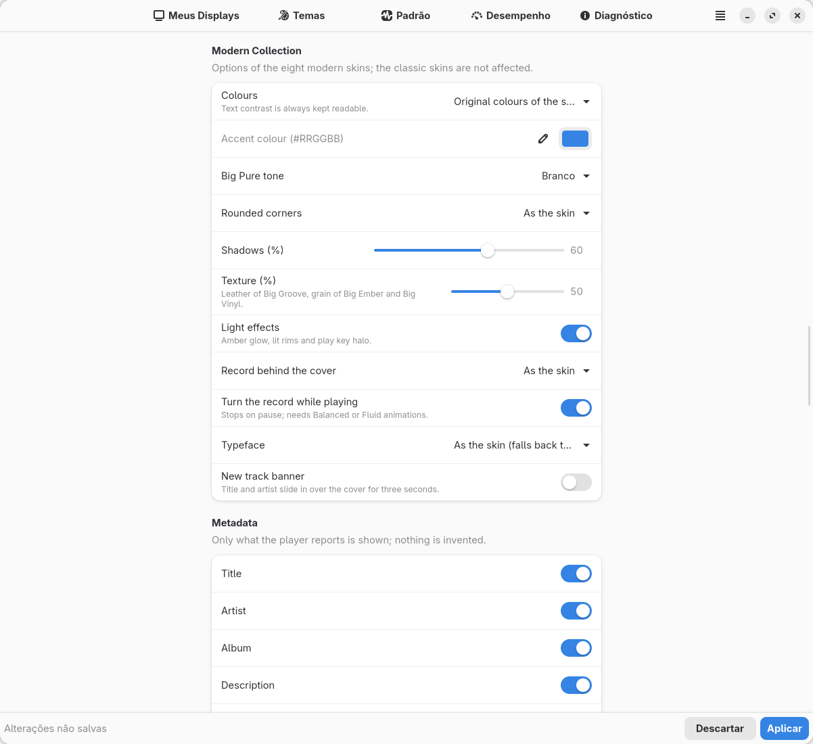

# Big Media Player — configurações da Modern Collection

Todas as chaves passam pelo esquema validado de `bsmd/settings.py`: valor
inválido volta ao padrão e é registrado; arquivos antigos continuam válidos e
nenhuma chave nova é obrigatória. As skins clássicas **ignoram** as chaves
`bmp_palette`, `bmp_accent_color`, `bmp_modern_*`, `bmp_pure_tone` e
`bmp_track_banner`.

## Novas chaves

| Chave | Valores (padrão em **negrito**) | Efeito |
| --- | --- | --- |
| `bmp_skin` | as 7 clássicas + `big_vinyl`, `big_pure`, `big_ember`, `big_groove`, `big_lounge`, `big_wave`, `big_flow`, `big_stage` | skin ativa (padrão continua **`bigamp`**) |
| `bmp_layout` | … + `cinema` | imagem de ponta a ponta nas modernas (nas clássicas equivale a `party`) |
| `bmp_animations` | **`auto`**, `off`, `economy`, `balanced`, `fluid` | nível de animação de **todas** as skins (auto = comportamento 4.3) |
| `bmp_volume_osd` | **`modern`**, `all`, `off` | volume ampliado temporário após uma mudança |
| `bmp_palette` | **`skin`**, `cover`, `custom`, `mono`, `contrast` | cores da skin, da capa, destaque próprio, monocromático, alto contraste |
| `bmp_accent_color` | `#RRGGBB` (vazio) | destaque do modo `custom` (inválido → cores da skin) |
| `bmp_modern_radius` | **`skin`**, `square`, `soft`, `round` | arredondamento do cartão e da capa |
| `bmp_modern_shadow` | 0–100, **60** | sombras projetadas |
| `bmp_modern_texture` | 0–100, **50** | couro do Groove, granulado do Ember e Vinyl |
| `bmp_modern_disc` | **`skin`**, `show`, `hide` | disco de vinil atrás da capa |
| `bmp_modern_spin` | **true** | girar o disco tocando (precisa de animações equilibradas/fluidas) |
| `bmp_modern_font` | **`skin`**, `system`, `dejavu` | família da skin (Lato, Noto Sans, Roboto…, com fallback), sans-serif do sistema, ou a DejaVu empacotada |
| `bmp_pure_tone` | **`white`**, `beige`, `grey`, `graphite` | tom do Big Pure (grafite = modo escuro) |
| `bmp_track_banner` | **false** | faixa com título/artista por 3 s ao trocar de música |

## Chaves existentes que valem também para as modernas

`bmp_text_size`, `bmp_art_size`, `bmp_art_shape`, `bmp_art_frame`,
`bmp_art_glow`, `bmp_show_*`, `bmp_marquee*`, `bmp_logo*`, `bmp_time_mode`,
`bmp_show_percent`, `bmp_show_volume`, `bmp_volume_source`, `bmp_volume_percent`,
`bmp_show_output` (liga o chip/ícone de saída real), `bmp_visualizer` (o
waveform do Big Wave: decorativo **DECO** ou espectro real **FFT**), todas as
`bmp_tele_*`, `bmp_idle_*`, `bmp_night*`, `bmp_app_skins`, `bmp_transitions`,
`bmp_glow` (efeitos de luz: brilho âmbar, aros, halo do play) e
`bmp_art_background` (nas modernas: capa desfocada como fundo do cartão inteiro).
`bmp_adaptive_colors` ligado equivale a `bmp_palette=cover` nas modernas.

## Na janela

Aba **Big Media Player**:

- **Skins**: filtro *Todas · Clássicas · Modernas*; cada linha com miniatura ao
  vivo no tamanho do display, nome, descrição, coleção e o botão de seleção
  (skin ativa). A prévia muda na hora; *Aplicar* envia ao display.
- **Aparência**: layout (com *Cinema*) e *Animações*.
- **Coleção Moderna**: cores, destaque (campo hexadecimal + seletor de cor),
  tom do Pure, cantos, sombras, textura, efeitos de luz, disco, giro, fonte e
  faixa de nova música.
- **Volume**: *Volume ampliado após uma mudança*.
- **Sem reprodução**: skin noturna e skin por aplicativo aceitam as modernas.
