# Big Media Player — Modern Collection (4.4)

A 4.4 acrescenta **oito skins modernas** ao Big Media Player. Não é outro tema
nem outro player: as 15 skins (7 clássicas + 8 modernas) usam o mesmo estado
MPRIS, o mesmo volume do sistema, a mesma telemetria, as mesmas telas de espera
e o mesmo motor de renderização. Só a apresentação muda.

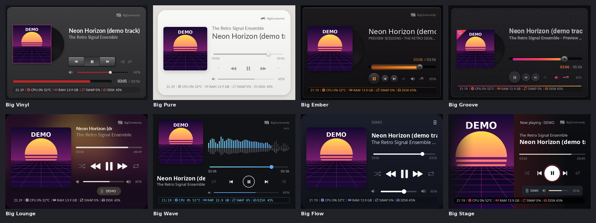

*Capturas geradas pelo renderizador real (`tools/make_bmp_gallery.py`), com os
dados de demonstração da prévia (marcados DEMO) e as configurações padrão.*

## As oito skins

Cada skin segue a **composição** de um estilo de player moderno — não é uma
troca de cores de outra. Nenhuma capa, foto, logotipo ou ícone das referências
é distribuído: as capas vêm do player MPRIS, e todos os símbolos, discos,
texturas e materiais são desenhados por código.

| Skin | Composição característica | Paleta |
| --- | --- | --- |
| 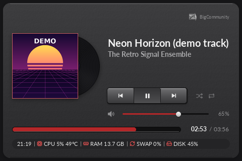 **Big Vinyl** | capa quadrada sobre um disco de vinil que **desliza para fora ao tocar e gira** (rótulo = a própria capa); teclas cinza unidas (segmentadas); volume vermelho com botão claro; barra de progresso larga no rodapé com `tempo / duração` à direita | grafite `#3E3E40`, preto, vermelho `#B32729` |
| 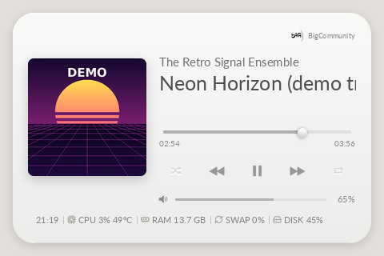 **Big Pure** | objeto branco fosco "flutuando" com sombra suave; artista acima do título em peso regular; linha de progresso fina e rebaixada com botão esférico; símbolos grandes cinza-claro em baixo-relevo, sem caixas; volume discreto | branco gelo, pérola, grafite; tons **branco, bege, cinza-claro e grafite (escuro)** |
| 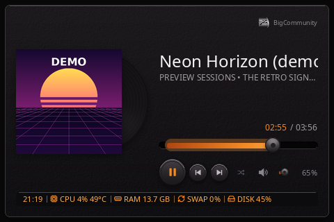 **Big Ember** | painel preto premium com contorno fino e granulado; capa grande com disco espiando; título grande, `ÁLBUM • ARTISTA` em caixa alta; `tempo / duração` com o decorrido em âmbar; canal preto com **luz âmbar**; teclas redondas escuras com aro iluminado (play maior primeiro) | preto `#121114`, grafite, laranja `#F18A27`, âmbar `#FFAD44` |
| 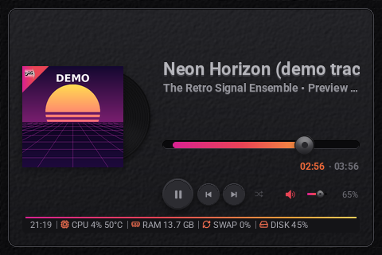 **Big Groove** | **couro texturizado** (procedural) dentro e fora do cartão; capa sobre disco com **aba colorida no canto** (logo da distro); títulos em baixo-relevo (letterpress); barra em degradê **magenta → vermelho → laranja → amarelo**; teclas redondas foscas de borracha | grafite `#1C1C1E`, magenta `#D92291`, vermelho `#EA4455`, laranja `#F7A13B` |
| 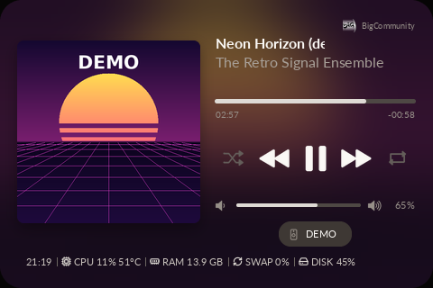 **Big Lounge** | vidro escuro e quente sobre a **capa desfocada** (ambiente); capa grande; muito espaço; progresso fino com tempo decorrido e **restante**; símbolos grandes sem moldura; volume longo entre ícones de volume baixo/alto; **chip com a saída de áudio real** (ou o aplicativo) | marrom muito escuro, preto quente, branco, cinzas |
| 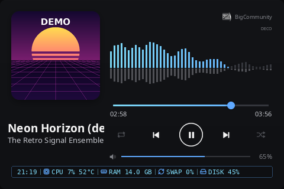 **Big Wave** | preto mínimo; capa arredondada com **título e artista centralizados embaixo**; **waveform** de barras finas espelhadas que se pinta de azul conforme a música avança; linha de progresso com botão azul; repetir · anterior · **play em anel** · próximo · aleatório; telemetria em HUD monoespaçado | preto `#131417`, azul `#5FA9FF`, ciano `#7DD8F5` |
| 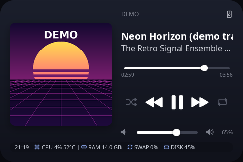 **Big Flow** | cartão de streaming em azul-marinho; capa grande arredondada; linha de origem (app); título e `Artista — Álbum`; ícone de saída de áudio; progresso branco fino; símbolos brancos grandes; **volume com botão grande** entre ícones | azul-marinho `#1B1F2C`/`#10121B`, branco, cinza `#7C808C` |
| 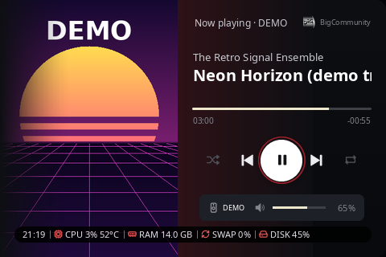 **Big Stage** | **cinematográfico**: a imagem ocupa a lateral esquerda de ponta a ponta (recorte de cinema) e se dissolve no palco escuro, com luz da cor de destaque vazando; "Tocando agora · app"; artista acima do título; play num **disco branco grande**; cartão inferior com **volume e saída reais** (no lugar da "próxima faixa", que o MPRIS não informa); telemetria em overlay semitransparente | preto profundo `#0B0C10`, grafite, branco, vermelho |

Variações: 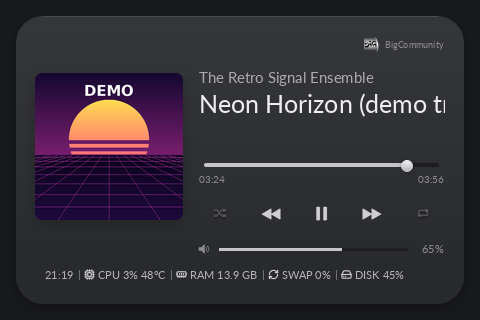
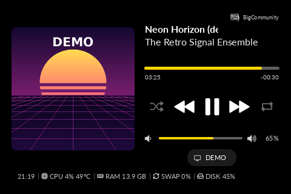

### O que as referências tinham e não foi copiado

- **Favorito (coração), fila e "próxima faixa"**: o MPRIS não fornece esses dados,
  então não aparecem como funções. O lugar do coração recebe o logotipo da
  distribuição; o cartão de "próxima faixa" do Big Stage virou o cartão de volume.
- **Nomes de saída fictícios** ("iPhone"): o chip e o ícone de saída mostram o
  dispositivo real (PipeWire/PulseAudio) quando *Volume → Mostrar o nome da saída*
  está ligado; senão o chip mostra o aplicativo de origem.
- **Aleatório/repetir** só aparecem quando o player informa esses estados.

## Funções comuns (iguais nas 15 skins)

Capa (ou miniatura de vídeo, ou arte substituta original), título, artista,
álbum, descrição, origem; barra de progresso, decorrido, duração ou restante,
"AO VIVO" sem duração; anterior, play/pause, próximo, aleatório e repetir
conforme as capacidades do player; volume do sistema com percentual e mudo,
saída de áudio; logotipo e nome da distribuição; telemetria (hora, CPU %,
temperatura da CPU, RAM, swap, disco, GPU % e temperatura) nos 8 modos e 3
posições; telas de espera; skin por aplicativo (`spotify=big_flow, firefox=big_stage`)
e skin noturna (`Big Pure` de dia, `Big Lounge` à noite).

Os controles desenhados no display são **representações** do estado: os displays
USB suportados não têm toque. A interação real é pela aba **Big Media Player** da
janela (botões, busca, volume e mudo que agem no player e na saída de áudio de
verdade) e pelos atalhos `--media`.

## Layouts responsivos

Cada skin descreve suas **linhas** (metadados, progresso, controles, volume,
chip…) e o motor as empilha ao lado da capa (paisagem), embaixo dela (retrato)
ou em duas colunas (ultrawide). Quando falta espaço, linhas opcionais saem numa
ordem fixa (visualizador, chip, linha de origem, volume…), nunca o progresso.
A fonte base nunca fica abaixo de 10 px; capas quadradas nunca são deformadas.

| Família | Exemplo |
| --- | --- |
| retrato (320×480, 480×800) | 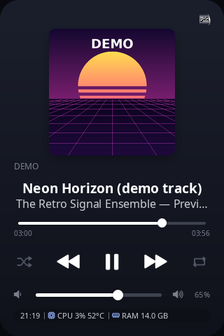 |
| ultrawide (1920×480, 1280×400) | 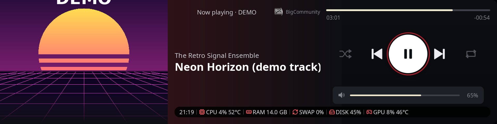 |
| micro (160×80, 80×160) — páginas alternadas, paleta da skin | 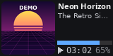 |
| paisagem grande (800×480) | 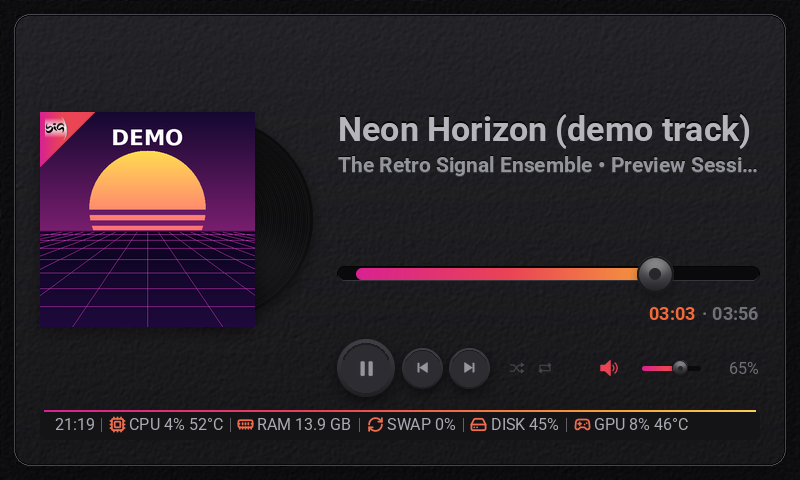 |

Modo **Cinema** (`bmp_layout=cinema`): em qualquer skin moderna a imagem passa
a ocupar a lateral de ponta a ponta, como no Big Stage. **Áudio/Festa** aumenta a
capa e o visualizador; **Informações** dá mais espaço aos metadados.

Um teste verifica, para 8 skins × 10 resoluções × 5 variantes × 3 posições de
telemetria, que nenhuma área sai da tela ou se sobrepõe a outra.

## Arquitetura

```
bsmd/bigmedia/
├── __init__.py      motor: dados MPRIS → Frame, caches, telemetria, overlays
├── layout.py        layout das clássicas (e micro de todas)
├── paint.py         primitivas (texto aceita uma família de fonte)
├── skins.py         Skin base + 7 clássicas; registro das 15 (CLASSIC_IDS, MODERN_IDS)
└── modern/
    ├── base.py      ModernSkin: linhas/layout, paletas, máscaras AA em cache, ícones
    ├── vinyl.py  pure.py  ember.py  groove.py
    └── lounge.py wave.py  flow.py   stage.py
```

O motor só ganhou ganchos opcionais (`compute_layout`, `before_art`, `extras`,
`overlay`, `chrome_key`) chamados quando `skin.modern` é verdadeiro. As
clássicas seguem exatamente o caminho da 4.3: uma comparação pixel a pixel de
65 renderizações (7 skins × 5 tamanhos × com/sem vinil, cores da capa e fundo
desfocado) contra a 4.3.0 deu resultado idêntico.

### Cores da capa

`bmp_palette=cover` extrai da capa uma cor viva (destaque) e um tom escuro
(fundo do Lounge, Flow e Stage), **uma vez por capa** (cache de 16). Depois de
qualquer modo, o texto é ajustado para contraste mínimo de 7:1 (título), 4,5:1
(secundário) e 3:1 (tempos) contra o fundo — testado com capas amarelas,
brancas, pretas e magenta em todas as skins e modos.

### Animações

`bmp_animations`: **Automático** (igual à 4.3: 10 q/s quando algo se move,
desligado no perfil Econômico), **Desligadas** (sem rolagem, sem giro, sem
transição), **Econômicas** (4 q/s, sem giro), **Equilibradas** (10 q/s),
**Fluidas** (20 q/s). Sempre limitado pelo alvo do próprio display, então um
display serial lento nunca recebe mais quadros do que aguenta. O disco só gira
e o visualizador só se mexe com a música tocando; pausado, nada anima.

### Overlays

- **Volume ampliado** (`bmp_volume_osd`): ao mudar o volume ou o mudo (teclado,
  KDE Plasma, janela), um painel com valor grande aparece por 2,2 s.
- **Nova faixa** (`bmp_track_banner`): título e artista sobem sobre a capa por 3 s.

## Criar uma skin moderna

```python
from .base import ModernSkin, Row

class Minha(ModernSkin):
    id, name = "big_minha", "Big Minha"
    description = N_("Uma frase.")
    faces = ("Lato", "Noto Sans")          # família preferida; fontconfig resolve
    art_frac, art_round, disc = 0.42, 0.06, 0.0
    rows = (Row("meta", 3.0, flex=1), Row("progress_times", 2.0), Row("controls", 3.0),
            Row("volume", 1.6, drop=2))     # drop: maior sai primeiro quando falta espaço
    meta = (("title", 1.4, True), ("artist_album", 1.0, False))
    base_pal = {...}                         # copie as chaves de uma skin moderna
```

Sobrescreva `card_fill`, `art`, `progress`, `buttons`, `volume`, `tele_decor`
conforme a personalidade. Registre em `modern/__init__.py`, `skins.MODERN_IDS`,
`settings.BMP_MODERN` e `MODERN_INSPIRATION` (janela); `tests/test_bigmedia_modern.py`
renderiza a skin em todos os estados e tamanhos e confere a geometria.
