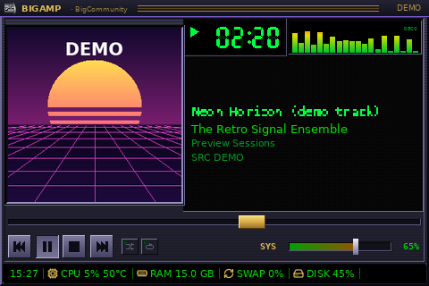

# Big Media Player — visão geral

O **Big Media Player** (`big_media_player`) transforma o display USB num reprodutor
retrô que acompanha a mídia que realmente toca no computador: Spotify, VLC,
Rhythmbox, navegadores com integração de mídia (YouTube no Firefox/Chrome) e
qualquer aplicativo que publique uma sessão **MPRIS2** no D-Bus da sessão.

## O que aparece no display

| Área | Conteúdo | Origem |
| --- | --- | --- |
| A — identificação | nome da skin, logo e nome da distribuição, aplicativo de origem | `/etc/os-release` + ícones instalados; `Identity` do MPRIS |
| B — capa | capa do álbum, miniatura de vídeo ou arte original de substituição | `mpris:artUrl` |
| C — informações | título (rolagem), artista, álbum, descrição, origem | `xesam:*` |
| D — reprodução | tempo decorrido, barra, duração total/restante, "AO VIVO" | `Position`, `mpris:length`, `Seeked` |
| E — controles | anterior, play/pause, stop, próximo, aleatório, repetir, volume do sistema, mudo | capacidades `Can*`; PipeWire/PulseAudio |
| F — telemetria | hora, CPU (+temp.), RAM, swap, disco, GPU (+temp.) | coletor de telemetria existente |

## Sete skins

Bigamp, Bigmatch, Bigative, Bigalplayer, Big Media Player, BigXMMS2 e BIGX
Multimedia System — homenagens originais às interfaces dos anos 1990/2000, todas
desenhadas proceduralmente (nenhum bitmap, logo ou sprite dos programas
originais). Detalhes em [big-media-player-skins.md](big-media-player-skins.md).

## Princípios

- **Nada inventado.** Duração desconhecida não vira um número; sem capa, uma
  arte original de substituição; o visualizador decorativo é rotulado `DECO`
  e o espectro real `FFT`; dados de demonstração só aparecem na prévia da
  janela, marcados `DEMO`.
- **Controles reais onde há entrada.** Os painéis suportados não têm toque nem
  botões; os botões desenhados no LCD apenas refletem estado e capacidades. Os
  controles funcionais ficam na aba *Big Media Player* da janela de
  configuração e no comando `big-screen-monitor-display.sh --media AÇÃO`
  (atalhos de teclado do desktop).
- **Segurança.** O serviço de hardware continua sem acesso à sessão do usuário:
  um agente de sessão envia instantâneos validados por um socket Unix
  autenticado ([arquitetura](big-media-player-architecture.md)).
- **Leveza.** Camadas estáticas em cache, progresso interpolado, eventos D-Bus e
  de áudio em vez de polling ([desempenho](big-media-player-performance.md)).

## Documentos

1. [Arquitetura](big-media-player-architecture.md)
2. [MPRIS e seleção do player](big-media-player-mpris.md)
3. [Volume do sistema](big-media-player-volume.md)
4. [Skins e como criar uma nova](big-media-player-skins.md)
5. [Configurações](big-media-player-settings.md)
6. [Telemetria](big-media-player-telemetry.md)
7. [Desempenho e medições](big-media-player-performance.md)
8. [Testes](big-media-player-testing.md)
9. [Relatório final](big-media-player-final-report.md)
