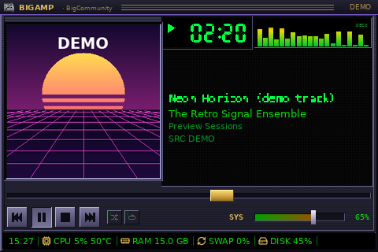
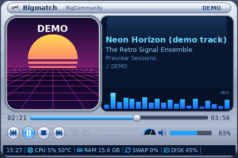
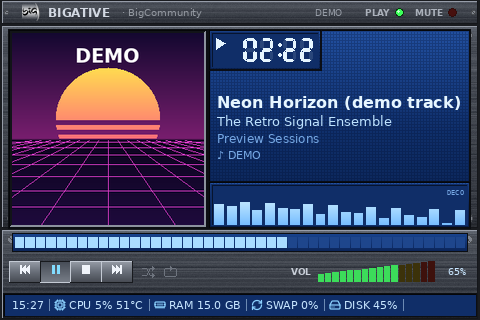
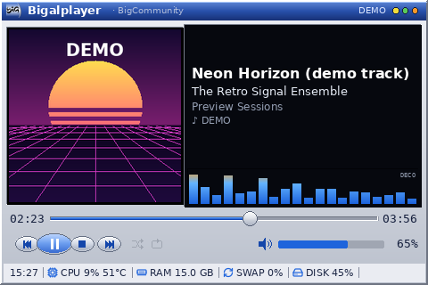
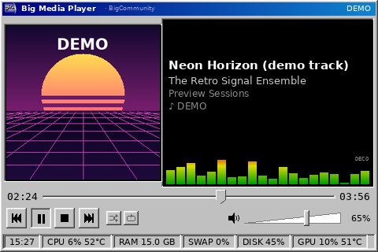
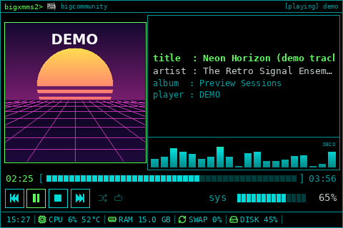
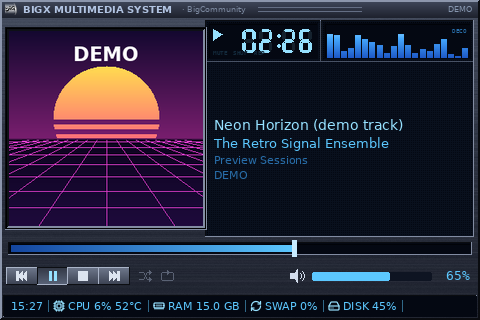
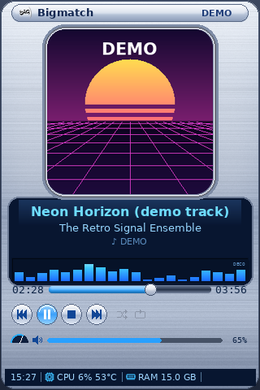
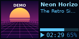
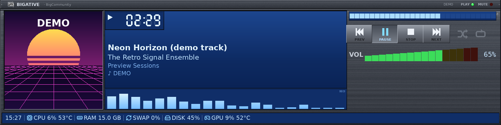

# Big Media Player — skins

> Esta página descreve as **sete skins clássicas**. As oito skins modernas
> (4.4) estão em [Modern Collection](big-media-player-modern.md).

Todas as skins mostram as mesmas áreas (A–F) e funcionam em todos os
tamanhos; muda só a apresentação. Materiais, cores, geometria e tipografia são
recriados por código (`bsmd/bigmedia/paint.py`): nenhum logo, bitmap, sprite,
fonte ou som dos programas originais é usado. O logotipo exibido é o da
distribuição Linux instalada.

| Skin | Homenagem a | Linguagem visual |
| --- | --- | --- |
|  **Bigamp** | Winamp 2.x | console escuro com nervuras, faixa de título dourada, LCD preto com dígitos de 7 segmentos verdes, texto em "pixel", barras de espectro verde→vermelho, teclas quadradas em relevo, controle deslizante dourado, volume em rampa verde→vermelha |
|  **Bigmatch** | Musicmatch Jukebox | corpo cromado prata-azulado arredondado e escovado, cápsula de título brilhante, display azul-marinho, capa em moldura metálica arredondada, botões circulares cromados, tubo de progresso com botão esférico, medidor em arco (volume real) |
|  **Bigative** | players Creative | módulos de metal empilhados com parafusos e escovado, LCD azul retroiluminado com dígitos de 7 segmentos, LEDs PLAY (verde) e MUTE (vermelho), teclas retangulares com legenda gravada, barra segmentada, escada de LEDs de volume |
|  **Bigalplayer** | RealPlayer | janela prateada clássica, barra de título azul, joias coloridas ornamentais, visor preto, botões ovais (play maior), barra de busca azul com polegar oval |
|  **Big Media Player** | Windows Media Player clássico | cinza 3D do Windows 9x, título azul-marinho em degradê, visualizador preto, botões quadrados, trackbar com polegar pontiagudo, volume em cunha, barra de status com painéis rebaixados |
|  **BigXMMS2** | clientes XMMS2 | preto, linhas ciano finas, prompt `bigxmms2>`, texto monoespaçado `chave : valor`, barras segmentadas `[■■■□□]`, miniatura com contorno fino |
|  **BIGX Multimedia System** | XMMS | metal escuro azulado, LCDs com texto azul luminoso, lâmpadas MUTE/SHUF/REP (acendem só com estado real), espectro azul, teclas compactas |

## Adaptação por tamanho (`bsmd/bigmedia/layout.py`)

| Família | Exemplo | Composição |
| --- | --- | --- |
| micro (lado < 128 px) | 160×80, 80×160 | capa + título rolando + progresso + tempo/volume; telemetria em página alternada |
| retrato | 320×480 | capa no topo, informações centralizadas, progresso, controles, volume |
| paisagem | 320×240 … 1280×720 | capa à esquerda; informações, LCD de tempo e visualizador à direita; progresso e controles embaixo |
| ultrawide (≥ 2,6:1) | 1920×480 | capa · informações · coluna de progresso/controles |

 



Nada encolhe abaixo de um mínimo legível: áreas são retiradas numa ordem fixa
(visualizador, LCD grande de tempo, linhas de álbum/descrição…). Quando o LCD
de tempo não cabe, o tempo volta para o lado da barra. Um teste verifica que
nenhuma área se sobrepõe em 9 resoluções × 7 skins.

## Criar uma nova skin

1. Em `bsmd/bigmedia/skins.py`, crie uma subclasse de `Skin`:

   ```python
   class Minha(Skin):
       id = "minha"
       name = "Minha Skin"
       description = N_("Uma frase sobre o visual.")
       pad, frame, title_h = 6, 3, 18        # px para um lado menor de 320 px
       has_readout = True                    # LCD grande de tempo nas informações
       time_inline = False                   # tempo ao lado da barra (quando não há LCD)
       art_shape = "rounded"                 # square | rounded | circle
       default_frame = "metal"               # metal | neon | bevel | line | none
       pal = {...}                           # copie as chaves de uma skin existente
   ```
2. Sobrescreva o que for característico: `chrome()` (estático, vai para o
   cache), `title_bar`, `button`, `toggle`, `progress`, `volume`, `readout`,
   `vis`, `tele`, `info_lines`/`role_style`. O resto vem da base.
3. Registre a classe em `SKINS` e o id em `settings.BMP_SKINS` (um teste
   confere as duas listas) e em `SKIN_INSPIRATION` de `media_player_page.py`.
4. `python3 -m pytest tests/test_bigmedia.py` renderiza a nova skin em todos
   os tamanhos e estados.

Regras: desenhe tudo com primitivas próprias; botões devem refletir
`enabled` (capacidade real) e `active` (estado real); não desenhe números que
não vêm dos dados.
