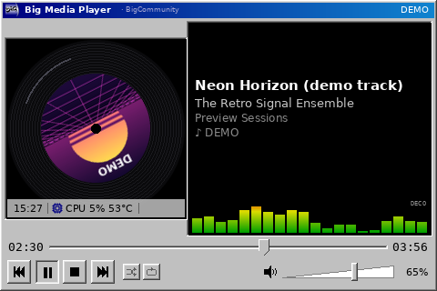

# Big Media Player — telemetria

A faixa de telemetria usa o coletor existente (`bsmd/telemetry.py`); nenhum
coletor novo foi criado. Itens: hora, CPU (+ temperatura), RAM usada, swap,
disco, GPU (+ temperatura). Um item só aparece se o dado existe: sem sensor de
temperatura, sem "°C"; sem swap configurado, sem SWAP; sem GPU com driver
legível, sem GPU.

## Modos (`bmp_tele_mode`)

| Modo | Faixa mostra |
| --- | --- |
| `auto` (padrão) | sempre, em displays ≥ 300×240; alternada nos menores |
| `always` | telemetria |
| `hidden` | nada (o espaço é devolvido ao player) |
| `intermittent` | telemetria por `bmp_tele_duration` s a cada `bmp_tele_every` s; no resto, detalhes da mídia |
| `alternate` | alterna telemetria e detalhes da mídia (estado, álbum, volume) a cada `bmp_tele_duration` s |
| `paused` | detalhes da mídia enquanto toca; telemetria quando pausado/parado |
| `idle` | telemetria após `bmp_tele_idle_after` s sem troca de faixa |
| `alerts` | telemetria só quando CPU ≥ `bmp_tele_alert_cpu` % ou CPU/GPU ≥ `bmp_tele_alert_temp` °C; o item em alerta fica vermelho |

O espaço da faixa fica reservado (exceto `hidden` e `overlay`), então o layout
não "pula" quando o conteúdo alterna. O modo festa (`bmp_layout = party`) usa
`alerts`.

## Posições (`bmp_tele_position`)

- `bottom` (padrão) / `top`: faixa fixa no estilo da skin.
- `overlay`: faixa translúcida (`bmp_tele_opacity`) sobre a parte de baixo da
  **capa** — nunca sobre o título, os tempos ou os controles; aparece só
  quando há telemetria a mostrar.

Em displays micro a telemetria vira uma página que alterna com a música.

## Personalização

Ícones (os mesmos SVG simbólicos dos outros temas, recoloridos), separador
(`|`, `•`, espaço), opacidade, animação de entrada (deslize de 0,35 s, sem
efeito na primeira exibição). Cores e fonte seguem a skin.
