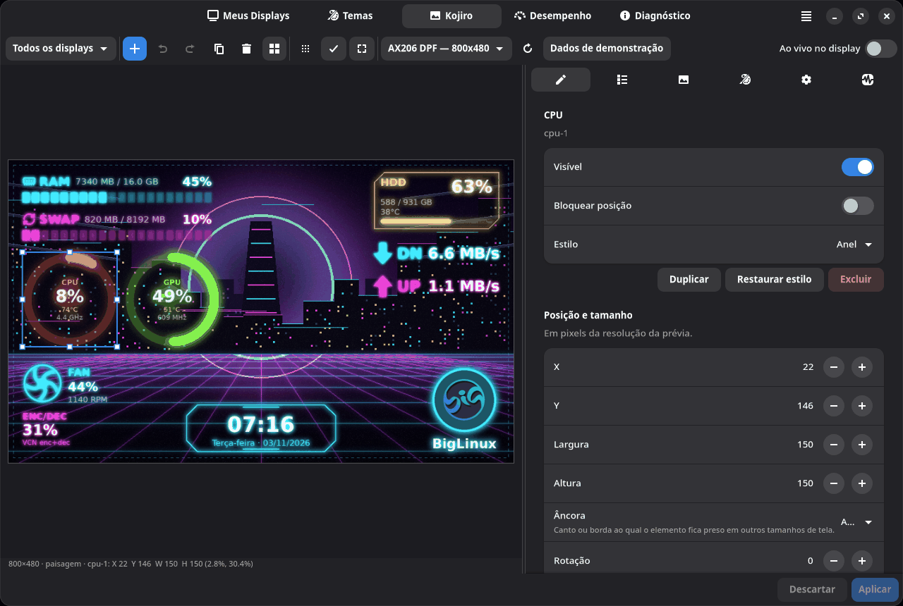
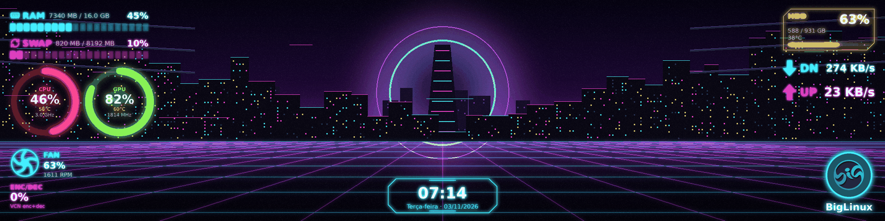

# Kojiro Design Studio

O editor mostra a **saída real do motor** na resolução do display (renderizada
fora da thread da interface) e desenha por cima as ajudas de edição.

## Barra de ferramentas

| Controle | Função |
| --- | --- |
| Display | *Todos os displays* (layout comum) ou um display específico — na primeira vez, oferece criar um layout próprio a partir do comum |
| ＋ | adicionar elemento (agrupados: hardware, informação, decoração) |
| Desfazer / refazer | até 100 passos; edições rápidas da mesma propriedade viram um passo |
| Duplicar / excluir | sobre a seleção |
| Alinhar | esquerda, centro, direita, topo, meio, base; distribuir; ordem das camadas; agrupar/desagrupar; copiar/colar estilo |
| Grade, encaixe, margens | grade configurável, encaixe em bordas/centros/outros elementos/margens, margens seguras |
| Resolução | resolução do display conectado ou 800×480, 480×320, 1024×600, 1280×720, 1920×480 (ultrawide), 480×480, 160×80 (micro) |
| ⟳ | alternar retrato/paisagem |
| Dados de demonstração | valores de exemplo em movimento (útil para criar sem hardware ou capturar telas) |
| Ao vivo no display | aplica cada alteração ao display automaticamente (1,2 s depois da última) |

## Mouse

- Clique seleciona; Shift/Ctrl+clique adiciona/remove da seleção; arrastar no
  vazio seleciona por retângulo; clicar em um elemento agrupado seleciona o grupo.
- Arrastar move (todos os selecionados juntos); as 8 alças redimensionam
  (Shift mantém a proporção nos cantos).
- Linhas-guia magenta mostram o encaixe; áreas vermelhas mostram sobreposição
  da seleção com outros elementos.
- Botão direito: duplicar, excluir, frente/trás, bloquear, ocultar, copiar/colar
  estilo, agrupar/desagrupar. Elementos bloqueados mostram 🔒 e não se movem.

## Teclado

| Tecla | Ação |
| --- | --- |
| Setas / Shift+setas | mover 1 px / 10 px |
| Del, Backspace | excluir |
| Ctrl+Z, Ctrl+Shift+Z, Ctrl+Y | desfazer, refazer |
| Ctrl+D | duplicar |
| Ctrl+A | selecionar tudo |
| Ctrl+G, Ctrl+Shift+G | agrupar, desagrupar |
| Ctrl+Shift+C, Ctrl+Shift+V | copiar, colar estilo |
| Page Up/Down (Ctrl: até o fim) | ordem das camadas |
| Ctrl+S | aplicar ao display |
| Esc | limpar seleção |

## Inspetor

| Aba | Conteúdo |
| --- | --- |
| **Elemento** | visível, bloqueio, estilo; posição/tamanho numéricos (px), âncora, rotação, centralizar; cores e efeitos; texto; painel de fundo; dados (sensor, GPU, ponto de montagem, interface, ventoinha…); intervalo; alertas |
| **Camadas** | lista na ordem Z com visibilidade, bloqueio e reordenação |
| **Fundo** | galeria (arte incluída e importadas, com remover), importar, cor/degradê, ajuste e posição, ajustes de imagem |
| **Aparência** | predefinições com miniaturas, paletas, fonte geral, efeito de fundo, painéis de legibilidade, animações e alertas |
| **Geral** | minhas predefinições, exportar/importar, restaurar padrão, resolução de referência, layout retrato, grade, margem, atalhos |
| **Avançado** | sensores deste computador, tempo do último quadro, camadas em cache, coletores em uso, tamanho das configurações |

## Responsividade

Posições são normalizadas sobre uma **resolução de referência** e presas a
uma **âncora** (automática pelo terço da tela ou escolhida). Em outra
resolução todos os elementos escalam por igual (círculos continuam redondos)
e ficam presos à sua âncora — elementos do canto direito continuam no canto
direito num ultrawide. O editor converte o arraste de volta com a inversa
exata, então dá para editar em qualquer resolução. O layout retrato é gerado
automaticamente (linhas com pares relacionados: CPU+GPU, download+upload,
ventoinha+vídeo; relógio embaixo) até você editar em retrato — a partir daí ele
é guardado à parte e pode voltar ao automático. Em telas minúsculas (WeAct
0,96") o Kojiro mostra até 3–4 linhas legíveis com os elementos mais importantes.

