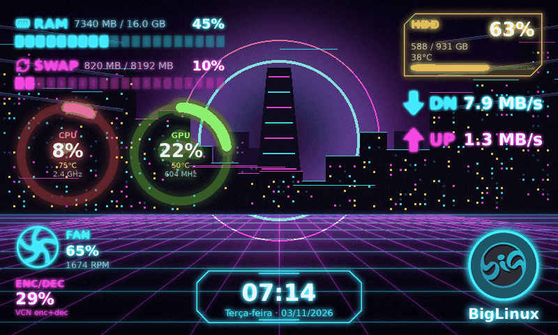

# Kojiro — visão geral

**Kojiro — Papel de parede e painel de hardware** (`kojiro`) é um tema nativo
do Big Screen Monitor Display: você escolhe qualquer imagem de fundo e posiciona
sobre ela, livremente, os elementos de monitoramento que quiser. Cada elemento é
uma camada independente — o papel de parede nunca tem textos "embutidos".

## O que dá para fazer

- Usar arte incluída (8 papéis de parede originais gerados pelo próprio
  aplicativo), uma foto sua (PNG, JPEG, WebP, BMP, GIF, TIFF, SVG), uma cor
  sólida ou um degradê — com ajuste, zoom, deslocamento, rotação, espelhamento,
  brilho, contraste, saturação, gama, desfoque, escurecimento, sobreposição de
  cor, vinheta e degradê de proteção para textos.
- Adicionar 23 tipos de elemento: CPU, GPU, RAM, SWAP, VRAM, ventoinha,
  codificação de vídeo, disco, download, upload, relógio, logotipo e nome da
  distribuição, núcleos, processos, tempo ligado, nome do computador, kernel,
  IP local, bateria, perfil de energia, texto, separador/linha luminosa e moldura.
- Escolher o formato de cada um (anel, semicírculo, arco, anel duplo, medidor
  com ponteiro, barras simples/segmentadas/degradê/verticais, termômetro,
  gráficos de linha/área/barras, minigráfico, texto, painel HUD, relógio digital
  de 7 segmentos…), cores, brilho neon, sombra, opacidade, fonte, estilo de
  texto, painel de fundo, vidro fosco, borda, cantos e rotação.
- Editar tudo com o mouse no **Kojiro Design Studio** (arrastar, redimensionar,
  encaixar, alinhar, distribuir, agrupar, camadas, desfazer/refazer).
- Partir de 7 predefinições: Cyberpunk, Minimalista, Gamer, Matrix, Retrô,
  Vidro e Industrial — e salvar, exportar e importar as suas.
- Ter um layout por display (vários displays ao mesmo tempo).

## Onde está

1. Janela de configuração → **Temas** → *Kojiro* → **Aplicar**.
2. A aba **Kojiro** aparece no topo: é o editor.
3. **Aplicar** (ou Ctrl+S, ou o interruptor *Ao vivo no display*) envia as
   alterações ao display em até 1 s, sem reiniciar o serviço e sem senha de
   administrador.

## Documentos

| | |
| --- | --- |
| [Arquitetura](kojiro-architecture.md) | [Configuração e formato](kojiro-configuration.md) |
| [Papéis de parede](kojiro-wallpapers.md) | [Predefinições](kojiro-presets.md) |
| [Sistema de elementos](kojiro-widget-system.md) | [Desempenho](kojiro-performance.md) |
| [Editor](kojiro-editor.md) | [Testes](kojiro-testing.md) |
| [Relatório final](kojiro-final-report.md) | |
