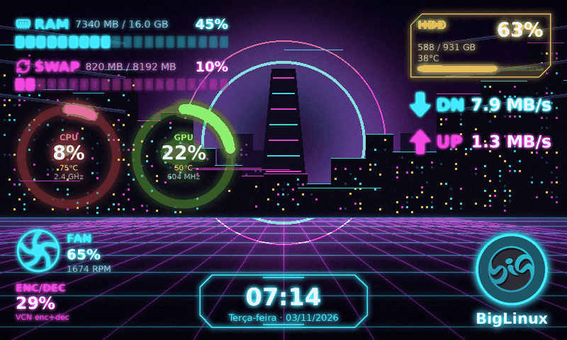
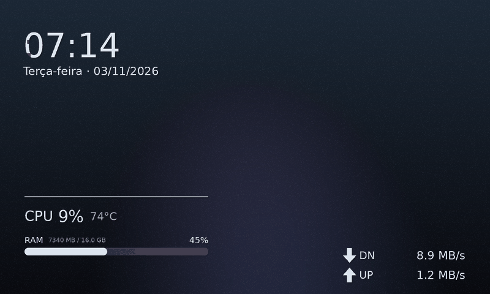
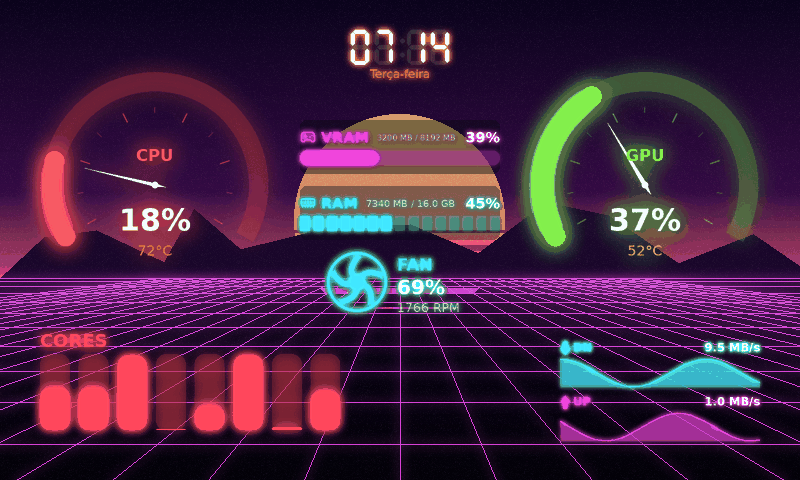
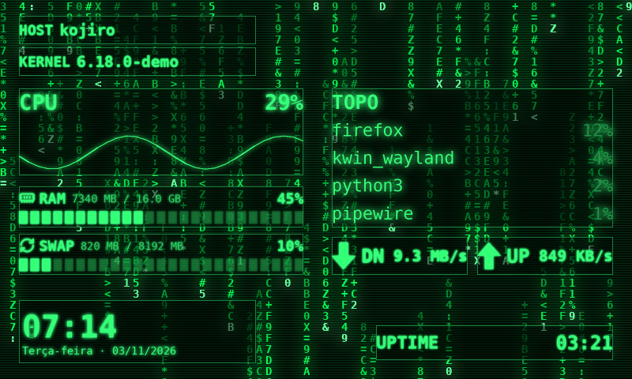
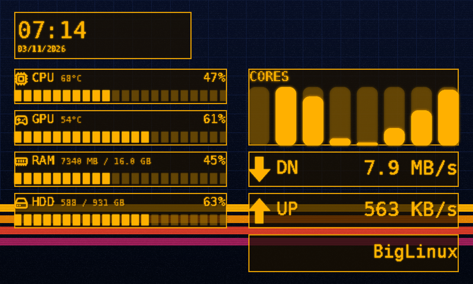
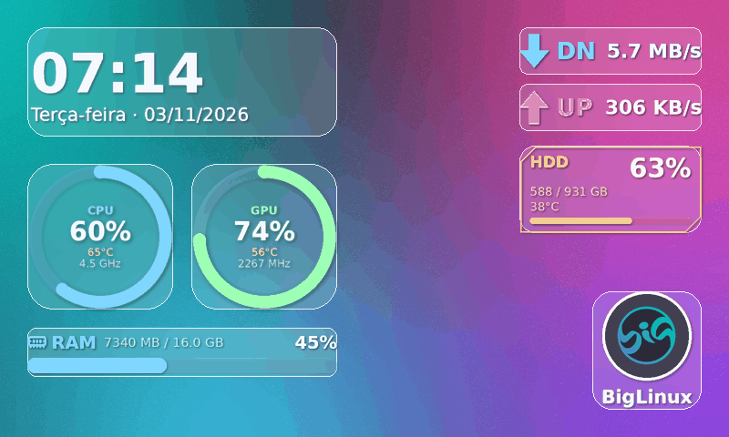
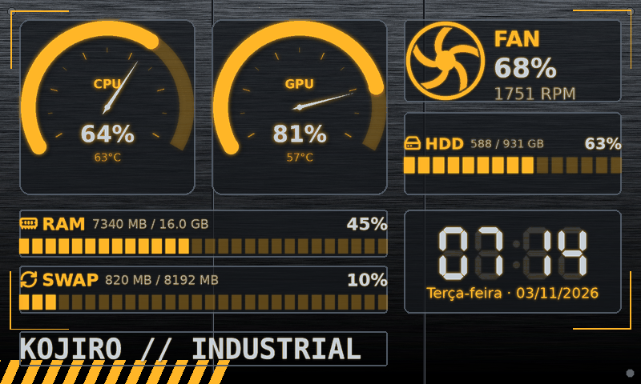
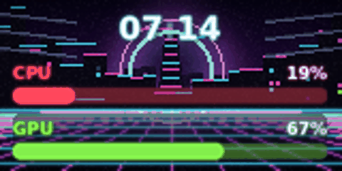

# Kojiro — predefinições

Todas usam dados reais; as imagens abaixo foram geradas com *dados de
demonstração* (800×480).

| | |
| --- | --- |
|  **Cyberpunk** — RAM/SWAP em barras segmentadas ciano/magenta no topo esquerdo, CPU (vermelho) e GPU (verde) em anéis, ventoinha girando e codificação de vídeo embaixo à esquerda, HDD (amarelo) e download/upload no topo direito, relógio com moldura futurista no centro inferior, logotipo circular e nome da distribuição embaixo à direita. Paleta: `#42E8FF #F044DB #FF475C #83EF4C #FFD94A #E8F4FF`. |  **Minimalista** — relógio grande, poucas linhas finas, sem brilho; feito para fotografias. |
|  **Gamer** — medidores grandes com ponteiro para CPU e GPU (com potência), VRAM, RAM, ventoinha, núcleos e gráficos de rede; relógio digital. Sem FPS: não há fonte confiável no sistema. |  **Matrix** — verde sobre preto, texto monoespaçado, gráfico de CPU, processos, tempo ligado, linhas de varredura. |
|  **Retrô** — âmbar, fonte pixelada, barras segmentadas, painéis com borda. |  **Vidro** — painéis translúcidos com vidro fosco sobre aurora colorida. |
|  **Industrial** — metal escovado, medidores de instrumento, relógio de 7 segmentos, cantoneiras. |  **Telas minúsculas** — qualquer predefinição em 160×80 vira linhas legíveis. |

Aplicar uma predefinição substitui os elementos (Ctrl+Z desfaz) e mantém um
papel de parede importado. **Aparência → Paleta de cores** recolore tudo de
uma vez (Cyberpunk, Matrix, Âmbar, Gelo, Pôr do sol, Monocromático).

Para salvar a sua: **Geral → Salvar o layout atual como predefinição…**; para
compartilhar: **Exportar pacote (.kojiro.zip)**.
